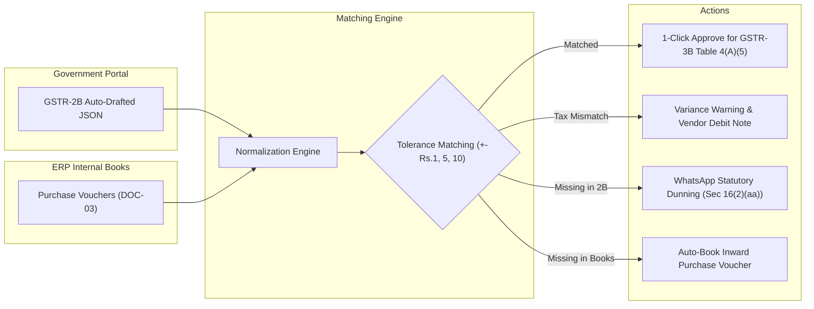

# Enterprise ERP System — Comprehensive User Workflow Manual
*For Cashiers, Billing Operators, Store Managers, and Chief Accountants*

Welcome to the complete operational manual for the Enterprise Pharmaceutical & Distribution ERP. This step-by-step guide walks you through every screen, keyboard shortcut, billing workflow, returns engine, financial statement, and report across the entire software suite.

> **Master Editable Walkthrough Reference**: An exhaustive, publication-grade Microsoft Word document covering the complete software architecture, keyboard operations, data models, APIs, and screens is available in `ERP_ENTERPRISE_SYSTEM_COMPLETE_SOFTWARE_MASTER_WALKTHROUGH.docx`.

---

## 1. Getting Started & System Navigation

### 1.1 Logging In
1. Launch the application in your web browser (`http://localhost:50005` or your Vercel URL) or open the native desktop application.
2. Enter your credentials:
   * **Company / Organization Code**: e.g., `AM-0001` or your provisioned tenant code.
   * **Username**: e.g., `admin` or your assigned operator username.
   * **Password**: `Admin@123`
3. Click **Sign In** or press `Enter`. The application securely stores your authentication session in local storage.

### 1.2 The Two-Screen Operational & Executive Architecture
The ERP implements strict role-based separation between high-speed counter billing and executive business intelligence across two primary screens:

1. **Screen 1: Operational Counter Workbench (Route: /)**:
   Designed for cashiers, billing operators, and store managers.
   * **Live Counter Metrics Strip**: Today's Cash Collected (real-time drawer cash), Today's Credit Billed (credit turnover and invoice count), Active SKU Catalog (master catalog count), and Stockout / Expiry Risk warnings.
   * **Rapid Transaction Command Hub**: 1-click & keyboard hotkey command buttons ([Sales Bill F2], [Purchase Bill F9], [Sales Return], [Purchase Return], [Receipt Voucher F6], [Payment Voucher F5], [Day Book], [Stock Register]).
   * **Urgent Counter Exception Center**: Prioritized operational exception warnings (critical stockouts, credit limit breaches, pending voucher approvals) with 1-click action triggers ([Raise PO ↗], [Review Ledger ↗], [Approve ↗]).
   * **Live Counter Voucher Ticker**: Real-time streaming audit trail showing the latest counter bills, receipts, and returns with timestamps and payment status badges.
   * **Apex Switcher**: Click [Executive BI Dashboard (Route: /dashboard) ↗] to switch directly to the executive intelligence center.

2. **Screen 2: Executive Business Intelligence & Control Centre (Route: /dashboard)**:
   Designed for proprietors, executives, CFOs, and business controllers.
   * **Executive KPI Strip**: Gross Revenue (Sales), Procurement Volume, Gross Operating Margin (%), and Consolidated Liquidity (Quick Ratio).
   * **Visual Comparative Curves**: 7-Month comparative volume analysis graph displaying Monthly Sales Turnover vs Inward Purchases.
   * **Operating Expense (Opex) Donut**: Comprehensive breakdown of freight, storage, travel, asset depreciation, and office overheads.
   * **Compact Regional Sales Map Widget**: Sized symmetrically in Row 2 (~340px height) showing state turnover (Delhi NCR, Punjab & Haryana, UP, Rajasthan).
   * **Click-to-Expand Territory Intelligence Modal (#mapModal)**: Click the compact map to expand into a high-resolution interactive territory modal with deep state drill-downs, chemist network coverage, quota attainment %, and full DOC-30 register links. Strictly 100% focused on sales turnover (zero vehicle/dispatch clutter).
   * **Product & Ageing Distributions**: Top 5 revenue-generating pharmaceutical products progress bars, and statutory receivables outstanding ageing distribution (0-30, 31-60, 61-90, 90+ days).


### 1.3 Personalizing Your Theme
Open **Settings** (`/settings`) from the top navigation bar to select your preferred interface theme:
1. **Neumorphic Minimalist (Default / Recommended)**: Soft off-white surfaces with deep forest green accents (`#1b4332`, `#2d6a4f`). High clarity for full 8-hour retail shifts.
2. **Modern Dark Slate**: Deep blue-black palette (`#0f172a`, `#1e293b`) with neon status badges for night counter shifts.
3. **Marg ERP Classic**: High-density legacy layout styled after classic DOS/Windows wholesale pharma billing software.

---

## 2. Universal Keyboard Master Hotkey Legend

The ERP is **100% keyboard-navigable**. You never need to touch the mouse during daily counter billing:

| Hotkey | Global Function | Module Context |
| :--- | :--- | :--- |
| `Enter` | **Advance / Next Field** | Advances from Date &rarr; Bill No &rarr; Party &rarr; Product &rarr; Batch &rarr; Qty &rarr; Free &rarr; Rate &rarr; Next Row |
| `Esc` | **Exit / Return to Home** | Safely exits the current billing screen and returns to the Home Dashboard (`HomeScreen`) |
| `F2` | **Against Bill Mode** | Toggles "Against Original Invoice" mode in Sales Return and Purchase Return screens |
| `F3` | **Batch Selector / Loose Mode** | Opens the live Batch Selection modal during billing (shows stock, MRP, expiry, rate) |
| `F4` | **Unified Approval Inbox** | Launches the cross-module Approval Inbox (`/workflow/inbox`) for 1-click task actions |
| `F5` | **View Register** | Switches between the Entry screen and the Historical Register list |
| `F7` | **Party / Ledger Search** | Opens the Debtor/Creditor ledger lookup modal with instant search |
| `F8` | **Load Return Bill** | Prompts for original invoice number during counter sales returns |
| `F9` | **Sales Order Picker** | Imports items directly from an approved customer Sales Order |
| `End` | **Instant Save / Settlement** | Jumps directly to the Bill Discount & Final Settlement modal |
| `Ctrl + S` | **Save & Post Voucher** | Instantly commits and saves Debit Notes, Credit Notes, or Vouchers |
| `ArrowUp` / `Down` | **Vertical Grid Navigation** | Navigates vertically across table rows or batch selection lists |
| `ArrowLeft` / `Right`| **Horizontal Cell Navigation**| Navigates between Rate, Discount, and Quantity cells in billing grids |

---

## 3. Module 1: High-Speed Counter Sales Billing (`/sales`)

Counter billing is engineered for ultra-high throughput (< 2–3 seconds per customer bill):

```
[Date] -> [Bill No] -> [Party F7] -> [Product F2] -> [Batch F3] -> [Qty] -> [Rate] -> [End] -> [Enter to Save]
```

### 3.1 Step-by-Step Counter Billing Flow
1. **Header Entry**:
   * **Date**: Defaults to today's date. Press `Enter` to confirm.
   * **Entry No (Bill No)**: Displays your current series (e.g. `INV-0001` or `RJ-INV-1001`). Press `Enter` to keep or type a custom bill number and press `Enter`.
   * **Party Name**: Press `[F7]` or start typing the customer/chemist name. The ledger dropdown filters in real time. Press `Enter` to select. The party's outstanding balance, credit limit, and drug license number display in the top info bar.
2. **Product Line Entry**:
   * The cursor lands automatically on the first product row (`PRODUCT`).
   * Type the drug name (e.g., `Crocin`, `Augmentin`) or product code. Press `Enter`.
   * **Batch Selection (`[F3]`)**: The Batch modal opens displaying active batches with Expiry, Stock, and MRP. Batches with zero quantity are hidden by default. Use `ArrowDown` to highlight the desired batch and press `Enter`.
   * **Quantity**: Type the units to sell (e.g., `10`) and press `Enter`.
   * **Free Quantity**: Enter bonus/scheme units (or press `Enter` to leave as `0`).
   * **Rate**: Auto-fills the default trade rate. Press `Enter` to keep or edit and press `Enter`.
   * **Discount %**: Enter item discount (e.g., `5%`). Press `Enter`.
   * The line total calculates automatically, and the cursor immediately creates and focuses row 2!
3. **Saving & Settlement (`[End]`)**:
   * When finished adding items, press `[End]` (or press `Enter` on an empty product row).
   * The **Discount & Settlement Modal** appears on screen:
     * Enter overall cash discount or percentage.
     * Select Payment Mode: **Cash**, **Credit**, or **UPI/Bank**.
     * View summary: Taxable Amount, CGST, SGST, IGST, Round-off, and Net Payable.
   * Press `Enter` to confirm and save.
   * The bill saves to PostgreSQL, active inventory deducts, double-entry journal vouchers post, and the Bill Number automatically advances to the next sequential number (e.g. `RJ-INV-1002`).

---

## 4. Module 2: Purchase Inward & Vendor Bill Entry (`/purchase`)

The purchase inward module records incoming inventory from pharmaceutical manufacturers and C&F distributors:

### 4.1 Step-by-Step Purchase Inward Flow
1. **Choose Inward Mode**:
   * `DIRECT`: Counter purchase entry for loose or spot invoices.
   * `AGAINST_PO`: Matches against an existing approved Purchase Order (`[PO Picker]`).
2. **Header Details**:
   * **Date**: Date of entry.
   * **Bill No**: Your internal purchase voucher number (defaults to `PB-0001` or your custom series).
   * **Party Name**: Press `[F7]` to select the supplier (e.g., `Sun Pharma Ltd.`, `Cipla`).
   * **Party Inv No**: Type the supplier's actual bill number printed on their paper slip (e.g., `SP/2026/9821`).
   * **Party Inv Date**: Select the date printed on the supplier's bill.
3. **Product & Batch Accrual**:
   * Enter Product Name.
   * **Batch No**: Enter the manufacturer's batch number printed on the carton.
   * **Expiry Date**: Enter in `MM/YY` format (e.g. `12/28`).
   * **Purchase Rate (P.Rate)**: Cost price per unit.
   * **Sale Rate (S.Rate)**: Retail trade price you will charge to chemists.
   * **MRP**: Maximum Retail Price printed on the medicine packaging.
4. **Discrepancy Complaints (DOC-17)**:
   * If any items arrived broken, leaked, or short, tick the `Discrepancy` box on that row. The ERP automatically generates a formal Vendor Complaint entry upon saving.
5. **Finalize**: Press `[End]` to review purchase tax, freight, and net total. Press `Enter` to post. Inventory is added immediately to `current_stock`.

---

## 5. Module 3: Supplier Debit Note / Purchase Return (`/purchase-return`)

When returning medicines to a supplier due to expiry, transit breakage, or excess shipment, issue a Supplier Debit Note:

```
[F2 Against Bill] -> [Pick Inward Bill] -> [Edit Return Units] -> [Route to Godown] -> [Ctrl+S Issue]
```

### 5.1 Dual Workflow Modes
* **Mode 1: `[F2] Against Inward Bill (Recommended)`**:
  1. Select the Supplier name from the dropdown.
  2. Click **`🔍 Select Inward Purchase Bill`**.
  3. A modal displays all past bills from this supplier with dates and grand totals (e.g. `#PB-0001: ₹863.98`).
  4. Click **`Load Items →`**. The exact inward items, batches, and purchase rates populate the return grid.
  5. The system restricts maximum return units so you can never return more than you purchased.
* **Mode 2: `[F3] Direct Loose Return`**:
  * For older batches or unlinked supplier stock, select products directly from the master list.

### 5.2 Stock Disposition Godown Routing
For each returned item, select where the stock is physically being deducted from:
* `🟢 Return from Saleable Stock`: Deducts active retail inventory (`current_stock`).
* `🔴 Return from Breakage Godown`: Deducts from non-saleable breakage stock (`brk_exp_stock`).
* `🟡 Return from Expired Godown`: Deducts from expired quarantine stock (`brk_exp_stock`).

### 5.3 Series Continuation & Saving
1. **Series Customization**: The Debit Note series defaults to `DN-0001`. You can edit this field to your company sequence (e.g., `RJ-DN-0020`).
2. **Keyboard Navigation**: Press `Enter` on `Return Units` &rarr; `Rate` &rarr; `Discount` &rarr; Next Row. Pressing `Enter` on the last row automatically focuses the **Issue Debit Note** button.
3. **Issue Debit Note**: Click **Issue Debit Note** or press `Ctrl + S`.
4. **Results**:
   * Green success confirmation banner displays.
   * Debit Note number auto-increments to **`RJ-DN-0021`**.
   * Supplier ledger is debited (reducing what you owe them), and Purchase Return account is credited.

---

## 6. Module 4: Customer Credit Note / Sales Return (`/sales-return`)

When a customer or chemist returns medicine to your store:

### 6.1 Step-by-Step Credit Note Flow
1. **Select Mode**:
   * Press `[F2]` for **Against Original Invoice** (Recommended).
   * Press `[F3]` for **Direct Counter Return**.
2. **Customer Selection**:
   * Select the Chemist / Debtor customer from the dropdown.
3. **Load Original Bill (`[F2]`)**:
   * Click **`🔍 Select Original Sales Bill`**.
   * Pick the customer's previous sales invoice (e.g. `#INV-2026-0001`).
   * The grid loads billed items with their original sold price and discount.
4. **Adjust Return Quantities**:
   * Type the returned units in the **Return Qty** column.
   * Press `Enter` to navigate across rows. Use `ArrowUp`/`ArrowDown` to shift between items.
   * Choose **Stock Disposition**:
     * `🟢 Saleable`: Medicine is intact; restores item to active counter stock.
     * `🔴 Breakage Godown`: Medicine is damaged; moves item to quarantined breakage inventory.
     * `🟡 Expired Godown`: Medicine expired; moves item to expired quarantine.
5. **Series Continuation**:
   * Edit the Credit Note number if desired (e.g. `RJ-CN-8281`).
6. **Save Credit Note (`Ctrl + S`)**:
   * Press `Ctrl + S` or click **Save Credit Note**.
   * Success banner confirms posting.
   * Next Credit Note auto-advances to **`RJ-CN-8282`**.
   * The customer's balance is credited (reducing their debt to you), and Sales Return account is debited.

---

## 7. Module 5: Breakage & Expiry Godowns (`/brk-receive`, `/brk-issue`)

Pharmaceutical regulations strictly prohibit keeping damaged or expired medicines in active saleable bins:

### 7.1 Breakage Receive (`/brk-receive`)
* **When to Use**: When a retail chemist returns damaged, leaked, or expired strips to your store.
* **Effect**: Accrues inventory directly into the quarantined `brk_exp_stock` table. Items in this table are completely invisible to regular sales billing and cannot be accidentally re-sold.

### 7.2 Breakage Issue (`/brk-issue`)
* **When to Use**: When you pack up accumulated damaged goods from your quarantine godown and return them to the pharmaceutical manufacturer for credit notes or replacements.
* **Effect**: Deducts inventory from `brk_exp_stock` and issues a formal Breakage Issue voucher (`BI-0001`).

---

## 8. Module 6: Financial Accounting & Audit Statements (`/finance`)

The finance module provides complete statutory and management accounting:

```
+-----------------------------------------------------------------------------------+
|                            FINANCIAL ACCOUNTING SUITE                             |
+------------------------------------+----------------------------------------------+
| 1. Daily Vouchers & Registers      | Payment, Receipt, Journal, Contra, Day Book  |
| 2. Period Close & Financials       | Trial Balance, Profit & Loss, Balance Sheet  |
| 3. Ledger & Reconciliation         | Ledger Statements, Bank Statement Matching   |
+------------------------------------+----------------------------------------------+
```

### 8.1 Chronological Day Book (`/finance/daybook`)
* Displays all financial transactions recorded on a given date in chronological order.
* Filters by voucher type: Sales, Purchase, Receipts, Payments, Journals.
* Shows debit/credit totals and running daily balance.

### 8.2 Ledger Statement (`/finance/ledger-statement`)
* Search any customer, vendor, bank, or expense ledger.
* Displays opening balance, individual transaction lines with invoice references, Dr/Cr columns, and closing balance.
* Includes **Print** and **Export to CSV** actions.

### 8.3 Trial Balance (`/finance/trial-balance`)
* Real-time verification that total debits equal total credits across all asset, liability, income, and expense heads.

### 8.4 Profit & Loss Statement (`/finance/profit-loss`)
* Calculates Trading Account: Sales, Cost of Goods Sold (COGS), Opening Stock, Purchases, Closing Stock & Gross Profit.
* Calculates Indirect Expenses, Depreciation, and Net Operating Profit.

### 8.5 Balance Sheet (`/finance/balance-sheet`)
* Categorizes Capital Account, Current Liabilities, Sundry Creditors against Fixed Assets, Current Assets, Sundry Debtors, and Bank Balances.

### 8.6 Bank Reconciliation (`/finance/bank-reconciliation`)
1. Upload your physical bank statement CSV (HDFC, SBI, ICICI).
2. The dual-pane matching screen displays un-cleared ERP vouchers on the left and un-reconciled bank statement lines on the right.
3. Match matching rows to mark them as `Cleared` and verify uncleared cheques.

---

## 9. Module 7: Management Reporting & Analytics (`/reports`)

### 9.1 Company-Wise Sales Register
* Aggregates billing records across all 25+ pharmaceutical companies (e.g. *Cipla*, *Sun Pharma*, *Lupin Limited*, *Mankind*, *Alkem Laboratories*).
* Displays: Manufacturer Code, Manufacturer Name, Invoices Count, Total Units Sold, and Turnover in `₹`.
* **Multi-Company Filter Modal**: Click `[Filter Companies]` to open a popup with instant search, `Select All`, `Clear All`, and individual checkboxes to filter report views.
* **Inline Product Drill-Down**: Click `[▶ View Products]` on any company row to expand an inline drawer showing individual drug sales, batch details, and rates.

### 9.2 Custom Report Designer (`/reports/designer`)
* Design custom management reports without writing code:
  1. Select **Subject**: Sales Invoices, Purchase Inward, General Ledger, or Inventory.
  2. Select **Grouping Dimension**: Group by Company, by Party, by Product, or Bill-by-Bill.
  3. Apply Filters: Minimum amount threshold, date presets (Today, This Week, This Month, FY 2026-27).
  4. Click **Run Report**: Queries live database records and renders in a clean analytical grid.
  5. Save as a reusable template for one-click future execution.

---

## 10. Frequently Asked Questions & Troubleshooting

### Q: Why did my bill series not reset to 1 when I opened a new bill?
> **A**: The ERP uses Marg/Tally series continuation. If your last bill was `RJ-INV-1025`, the system automatically defaults to `RJ-INV-1026`. If you wish to begin a new series, simply type your new series into the Entry No field (e.g. `2027-INV-0001`), and the ERP will continue from that number onwards.

### Q: Can I sell medicine if physical stock is temporarily negative?
> **A**: Yes. The ERP features backorder tolerance so counter billing is never blocked during busy retail hours. You can complete the sale immediately and enter the purchase invoice when the supplier delivery arrives.

### Q: What is the difference between Sales Return and Breakage Receive?
> **A**: Use **Sales Return (`/sales-return`)** for customer returns where you are issuing an official Credit Note against a financial account. Use **Breakage Receive (`/brk-receive`)** when you are physically receiving damaged goods directly into your non-saleable quarantine godown.

### Q: How do I exit any screen in an emergency?
> **A**: Simply press the `[Esc]` key on your keyboard. The system checks for unsaved changes and safely navigates you back to the Home Dashboard.

---

## 11. Master 6-Module Keyboard Operation Quick Reference & Shortcuts Matrix

For maximum speed, operators can execute all primary billing and voucher workflows exclusively from the keyboard without touching the mouse:

| Module Name | Shortcut Route | Header & Series Hotkeys | Party / Ledger Selection | Product Search & Grid | Save Confirmation |
|---|---|---|---|---|---|
| **Sales Bill** | `/sales?type=bill` | Type entry no &rarr; `Enter` | `F7` or click party &rarr; Enter | `F7` / `Enter` on product &rarr; Enter batch & qty | `Ctrl+S` &rarr; Enter on `Yes, Save Bill` |
| **Purchase Bill** | `/purchase?type=bill` | Type entry no &rarr; `Enter` | `F7` or `Enter` &rarr; picks vendor | `F7` / `Enter` &rarr; picks product &rarr; batch, qty, prate | `SAVE (End / Ctrl+S)` &rarr; Enter on `Yes, Save` |
| **Supplier Debit Note** | `/purchase-return` | Type DN number | Type supplier &rarr; `Enter` | `[F2]` pick inward bill or `[F3]` loose return &rarr; qty | `Issue Debit Note` button |
| **Customer Credit Note** | `/sales-return` | Type CN number | Select debtor &rarr; `Enter` | `[F2]` pick sales bill or `[F3]` loose return &rarr; qty | `Issue Credit Note` button |
| **Breakage Issue** | `/brk-issue?type=bill` | Type entry no &rarr; `Enter` | `Enter` opens vendor modal | `Enter` on product &rarr; enters damaged batch/qty | `SAVE (End / Ctrl+S)` &rarr; Enter on `Yes, Save` |
| **Breakage Receive** | `/brk-receive?type=bill` | Type entry no &rarr; `Enter` | `Enter` opens debtor modal | `Enter` on product &rarr; enters damaged batch/qty | `SAVE (End / Ctrl+S)` &rarr; Enter on `Yes, Save` |

### Series Continuation Behavior:
* In any module, operators may override the default numbering by typing any alphanumeric code (e.g., `RJ-INV-1001` or `KA-PB-500`).
* When saving, the ERP detects the numerical tail and automatically projects the next bill to `RJ-INV-1002` or `KA-PB-501`.
* The state is stored in `localStorage` and synchronized with the backend database so multiple consecutive bills continue seamlessly.

---

## 12. Executive Reports & Financial Statements Operations Guide

Operators and accountants can access and verify company financial performance through the following dedicated modules:

### 12.1 Company-Wise Sales Intelligence (`/reports`)
* **Overview**: Aggregates sales figures across all 25+ manufacturers/principals (Cipla, Sun Pharma, Abbott, Mankind, etc.) with real-time turnover in Rupees (`₹`), total units sold, and bill counts.
* **Batch Filtering**: Click `Filter Companies` to trigger the multi-company modal. Use `Select All`, `Clear All`, or instant type search to isolate individual pharmaceutical brands.
* **Inline Product Drill-Down**: Click `[▶ View Products]` on any manufacturer row to expand individual drug transactions, batches, expiry dates, and net billing values without leaving the register.
* **Exports**: One-click export to CSV, Microsoft Excel, and PDF for executive meetings.

### 12.2 Practical Report Designer (`/reports/designer`)
* **Dynamic Semantic Builder**: Choose data subjects (`Sales`, `General Ledger`, `Inventory`) and grouping dimensions (`Company`, `Customer / Party`, `Product SKU`, or `Bill-by-Bill`).
* **Thresholds & Presets**: Filter by minimum bill amounts (e.g. `> ₹50,000`), party search keywords, or financial date presets (`TODAY`, `MTD`, `YTD`, `FY 2026-27`).
* **Reusable Templates**: Save custom analytical views with custom names (e.g. `"Executive Monthly Sales Template"`) to execute recurring reports with a single click.

### 12.3 Complete Double-Entry Financial Suite (`/finance`)
* **Day Book (`/finance/daybook`)**: Chronological audit trail of all transactions occurring within selected dates. Displays multi-leg postings with debited and credited account names and running daily totals.
* **Ledger Statement (`/finance/ledger-statement`)**: Select any of the 69 active business partner or expense accounts from the dropdown. Renders opening balance, voucher debit/credit legs, particulars, and real-time running closing balance.
* **Trial Balance (`/finance/trial-balance`)**: Authoritative double-entry trial balance across 62 active ledgers. Calculates total debits and credits, balances the ledger books, and highlights any zero-delta discrepancies.
* **Profit & Loss Statement (`/finance/profit-loss`)**: Displays Income vs Expense accounts categorized into Direct/Indirect accounts with subtotals and highlighted Net Profit/Loss banners.
* **Balance Sheet (`/finance/balance-sheet`)**: Authoritative financial health statement balancing Capital & Liabilities against Assets.
* **Bank Reconciliation (`/finance/bank-reconciliation`)**: Reconciles uploaded bank statements against ERP journal entries with split-screen unallocated transaction matching.

---

## 13. Statutory GST Compliance & Tax Filing Workbench (`/gst`)

The Statutory GST Compliance module provides an automated, portal-ready filing dashboard for monthly and quarterly GST returns in compliance with Indian GST regulations.

### 13.1 Navigating & Setting Return Periods
1. Access the workbench via `/gst` or click **GST Compliance** from the main navigation sidebar.
2. The header ribbon automatically displays your organization GSTIN (e.g. `07AAAAA0000A1Z5`) and active fiscal year.
3. Use the quick period filter presets:
   * `FY 2026-27`: Full financial year consolidation.
   * `MTD`: Month-to-date current tax period.
   * `Q1` / `Q2`: Quarterly return periods.
   * Custom date inputs for specific audit or return periods.
4. Click **Fetch Returns** to instantly query all outward and inward transactions across the organization.

### 13.2 Reading Executive Statutory Metrics
The top KPI ribbon provides an immediate executive summary:
* **Card 1 (Outward Supplies)**: Displays gross taxable sales turnover (`₹1,52,519.34`), total tax liability (`₹17,318.00`), and CGST/SGST/IGST breakdown.
* **Card 2 (Inward Supplies & ITC)**: Displays total inward purchase turnover (`₹1,81,76,245.90`), gross input credit (`₹29,04,051.62`), debit note reversals (`-₹95.20`), and net eligible ITC (`₹29,03,956.42`).
* **Card 3 (Net Cash Payable)**: Computes statutory liability after automatic ITC set-off (`₹0.00` cash payable), and displays accumulated ITC carried forward to next tax period (`₹28,86,638.42`).
* **Card 4 (Document Statistics)**: Tracks total outward invoices/notes (`49`) and inward purchase receipts (`105`).

### 13.3 Filing GSTR-1: Outward Supplies Register
Click the **GSTR-1** tab to access the multi-table outward supplies registers:
* **Table 4 (B2B Invoices)**: Displays invoices issued to GST-registered chemists and distributors with customer GSTIN, POS state code, reverse charge flag, invoice value, and tax rates.
* **Table 7 (B2CS Retail Sales)**: Summarizes retail counter sales to unregistered customers aggregated state-wise and rate-wise.
* **Table 9B (CDNR Credit Notes)**: Lists credit notes issued for customer sales returns, showing differential amounts and tax reductions.
* **Table 12 (HSN Summary)**: Aggregates outward supplies by 4/6/8-digit pharmaceutical HSN codes with total unit quantities, UQC codes, and tax splits.
* **Table 13 (Documents Issued)**: Audits voucher numbering sequences, tracking series start number, end number, total issued, and cancelled counts.

### 13.4 Reconciling GSTR-2: Inward Supplies & Input Tax Credit
Click the **GSTR-2** tab to audit inward purchases:
* Review all inward bills received from pharmaceutical manufacturers and suppliers with vendor GSTINs, supplier bill numbers, and eligible ITC.
* Inspect the emerald **ITC Reconciliation Banner** confirming automatic deduction of Debit Note ITC reversals from gross purchase credit.

### 13.5 Reviewing GSTR-3B: Monthly Consolidated Return
Click the **GSTR-3B** tab to review consolidated return tables:
* **Table 3.1**: Outward taxable supplies and inward supplies liable to reverse charge.
* **Table 4**: Eligible Input Tax Credit categorized by supply type.
* **Table 5.1 & Payment of Tax**: Net tax payable breakdown, automatic ITC set-off, and net cash liability.

### 13.6 Generating Official GSTN Portal Offline JSON
1. Click the green **Download GST Portal JSON** button in the top action header.
2. The system generates an official Government GSTN Offline Utility JSON export (`GSTR1_MMYYYY.json`) conforming to schema `GSTR1_Offline_Utility_v1.5`.
3. An emerald confirmation banner confirms: `"GSTN Official JSON export ready for upload to gst.gov.in"`.
4. Upload this downloaded JSON directly into the official GST Portal offline utility tool or upload section on `https://www.gst.gov.in`.

### 13.7 Exporting for Internal Audit
* Use the **Export CSV**, **Export Excel**, or **Print PDF** buttons on any tab to produce compliance reports for external chartered accountants and tax auditors.
---

## 14. Counter Payment, Receipt & Bill-by-Bill Settlement Engine (DOC-24 & DOC-07)

### 14.1 Recording Customer Counter Receipts (`[F6]` / `/receipt`)
1. Navigate to `/receipt` or press `[F6]` anywhere within the financial cockpit.
2. The Voucher Number automatically populates with the next sequential code (e.g. `RCP-0001` -> `RCP-0002`). You can also manually adjust the series if needed.
3. Select the Chemist Debtor by pressing `[F7]` or clicking **Select Customer...**. Search by customer legal name, trade name, or GSTIN, and press `[Enter]` to confirm.
4. Select the receiving account from the **Deposit / Payment Ledger Account** dropdown (e.g., `Cash in Hand` or `HDFC Bank Current A/c`).
5. Choose payment instrument mode: `Cash`, `Cheque`, `NEFT/RTGS`, or `UPI`. For non-cash modes, enter the Cheque/UTR reference number and bank name.
6. Enter the **Transaction Amount (₹)**.
7. **Bill Allocation**:
   - Click **Auto-Allocate FIFO [Alt+A]** to chronologically apply the received funds against the oldest outstanding bills.
   - Alternatively, type exact settlement amounts directly in the **Allocate (₹)** column for specific bills or click **[Full]** to settle an entire invoice.
   - Any remainder not allocated to specific bills is automatically calculated and preserved as a **Floating On-Account Advance**.
8. Click **Post & Save Receipt (Ctrl+S)**.
9. A confirmation modal displays the voucher summary and allocations. Press `[Enter]` or click **Yes, Confirm Post** to write the balanced double entries to the General Ledger.

### 14.2 Recording Supplier Outward Payments (`[F5]` / `/payment`)
1. Navigate to `/payment` or press `[F5]` from the header.
2. Select the Payee Supplier / Creditor (`[F7]`). The system immediately loads open purchase bills and vendor debit notes.
3. Select the disbursement bank or cash account and payment mode.
4. Enter the disbursement amount and click **Auto-Allocate FIFO [Alt+A]** or allocate manually.
5. Click **Post & Save Payment (Ctrl+S)** and confirm. The system debits the Supplier ledger and credits Cash/Bank.

### 14.3 Using the Outstanding & Ageing Workbench (`/finance/outstanding`)
1. Navigate to `/finance/outstanding` from the sidebar or by clicking **Outstanding Ageing** on the receipt voucher.
2. **Debtor Receivables vs. Creditor Payables**:
   - Toggle between **Debtor Receivables (Chemists)** and **Creditor Payables (Suppliers)** via the top tab buttons.
3. **Statutory Ageing Buckets**:
   - Review top KPI cards showing total outstanding, `0–30 Days (Current)`, `31–60 Days`, `61–90 Days`, and `90+ Days Overdue`.
4. **Expandable Bill Drawers**:
   - Click anywhere on a party's row to slide open the underlying open invoices table.
   - Inspect individual Bill Numbers, Invoicing Dates, Gross Values, Settled Amounts, Net Due, Overdue Days, and Ageing Brackets.
5. **One-Click Counter Settlement**:
   - Click **[Receive ↗]** or **[Pay ↗]** on any party row to open the counter voucher cockpit pre-filled for that account.
6. **Export Ageing Statements**:
   - Click **Export CSV** to download a spreadsheet of the entire ageing ledger.

---

## 15. Journal Voucher, Accounting Adjustment & Accrual Engine (DOC-25)

### 15.1 Keyboard-First Multi-Leg Journal Entry (/journal and /finance/journal)
1. Navigate to /journal or /finance/journal from the navigation sidebar.
2. The Voucher Number automatically populates with the next sequential code (e.g. JV-0001 -> JV-0002).
3. Select the posting date (defaults to today) and choose a **Classification**:
   - Standard Manual Journal: General debit/credit adjustments across accounts.
   - Accrual Journal: Unbilled revenue/expense recognition with scheduled reversal date.
   - Provision: Bad debt estimates, tax provisions, statutory audit fees.
   - Prepaid / Deferred Adjustment: Monthly amortization of prepaid expenses (insurance, software licenses).
   - Reclassification / Transfer: Moving balances between ledgers without impacting net profit.
   - Opening Balance Adjustment: Auditor opening balance corrections.
4. If applicable, enter a **Ref / Source Doc #** (e.g. INV-2026-881 or AGREEMENT-2026) and an overall audit note.
5. **Accrual Reversal Scheduler**:
   - When Accrual Journal is selected, the **Auto-Reversal** checkbox is automatically enabled.
   - The system automatically suggests the 1st of the next month as the reversal date. You can also manually toggle this on for any journal.
6. **Multi-Leg Allocation Grid**:
   - For Leg 1: Toggle Dr, select the ledger account from the dropdown, and enter the debit amount (e.g. Rent Expense: ₹10,000.00).
   - Click **Add Dr Line** or press [Alt+A] to add additional debit legs (e.g. Electricity Expense: ₹2,500.00).
   - Use [Ctrl+D] on any row to duplicate it.
7. **Instant Auto-Balance [Ctrl+B]**:
   - To balance the transaction without mental arithmetic, press [Ctrl+B] or click **Auto-Balance [Ctrl+B]**.
   - The engine computes the difference between total debits and credits and instantly sets or spawns the balancing leg (e.g. Cash in Hand: Cr ₹12,500.00).
   - The status badge transitions from red OUT OF BALANCE to glowing emerald BALANCED.
8. Click **Post Journal Voucher** or press [Alt+S]/[Ctrl+S].
9. The Pre-Posting Confirmation Modal summarizes the complete debit/credit breakdown. Click **Confirm & Post Voucher** to write the ACID transaction to PostgreSQL.
10. The voucher sequence automatically advances (JV-0001 -> JV-0002) and the form resets cleanly for the next entry.

### 15.2 Journal Register & Traceable One-Click Reversals (/finance/journal-register)
1. Navigate to /finance/journal-register from the sidebar or click **Journal Register** on the cockpit.
2. **Audit Metrics**: Review top KPI cards showing Total Journals, Total Volume (₹), Active Accruals, and Reversals Posted.
3. **Filtering & Search**: Filter by Classification, Status (Active vs. Reversed), date ranges, or search keywords.
4. **Inspecting Entry Legs**: Click anywhere on a voucher row to expand the drawer showing all underlying debit and credit legs.
5. **Traceable One-Click Reversal**:
   - Click the **[Reverse ↩]** button next to any active journal voucher.
   - A modal appears showing the original voucher volume and explains that an inverted double-entry voucher will be posted.
   - Enter the reversal posting date and reason note.
   - Click **Confirm Reversal & Post**.
   - The engine automatically posts an inverted voucher to the General Ledger (Dr becomes Cr, Cr becomes Dr), updates running account balances, transitions the original voucher to Reversed, and links the two vouchers for permanent audit traceability.

---

## 16. Expense, Petty Cash & Employee Reimbursement Engine (DOC-26)

### 16.1 Operating the Expense Cockpit (`/finance/expenses`)
1. Navigate to `/finance/expenses` from the Finance hub or navigation sidebar.
2. Review the 4 analytical KPI cards:
   - **Approved Expenses**: Cumulative total of verified claims committed to the GL.
   - **Pending Approvals**: Tally of employee claims awaiting managerial approval.
   - **Active Advances**: Total un-settled cash/tour advances in circulation.
   - **Settled Advances**: Total count of fully reconciled advances.
3. Toggle between the three functional tabs:
   - **Expense Claims & Approvals**: View, search, and approve itemized reimbursement claims.
   - **Employee Advances & Imprest**: Issue and track employee tour and petty cash imprest funds.
   - **Expense Categories**: View operational expense classifications and mapped GL ledgers.

### 16.2 Issuing an Employee Advance / Tour Imprest
1. In the header or on the Advances tab, click **[+ Issue Advance]**.
2. Select the **Employee Account** from master ledgers.
3. Enter the **Advance Amount (₹)** (e.g. ₹5,000.00). Ensure cash disbursements comply with statutory limits (under ₹10,000 as per Income Tax Act Sec 40A(3)).
4. Specify the **Issue Date** and audit **Reason / Purpose** (e.g. *Client Field Tour & Incidentals Advance*).
5. Click **Issue Advance**. The advance record immediately appears in the advances registry with status `Active`.

### 16.3 Recording a Multi-Line Expense Claim
1. Click **[+ New Expense Claim]** to open the entry modal.
2. Select the **Claimant / Employee Ledger**.
3. **Advance Settlement Linkage**: If the employee has active advances, select the relevant advance from the *Link Active Advance (Settlement)* dropdown. The claim will be used to reconcile that advance.
4. Enter the **Claim Date**, **Claim No #**, and overall **Audit Notes**.
5. Fill in the itemized line items:
   - Select **Expense Category** (e.g. *Travel & Commute*, *Freight & Cartage*, *Meals & Entertainment*).
   - Enter **Bill / Receipt #** and **Bill Date**.
   - Enter the line **Amount (₹)**.
   - Enter line details/purpose in the **Line Note** field.
6. Click **[+ Add Line]** to add subsequent expenditure lines. Use the trash icon to remove unnecessary lines.
7. Observe the **Total Claim Amount (₹)** recalculating dynamically in real-time.
8. Click **Submit Claim**. The claim is created in `Draft` status.

### 16.4 One-Click Claim Approval & General Ledger Commitment
1. On the *Expense Claims & Approvals* tab, locate the draft claim.
2. Click anywhere on the row to expand the drawer and inspect all underlying receipt line items.
3. Click the **[Approve]** button on the claim row.
4. The system executes the atomic posting transaction:
   - Posts a balanced Journal Voucher to the General Ledger:
     - **Credit**: Employee Account (Total Claim Amount)
     - **Debit**: Each expense category ledger (Itemized bill amounts)
   - If an advance was linked, the advance status automatically transitions from `Active` to `Settled` with voucher ID linkage.
   - Claim status transitions to `Approved`, and the action displays `GL Committed`.
   - Top KPI cards update immediately to reflect the approved expenditure and settled advance.

### 16.5 Single-Click Direct Operational Expense Entry & Live P&L Reflection
For high-frequency petty cash expenditures (such as daily tea & coffee, snacks for visitors, courier receipts, auto fares, office stationery, and cleaning supplies), you do not need to create multi-step tour claims. You can record direct cash/bank outflows immediately from the main screen:

1. **Open the Quick Entry Tab**: On `/finance/expenses`, click the first tab **⚡ Quick Daily Expense Entry (Cash/Bank)**.
2. **Select Settlement Account (`Paid From`)**: Choose either **Cash in Hand** or your corporate bank account (e.g. HDFC/SBI). This ledger will be credited.
3. **Select Expense Head (`P&L Ledger Account`)**: Choose the appropriate statutory indirect expense account:
   - *Tea, Coffee & Refreshments Exp A/c*
   - *Travelling & Conveyance Exp A/c*
   - *Freight & Cartage Inward Exp A/c*
   - *Printing & Stationery Exp A/c*
   - *Courier & Postage Exp A/c*
   - *Staff Welfare & Entertainment Exp A/c*
   - *Office Cleaning & Sanitation Exp A/c*
4. **Enter Amount & Payee**: Input the disbursement amount (₹), payee name (e.g. *Ramesh Chaiwala* or *DTDC Courier*), and audit narration.
5. **Inspect Live Accounting Impact Box**: Before posting, observe the dynamic preview box showing:
   - `Dr: [Selected Head] (Indirect Expenses - P&L)`
   - `Cr: [Settlement A/c] (Asset Account - Cash/Bank)`
   - `📉 Decreases Net Profit by: ₹[Amount]`
6. **Submit**: Click **⚡ Record Expense & Post to GL & P&L**.
7. **Immediate Verification**:
   - The expense appears instantly in the *Recent Operational Expenditures Register* below.
   - Click **[P&L ↗]** to open the Profit & Loss Statement where the expense appears under **INDIRECT EXPENSES**, reducing Net Profit.
   - Click **[DayBook ↗]** to open the Day Book where the Payment Voucher (`PAY/2026-27/xxxx`) is permanently recorded.

---

## 17. Fixed Assets & Depreciation Engine (DOC-27)

### 17.1 Navigating the Fixed Assets Cockpit (`/finance/assets`)
1. Access the Fixed Assets Cockpit by navigating to `/finance/assets` from the Finance hub or top navigation.
2. Review the 4 high-level executive KPI cards:
   - **Total Gross Block (₹)**: Total historical purchase/capitalization cost of all recorded enterprise fixed assets.
   - **Accumulated Depreciation (₹)**: Total cumulative depreciation written off against asset values across all historical periods.
   - **Net Book Value (₹)**: Current net carrying value on the company's Balance Sheet ($\text{Gross Block} - \text{Accumulated Depreciation}$).
   - **Active Asset Count**: Total quantity of operational, non-disposed fixed assets.
3. Review the **Master Fixed Assets Register** table displaying Asset Code, Asset Name, Statutory Category, Purchase Date, Purchase Cost, Current Book Value, Depreciation Method, and Action buttons.

### 17.2 Registering a New Fixed Asset
1. On `/finance/assets`, click the **[+ Register Fixed Asset]** button.
2. Fill out the asset registration form:
   - **Asset Code**: Auto-generated sequence (e.g., `AST-2026-0001`) or customized alphanumeric tag.
   - **Asset Name**: Comprehensive asset description (e.g., *Air Conditioned Cold Storage Chiller Unit 5HP* or *Billing Terminal PC Workstation 01*).
   - **Asset Category**: Select statutory class (e.g., *Plant & Machinery*, *Computer Equipment*, *Furniture & Fixtures*, *Office Equipment*, *Vehicles*).
   - **Capitalization / Purchase Date**: Date the asset was placed into commercial service.
   - **Purchase Cost / Gross Block (₹)**: Invoice cost inclusive of non-refundable taxes, freight, and installation charges (e.g. ₹2,00,000.00).
   - **Residual / Salvage Value (₹)**: Expected scrap value at the end of useful life (defaults to statutory 5% under Companies Act 2013, e.g. ₹10,000.00).
   - **Depreciation Method**: Choose **Straight Line Method (SLM)** or **Written Down Value (WDV)**.
   - **Useful Life (Years)**: Enter statutory operational lifespan (e.g. 3 years for computers, 10 years for furniture, 15 years for plant & machinery).
   - **Asset Location / Godown**: Physical location (e.g. *Main Wholesale Godown*, *Retail Counter 1*, *Admin Office*).
3. Click **Save Asset**. The asset is immediately registered, active, and available for depreciation scheduling.

### 17.3 Managing Statutory Asset Categories (`/finance/asset-categories`)
1. Navigate to `/finance/asset-categories` to review or add statutory category blocks.
2. Configure default parameters per category:
   - Statutory Group Name (Companies Act 2013 Schedule II / Income Tax Act 1961).
   - Default Depreciation Method (SLM vs WDV).
   - Default Useful Life (Years) and Depreciation Rate (%).
   - Linked GL Fixed Asset Account (`Fixed Assets` Balance Sheet group).
   - Linked GL Depreciation Expense Account (`Indirect Expenses` P&L group).
   - Linked GL Accumulated Depreciation Account (`Fixed Assets Contra` group).

### 17.4 Running Single Asset & Bulk Period Depreciation Runs
1. **Single Asset Depreciation**:
   - Locate the target asset on `/finance/assets`.
   - Click the **[Run Depreciation]** button on the asset row.
   - The system calculates the period depreciation based on capitalization date, useful life, and selected method:
     $$\text{SLM Annual} = \frac{\text{Purchase Cost} - \text{Salvage Value}}{\text{Useful Life}}$$
     $$\text{WDV Periodic} = \text{Current Net Book Value} \times \text{Depreciation Rate}$$
   - Confirm the calculation dialog.
2. **Bulk Financial Period Depreciation Run**:
   - In the apex action bar, click **[⚡ Bulk Depreciation Run]**.
   - Select the target fiscal period (e.g. *Current Month-End* or *FY 2026-27 Year-End*).
   - The engine iterates through all active fixed assets, prorates depreciation based on days in service, and posts individual double-entry journal vouchers atomically.

### 17.5 Verifying GL Impact & Financial Statement Reflection
1. **Journal Voucher Posting**:
   - Each depreciation run generates an atomic double-entry Journal Voucher (`JRN/2026-27/xxxx`):
     - **Debit**: *Depreciation Expense A/c* (P&L &rarr; Indirect Expenses)
     - **Credit**: *Accumulated Depreciation A/c* (Balance Sheet &rarr; Fixed Asset Contra)
2. **Profit & Loss Statement Reflection**:
   - Open `/finance/profit-loss`.
   - Under **INDIRECT EXPENSES**, observe the *Depreciation Expense* head reflecting the exact debited amount, reducing Net Profit.
3. **Balance Sheet Reflection**:
   - Open `/finance/balance-sheet`.
   - Under **FIXED ASSETS**, inspect the Gross Block less Accumulated Depreciation, yielding the updated Net Carrying Value.

---

## 18. Bank Reconciliation & Physical Cash Control Engine (DOC-28)

### 18.1 Navigating the Bank Reconciliation Workbench (`/finance/bank-reconciliation`)
1. Navigate to `/finance/bank-reconciliation` from the Finance hub or navigation menu.
2. The cockpit is divided into an executive BRS summary header, a dual-pane reconciliation workbench, and a cash drawer physical verification counter.

### 18.2 Reading Real-Time BRS Metrics
The top KPI strip provides real-time financial reconciliation metrics:
- **Statement Closing Balance (₹)**: The ending balance reported on your bank statement as of the reconciliation date.
- **Book Balance (ERP) (₹)**: Current live closing balance in the General Ledger for the selected bank account.
- **Unreconciled Variance (₹)**: Calculated difference ($\text{Statement Balance} - \text{Book Balance} \pm \text{Unpresented/Uncleared Items}$). When fully reconciled, this value reaches **₹0.00**.
- **Pending Clearance Count**: Total number of issued cheques not yet presented, and deposits in transit.

### 18.3 Step-by-Step Bank Reconciliation Workflow
1. **Select Bank Account**: In the top toolbar, select the relevant corporate bank ledger (e.g. *HDFC Bank Current A/c* or *State Bank of India A/c*).
2. **Input Statement Balance & Date**: Enter the Statement Closing Date and Statement Closing Balance from your official bank statement.
3. **Left Pane (ERP Transactions)**:
   - Displays all Payment and Receipt vouchers posted in the ERP against the selected bank account that have not been marked cleared.
   - Shows Voucher Number, Posting Date, Party / Narration, Cheque / Ref Number, Debit (Deposit) or Credit (Withdrawal) amount, and Reconciliation Checkbox.
4. **Right Pane (Bank Statement Feed / Upload)**:
   - Click **[Upload Statement CSV]** to import your bank's downloaded statement file (columns: Date, Description, Reference No, Debit, Credit, Balance).
   - The imported lines render in the right pane alongside ERP transactions.
5. **Manual Matching**:
   - Click the checkbox next to any ERP voucher that matches a corresponding bank statement entry.
   - The clearance date populates with the statement date, and the Unreconciled Variance adjusts immediately.

### 18.4 Automated Multi-Rule Auto-Matching Engine
1. Click the **[⚡ Auto-Match Rules]** button in the workbench toolbar.
2. The Auto-Match Modal opens with configurable tolerance criteria:
   - **Reference / Cheque Number Matching**: Matches transactions with identical cheque/UTR/reference strings.
   - **Exact Amount Matching**: Matches debits to credits with identical currency amounts.
   - **Date Proximity Tolerance**: Configurable window (defaults to $\pm 3$ days) to account for bank clearing delays.
3. Click **Execute Auto-Match**:
   - The system automatically pairs and clears matching records across both panes.
   - Displays a confirmation summary: *e.g., "Successfully auto-matched and cleared 24 bank transactions"*.
   - Unmatched transactions remain highlighted for manual auditor review.

### 18.5 Physical Cash Denomination Tally (Daily Drawer Count)
Cash handling requires strict physical control to prevent shrinkage and leakage. The embedded Cash Verification module provides an end-of-day cash drawer tally:

1. Scroll to the **Physical Cash Denomination Counter** section or click the **Cash Tally** tab.
2. Select the cash ledger (defaults to *Cash in Hand*).
3. The currency denomination counting grid renders all standard Reserve Bank of India denominations:
   - **Notes**: ₹2000, ₹500, ₹200, ₹100, ₹50, ₹20, ₹10
   - **Coins**: ₹5, ₹2, ₹1
4. Count the physical cash in the cash drawer and enter the quantity of pieces for each denomination.
5. As you type numbers into each denomination field, the system calculates line totals and the grand **Physical Cash Total (₹)** dynamically.
6. **Variance Detection**:
   - The system compares the **Physical Cash Total** against the **Book Cash Balance** from the General Ledger.
   - If $\text{Physical} = \text{Book}$: Green banner displays **"Cash Drawer Exactly Reconciled (₹0.00 Variance)"**.
   - If $\text{Physical} < \text{Book}$: Amber/Red banner flags **"Physical Cash Shortage: -₹[Delta]"**. Enter explanation (e.g. *Cashier drawer shortage under investigation*).
   - If $\text{Physical} > \text{Book}$: Blue/Amber banner flags **"Physical Cash Excess: +₹[Delta]"**.
7. Enter the Cashier Name, Verification Date, and Auditor Remarks.
8. Click **Save Physical Cash Verification**. The verification record is permanently archived in `cash_verifications` with timestamp and user audit trail.

---

## 19. Statutory GST Filing, E-Invoicing & E-Way Bill Compliance Workbench (DOC-29)

### 19.1 Navigating the GST Compliance Cockpit (`/gst`)
1. Access the GST hub by navigating to `/gst` from the navigation sidebar.
2. Review the **Executive Statutory KPI Strip**:
   - **Outward Taxable Value (₹)**: Total taxable turnover of goods and services supplied.
   - **Outward Tax Liability (₹)**: Total GST liability (CGST + SGST + IGST) payable on outward sales.
   - **Inward Taxable Value (₹)**: Total purchase turnover from GST-registered suppliers.
   - **Eligible ITC (₹)**: Net Input Tax Credit available for set-off after Debit Note adjustments.
   - **Net Cash Tax Payable (₹)**: Calculated net cash outflow required after utilizing eligible ITC.
   - **Accumulated ITC Balance (₹)**: Credit balance carried forward to the next tax period.

### 19.2 GSTR-1 Outward Supplies Multi-Table Register
Click on the **GSTR-1 Outward Supplies** tab. The interface renders the official table-based structure:

1. **Table 4 (B2B Taxable Invoices)**:
   - Lists all supplies made to registered business partners (chemists, hospitals, institutions).
   - Columns: Invoice Number, Invoice Date, Customer Name, Recipient GSTIN, Place of Supply (POS), Reverse Charge (Y/N), Invoice Type, Taxable Value, CGST, SGST, IGST, and Total Invoice Value.
2. **Table 7 (B2CS Others / Retail)**:
   - Consolidated summary of supplies made to unregistered retail consumers.
   - Grouped by Place of Supply state code and GST tax rate (e.g. 5%, 12%, 18%).
3. **Table 9B (Credit / Debit Notes Registered - CDNR)**:
   - Lists Credit Notes issued to registered parties (from Sales Returns `/sales-return`).
   - Automatically reduces outward taxable turnover and GST liability.
4. **Table 12 (HSN Summary of Outward Supplies)**:
   - Summarizes outward sales by pharmaceutical HSN code (e.g., HSN `3004` for medicaments).
   - Displays HSN Code, Description, Unit Quantity Code (UQC: e.g., `BOX`, `TAB`, `BTL`), Total Quantity, Total Value, Taxable Value, and Integrated/Central/State tax breakdown.
5. **Table 13 (Documents Issued During the Tax Period)**:
   - Details serial numbering sequences for Sales Invoices, Debit Notes, Credit Notes, and Delivery Challans.
   - Displays From Serial No, To Serial No, Total Number Issued, and Cancelled Document Count.

### 19.3 GSTR-2 Inward Supplies & ITC Register
Click on the **GSTR-2 Inward Register** tab:
1. Lists all inward purchase invoices accrued from pharmaceutical manufacturers and C&F distributors.
2. Displays Supplier Name, Supplier GSTIN, Supplier Invoice Number, Invoice Date, Taxable Value, and Eligible ITC breakdown (CGST, SGST, IGST).
3. **Automatic Debit Note ITC Reversal**:
   - Supplier Debit Notes recorded in `/purchase-return` are highlighted in amber with negative values.
   - The engine automatically reverses ITC on purchase returns, preventing statutory notice penalties for claiming excess ITC under Section 16(2) of the CGST Act.

### 19.4 GSTR-3B Monthly Consolidated Return & Set-off Calculator
Click on the **GSTR-3B Return** tab:
1. **Table 3.1: Details of Outward Supplies and inward supplies liable to reverse charge**:
   - 3.1(a) Outward taxable supplies (other than zero rated, nil rated and exempted).
   - Displays consolidated Taxable Value, IGST, CGST, and SGST liabilities.
2. **Table 4: Eligible Input Tax Credit (ITC)**:
   - 4(A) ITC Available (whether in full or part) from Import of goods, inward supplies from registered persons.
   - 4(B) ITC Reversed (as per rules 42 & 43 and purchase returns).
   - 4(C) Net ITC Available ($4(A) - 4(B)$).
3. **Table 5.1: Payment of Tax**:
   - Calculates the automatic set-off of IGST, CGST, and SGST outward liabilities against available ITC.
   - Displays Net Tax Payable in Cash and Cash Ledger utilization.

### 19.5 Generating the Official Government GSTN Offline Utility JSON
To upload your returns directly to the official government GST portal (`gst.gov.in`):
1. In the top action bar of `/gst`, click the **[Download GSTN JSON]** button.
2. The system formats and validates the entire return against the **Official GSTR1_Offline_Utility_v1.5** JSON schema.
3. The browser automatically downloads the file (e.g., `GSTR1_2026_09_AM0001.json`).
4. Log in to the GST Portal (`services.gst.gov.in`), navigate to **Returns Dashboard &rarr; GSTR-1 &rarr; Prepare Offline**, and upload this file directly.

### 19.6 E-Invoicing (IRN) & E-Way Bill Compliance Workbench (`/gst/compliance`)
Navigate to `/gst/compliance` for high-volume statutory logistics and invoicing:
1. **E-Invoicing Tab (B2B IRN)**:
   - Displays registered B2B invoices requiring government clearance.
   - Click **[Generate IRN]** on any eligible invoice.
   - Generates the 64-character hash Invoice Reference Number (IRN), Signed Digital Signature, and Signed QR Code in compliance with the National Informatics Centre (NIC) Invoice Registration Portal (IRP).
2. **E-Way Bill Generation Tab**:
   - Filters outward sales invoices and delivery challans where total invoice value exceeds the statutory ₹50,000 threshold.
   - Click **[Create E-Way Bill]**. Enter Transporter ID, Transporter Name, Approximate Distance (km), Transport Mode (Road/Rail/Air/Ship), and Vehicle Number.
   - Click **Submit to NIC**. The system registers the E-Way Bill and populates the 12-digit E-Way Bill Number and Validity Expiry Date.
3. **Cryptographic Signed Ledger Verification (`/gst/signed-ledger`)**:
   - Opens the Signed Ledger verification utility.
   - Upload any exported customer ledger statement or scan its verification QR code.
   - The engine validates the SHA-256 cryptographic signature against organizational public keys, verifying that the financial ledger has not been tampered with since issuance.

---
## 20. Dashboard, KPI, Business Intelligence & Management Control Centre Engine (DOC-31)

### 20.1 Operational Counter Workbench (Route: /)
The front-counter workbench (/) serves cashier and billing desk operations:
1. **Live Operational KPI Strip**:
   - **Today's Cash Collected (₹)**: Real-time sum of cash settled at the counter drawer.
   - **Today's Credit Billed (₹)**: Credit sales to pharmacy accounts with invoice count.
   - **Active SKU Catalog**: Verified active master pharmaceutical items.
   - **Stockout / Expiry Risk**: Real-time count of critical low-stock items and near-expiry batches.
2. **Rapid Transaction Command Hub (Hotkeys)**:
   - [Sales Bill F2]: Instantly opens new sales invoice entry.
   - [Purchase Bill F9]: Opens inward supplier purchase entry.
   - [Sales Return]: Launches credit note / sales return screen.
   - [Purchase Return]: Launches debit note / supplier return screen.
   - [Receipt Voucher F6]: Opens customer payment receipt screen.
   - [Payment Voucher F5]: Opens supplier payment voucher screen.
   - [Day Book]: Launches daily accounting journal.
   - [Stock Register]: Opens real-time inventory lookup.
3. **Urgent Counter Exception Centre**:
   - Displays prioritized operational warnings (critical stockouts, credit limit violations, pending expense approvals) with 1-click execution buttons.
4. **Live Counter Voucher Ticker**:
   - Streaming audit feed of the latest counter bills, receipts, and returns with timestamps and settlement status.
5. **Apex Launcher**:
   - Click [Executive BI Dashboard (Route: /dashboard) ↗] to transition to executive business intelligence.

---

### 20.2 Executive Business Intelligence & Control Centre (Route: /dashboard)
Designed for business owners, executives, and financial controllers:
1. **Executive KPI Strip**:
   - **Gross Revenue (Sales)**: MTD turnover vs target, attainment %, and YoY growth rate.
   - **Procurement Volume**: Purchase expenditure, COGS ratio, and inward supplier count.
   - **Gross Operating Margin**: Trading gross profit (₹) and margin percentage (%).
   - **Consolidated Liquidity**: Liquid capital (Cash + Bank balances) and Quick Ratio health.
2. **Sales Turnover vs Purchase Trend**:
   - 7-Month comparative volume analysis graph displaying monthly sales turnover curves against inward procurement curves.
3. **Operating Expenses (Opex) Distribution**:
   - Donut chart breaking down administrative, freight, storage/godown, conveyance, and asset depreciation overheads.
4. **Compact Regional Sales Map Widget & Territory Intelligence Modal**:
   - **Compact View**: Sits in Row 2 alongside the Opex card (~340px height). Displays state-wise sales turnover (Delhi NCR, Punjab & Haryana, Uttar Pradesh, Rajasthan) and territory rankings. Strictly 100% focused on sales revenue and chemist coverage (no fleet/dispatching clutter).
   - **Click-to-Expand Interaction**: Click the map card or Expand ↗ to open the full-screen interactive modal (#mapModal).
   - **Enlarged Territory Map**: Interactive vector polygons with click-to-drill-down capabilities.
   - **Territory KPI Card**: Displays selected state billed turnover, retail chemist network coverage, and monthly sales quota attainment %.
   - **State Performance Table**: Detailed comparative performance matrix with direct drill-down to the DOC-30 sales register.
5. **Top 5 Revenue-Generating Pharmaceutical Products**:
   - Ranked list of top-selling pharmaceutical molecules with billed turnover, pack counts, and market share progress bars.
6. **Statutory Receivables Outstanding Ageing Distribution**:
   - Multi-bucket ageing analysis (0-30, 31-60, 61-90, 90+ days) with risk color indicators and direct link to the Ageing Workbench.

---

## 21. Workflow, Approval, Alert & Business Automation Engine (DOC-32)

### 21.1 Unified Approval & Task Inbox (Route: `/workflow/inbox`, Hotkey: `[F4]`)
The Approval Inbox aggregates actionable approval requests across Sales, Procurement, Finance, and Inventory into a single, high-velocity workbench:
1. **Direct Access**: Press `[F4]` from anywhere on the Counter Workbench (`/`), or click **Workflows & Approvals [F4]** in the main navigation bar.
2. **Actionable Queue & Filter**:
   - Filter by **Pending Queue**, **Completed History**, or **All Items**.
   - Instant search across document numbers, chemist/supplier party names, or approval categories.
   - Urgency priority indicators (**URGENT**, **HIGH**, **NORMAL**, **LOW**) and real-time SLA countdown badges (e.g. `11.8h rem`).
3. **Inspection Slide-Over Drawer**:
   - Click any task row (or use keyboard selection) to open the detailed drawer on the right.
   - Shows transaction value in INR, requestor name, assigned approver role, and full visual stage timeline with timestamps.
4. **Maker-Checker Compliance Enforcement**:
   - The engine guarantees strict separation of duties.
   - If the logged-in user created the document, an orange banner appears: `Maker-Checker Policy Enforcement: You are recorded as the creator of this document. Approval must be executed by an independent reviewer.`
   - The **Approve [A]** action is strictly disabled to prevent self-approval fraud.
5. **Fast Keyboard Actions**:
   - **Approve [A]**: Instantly signs off the task and moves the transaction to the next stage or completes the approval chain.
   - **Reject [R]**: Launches a mandatory explanation modal (`#reject-remarks-input`). Enter the reason (e.g., *Rate variance exceeds authorized threshold*) and click **Confirm Rejection** to terminate the workflow and notify the initiator.
   - **Delegate [D]**: Reassigns the task to another authorized supervisor or peer during leaves/audits.

---

### 21.2 Visual No-Code Workflow Designer (Route: `/workflow/designer`)
Enables store managers, CFOs, and system administrators to configure approval hierarchies without writing code:
1. **Rule Template Configuration**:
   - Pick the source module (**Purchase**, **Sales**, **Finance**, **Inventory**).
   - Select the trigger event (**Amount Threshold**, **Credit Limit Breach**, **Expense Claim Signoff**).
   - Set the unique rule code, rule name, and toggle **Maker-Checker Enforcement**.
2. **Multi-Tier Hierarchy Builder**:
   - **Stage 1 (Floor Review)**: Configure minimum and maximum transaction bounds, assigned role (e.g. *Branch Floor Manager*), and SLA window (e.g. *12 Hours*).
   - **Stage 2 (Executive Signoff)**: Set bounds for elevated amounts (e.g. *₹50,001 - ₹2,00,000*), assigned role (*CM Admin*), and SLA window (*24 Hours*).
   - **Stage 3 (Director Authorization)**: For highest-value transactions exceeding ₹2,00,000 assigned to *Account Master Director* (*48 Hours*).
   - Add or remove stages with 1-click controls.
3. **Automated Downstream Actions**:
   - Configure idempotent actions executed upon approval (e.g. `RELEASE_FOR_INWARD`, `ALLOW_BILLING_DISPATCH`, `DISBURSE_PAYMENT`).
   - Configure rejection handling (e.g. `CANCEL_PO`, `HOLD_DISPATCH`).
4. **Interactive Sandbox Simulator**:
   - Test transaction values before publishing.
   - Enter a test amount (e.g. `₹75,000`) in `#input-sim-amount` to immediately view the simulated routing path, active tier, and target reviewer role.

---

### 21.3 Real-Time Execution & SLA Monitor (Route: `/workflow/monitor`)
Provides real-time visibility and health tracking for all automated enterprise workflows:
1. **SLA Health & Performance Cards**:
   - **Active Pending Tasks**: Live count of unresolved tasks across all departments.
   - **Average Turnaround Time (TAT)**: Enterprise benchmark (currently **1.8 Hours** vs 4h optimal limit).
   - **SLA Compliance Rate**: Percentage of tasks approved within SLA deadlines (currently **94.2%**).
   - **Idempotency Engine**: Real-time status of SHA-256 deduplication locks (**100% Locked**).
2. **Department Approval Volume Distribution**:
   - Graphical breakdown across Procurement, Counter Sales, Finance & Expenses, and Inventory Quality.
3. **Bottleneck Approver Ranking**:
   - Identifies roles with delayed queues, average delay hours, and escalation risk indicators.
4. **Live Execution Stream & Idempotency Audit**:
   - Real-time audit log of all active workflow instances.
   - Displays deterministic cryptographic hashes: `SHA-256: [hash]` ensuring zero double-approvals or duplicate downstream commands.
   - **Safe Retry [↻]**: 1-click idempotent retry for interrupted external actions.

---

## 22. Audit Trail, Data Governance & Compliance Control Engine (DOC-33)

DOC-33 delivers an immutable, cryptographically chained audit logging and compliance governance layer that satisfies the Ministry of Corporate Affairs (MCA) Audit Trail Rules, US FDA 21 CFR Part 11, and statutory GST requirements.

---

### 22.1 Using the Audit Explorer (`/audit` or `/audit/explorer`)

1. **Accessing the Explorer**:
   - Click the **Audit Trail** launcher tile on the Counter Workbench (`/`).
   - Or click **Audit Trail ↗** in the Urgent Counter Exceptions card.
   - Or select **Audit Trail** from the top navigation bar.
2. **Top Metric Cards**:
   - **Total Audited Events**: Live tally of append-only records committed to `audit_events`.
   - **Hash Chain Integrity**: Real-time cryptographic validation status (**100% Cryptographically Verified**).
   - **Active Legal Holds**: Number of active litigation or tax inquiry preservation holds.
   - **Terminal Event Hash**: Displays the latest 64-character SHA-256 root hash.
3. **Deep Search & Filters**:
   - Global Search (`#input-audit-search`): Press `[Ctrl+F]` to focus search bar. Search by Document Number, User name, Reason, or Module.
   - Module Filter: Filter by `INVOICE`, `VOUCHER`, `PARTY`, `PRODUCT`, `WORKFLOW_TASK`, `LEGAL_HOLD`, `RETENTION_POLICY`, or `EVIDENCE_PACK`.
   - Action Filter: Filter by `CREATE`, `UPDATE`, `POST`, `APPROVE`, `REJECT`, `CANCEL`, `LEGAL_HOLD_APPLIED`, `AUDIT_EXPORT`.
4. **Keyboard Hotkeys in Audit Explorer**:
   - `[Ctrl+F]`: Jump to global search input.
   - `[ArrowUp]` / `[ArrowDown]`: Navigate through audit rows.
   - `[Enter]`: Open slide-over Change Detail Drawer for highlighted event.
   - `[E]`: Open the Auditor Evidence Pack export modal.
   - `[Esc]`: Dismiss drawer or active modal.

---

### 22.2 Change Detail Slide-Over Drawer & Cryptographic Seal Verification

Clicking **Inspect 👁** or pressing `[Enter]` on any row slides open the **Change Evidence Detail Drawer**:
1. **Cryptographic Hash Chaining Verification**:
   - Displays the **Previous Event Hash (`prev_hash`)** and **Current Event Hash (`event_hash`)**.
   - Displays green **`✓ SEAL VALID (SHA-256)`** badge certifying the mathematical link has not been tampered with.
2. **Event Metadata Banner**:
   - Authenticated Actor identity, Action Type, Canonical UTC timestamp, and Operational Reason.
3. **Field-Level Before/After Comparison Grid**:
   - Itemizes every modified field with Old State (highlighted in red) vs New State (highlighted in green).
   - Diff status badges: `ADDED`, `MODIFIED`, `REMOVED`.
   - Sensitive credentials (passwords, tokens, secret keys) are automatically masked as `[REDACTED_SENSITIVE]`.

---

### 22.3 Operating the Data Governance Console (`/audit/governance`)

Access the console via the top header or route `/audit/governance`:
1. **Retention Policies Tab**:
   - Lists data classifications (`INVOICE`, `VOUCHER`, `AUDIT_EVENT`, `PARTY`).
   - Default statutory retention period is **2,920 Days (8 Years)** meeting statutory Indian Companies Act 2013 and CGST Act rules.
   - Click **Adjust Days** to customize retention schedules. Every policy modification generates an immutable audit record.
2. **Statutory Legal Holds Tab**:
   - Manages records protected against automated disposal or archival during tax inquiry or litigation.
   - To establish a hold, click **+ Establish Statutory Legal Hold**:
     - Choose Scope (`MODULE`, `RECORD`, `PARTY`, `ALL`).
     - Enter Scope Description (e.g. *Sales Invoices Series 2025-26 under Tax Notice*).
     - Enter statutory justification notice citation.
     - Click **Commit Legal Hold**. An immutable `LEGAL_HOLD_APPLIED` audit event is recorded.
   - To release a hold, click **Release Hold**, provide mandatory closure remarks, and confirm. An immutable `LEGAL_HOLD_RELEASED` audit event is recorded.
3. **Forensic Anomaly Signals Tab**:
   - Real-time heuristic evaluation cards:
     - **High-Volume Activity Velocity (`MASS_EDITS`)**: Flags rapid mass updates.
     - **Transaction Reversals & Cancellations (`REPEATED_REVERSALS`)**: Audits cancellation frequency.
     - **Off-Hours Critical Modifications (`AFTER_HOURS`)**: Flags transactions posted between 22:00 and 06:00.
     - **Statutory Preservation Holds (`ACTIVE_LEGAL_HOLDS`)**: Highlights active held records.
     - **Cryptographic Hash Chain Seal (`CHAIN_INTEGRITY`)**: Confirms 100% sequential validity.
4. **Auditor Evidence Pack Generator Tab**:
   - Enter statutory audit mandate and click **Generate & Digitally Seal Evidence Pack**.
   - Produces a verifiable JSON package with embedded cryptographic manifest, pack ID, and terminal hash.
---

## 23. Cargo & Consignment Management Engine (DOC-34)

### 23.1 Overview & Non-Negotiable Architecture
The Cargo & Consignment Management Engine decouples physical freight movements from document generation and dispatch staging. A consignment represents a distinct, real-world transport commitment possessing its own life cycle, multi-package volumetric hierarchy, and financial allocation rules.

Key architectural tenets:
1. **Independent Consignment Identity**: Consignments possess an alphanumeric continuation series (`CN-YYYY-XXXX`) completely independent of invoice, challan, or order numbering. Multiple sales invoices or stock transfers can be bundled into a single consignment, or a single large dispatch can be split across multiple consignments.
2. **Admin-Funded Client Cargo Architecture**:
   - In centralized distribution setups, Platform Admin bears freight costs on behalf of Client Companies.
   - **Zero Client GL Auto-Debit**: When `is_admin_funded` is active, the Client Company General Ledger (DOC-08) is **never** debited. The expense is posted solely in the Platform Admin Company General Ledger under Account 5200 (Freight & Logistics Expense).
   - The Client Company portal displays allocated cargo costs strictly for operational pricing, unit-level profitability, and margin analysis.
   - **Combined Multi-Client Reporting Toggle**: Platform Admin executives can aggregate cargo movements and total freight spend across multiple client companies without breaching underlying multi-tenant isolation.
3. **Volumetric CBM Formula**:
   $$\text{CBM} = \frac{\text{Length (cm)} \times \text{Width (cm)} \times \text{Height (cm)}}{1,000,000}$$
   Package barcodes (`PKG-YYYY-XXXX-NN`) track tare weight, gross weight, fragility, and volumetric cubic meters.
4. **Lifecycle State Machine**:
   $$\text{PLANNED} \longrightarrow \text{READY\_FOR\_LOADING} \longrightarrow \text{LOADING} \longrightarrow \text{DISPATCHED} \longrightarrow \text{IN\_TRANSIT} \longrightarrow \text{DELIVERED} \longrightarrow \text{CLOSED}$$
   Branching to `EXCEPTION` occurs whenever shortages, damage, or delivery discrepancies are registered.

---

### 23.2 Operating the Cargo Management Board (`/cargo` or `Ctrl+1`)

1. **Accessing the Board**:
   - Press **`Ctrl+1`** from any screen or click the **Cargo & Consignment** tile on the Counter Workbench (`#hub-btn-cargo-management`).
2. **Top Operational KPI Strip**:
   - **Total Consignments**: Lifetime active registry count.
   - **Active in Transit**: Consignments currently on the road under carrier custody.
   - **Total Volumetric CBM**: Sum of cubic meters across active shipments.
   - **Admin-Borne Freight (₹)**: Logistics expenditure funded by Platform Admin.
   - **Pending POD Deliveries**: Shipments delivered requiring receiver sign-off.
3. **Registering a New Consignment (`[F6]` or New Consignment Button)**:
   - Click **+ Register Consignment (`[F6]`)**:
     - Carrier selection (transporter name, vehicle number, driver name, driver phone).
     - Route configuration (Origin Hub and Destination Hub).
     - Document linkage (optional reference to Sales Bill, Dispatch Challan, or Transfer Note).
     - Volumetric package dimensions (Type: Carton/Box/Pallet, Length, Width, Height in cm, Gross Weight in kg). The system calculates CBM automatically.
     - Cost Bearer Policy: Check *Admin Company Bears Cargo Cost* to apply central platform funding.
     - Click **Save & Generate Consignment**. An immutable audit record is committed to DOC-33.
4. **Inspecting Consignments via Slide-Over Drawer**:
   - Click any consignment row to open the change and inspection drawer (`#drawer-consignment-detail`).
   - Displays package barcodes, volumetric dimensions, freight breakdown, and current state.
   - Click **Confirm Dispatch** or **Mark In-Transit** to advance movement states.

---

### 23.3 Operating the Cargo Cost Center (`/cargo/costs`)

1. **Navigating to Cost Allocation**:
   - Click **Cargo Costs Allocation** (`[F4]`) from the Cargo Board toolbar or navigate to `/cargo/costs`.
2. **Combined Multi-Client Reporting Toggle**:
   - Click **Toggle Combined Admin MIS (`#toggle-combined-reporting`)**:
     - **Cross-Tenant Admin View**: Aggregates freight liabilities across Jaipur, Delhi, and regional distribution centers.
     - **Single-Tenant View**: Scopes reporting exclusively to the active operating company.
3. **Financial Bifurcation Summary**:
   - Gross Freight Incurred vs Client Recovered (via DOC-35) vs Net Admin-Borne Cost.
4. **Exporting CSV Manifest**:
   - Click **Export CSV Manifest (`#btn-export-cost-report`)** to generate auditor-compliant spreadsheets itemizing consignments, LR dockets, carriers, volumetric CBMs, and ledger cost allocations.

---

### 23.4 Operating the POD & Exception Claims Desk (`/cargo/pod-exceptions`)

1. **Accessing the Desk**:
   - Click **POD & Exception Desk** from the Cargo Board or navigate to `/cargo/pod-exceptions`.
2. **Tab 1: Pending Deliveries Awaiting POD**:
   - Lists shipments arrived at destination requiring physical confirmation.
   - Click **Record Delivery POD ➔**:
     - Enter Receiver Name.
     - Verify Accepted Quantity vs Short Quantity vs Damaged Quantity.
     - Enter Digital Signature Token or Receiver Remarks.
     - Click **Commit Delivery POD**.
     - If accepted quantity matches total packages, consignment state automatically transitions to `DELIVERED`.
     - If damage or shortage is reported, consignment state immediately transitions to `EXCEPTION`.
3. **Tab 2: Active Transit Exceptions & Claims**:
   - Lists consignments with recorded shortages or transit carrier damages.
   - Click **Resolve & Claim ➔**:
     - Select corrective resolution: Carrier Liability Claim, Demurrage Waiver, or Inventory Write-off.
     - Enter resolution justification and claim reference number.
     - Click **Commit Resolution**. Consignment state transitions to `CLOSED` and emits an immutable audit event.

---

## 24. Customer Receipt & Supplier Payment Luxury Architecture

The Receipt (`/receipt`) and Payment (`/payment`) voucher modules provide a high-density, Marg-inspired luxury interface with real-time financial telemetry, party lookup modals, FIFO bill-by-bill allocation, and sequential series continuation.

```
+---------------------------------------------------------------------------------------------------------+
|                                    RECEIPT & PAYMENT VOUCHER COCKPIT                                    |
+------------------------------------+------------------------------------+-------------------------------+
|  Active Ledger Balance             |  Total Settlement Allocation       |  Unallocated Floating Credit |
|  ₹1,24,500.00 (Debtor / Creditor)  |  ₹50,000.00 (Allocated)            |  ₹0.00 (Advance / Surplus)    |
+------------------------------------+------------------------------------+-------------------------------+
| Header: [Series: REC-2026-0001] | [Date: 15/10/2026] | [Party F7: Apollo Pharmacy] | [Mode: Bank/NEFT]   |
| Settlement Grid: [Alt+A] Auto-Allocate FIFO | Bill-by-Bill Outstanding List | Per-Row Allocation Inputs  |
| Footer: [Ctrl+S] Post Voucher | [Esc] Exit to Counter Workbench                                         |
+---------------------------------------------------------------------------------------------------------+
```

### 24.1 3-Card Financial Telemetry Strip
Positioned immediately above the voucher entry card, the 3-card telemetry strip delivers real-time situational awareness:
1. **Active Ledger Balance (`#kpi-active-balance`)**:
   - Updates instantaneously when a Debtor or Creditor is selected.
   - Shows the net running balance from the General Ledger (DOC-08), clearly indicating Dr (Receivable) or Cr (Payable).
2. **Total Settlement Allocation (`#kpi-total-allocated`)**:
   - Calculates the dynamic running sum of all amounts allocated across unpaid invoices in the grid.
   - Highlights in green when the allocated sum exactly matches the voucher amount.
3. **Unallocated Floating Credit (`#kpi-unallocated-credit`)**:
   - Computes $\text{Voucher Amount} - \text{Total Allocated Amount}$.
   - Any positive surplus remains unallocated as an on-account customer advance or supplier credit balance.

---

### 24.2 Step-by-Step Cashier Operation
1. **Initiate Voucher**:
   - From Counter Workbench (`/`), press **`[F6]`** for Customer Receipt or **`[F5]`** for Supplier Payment (or click the corresponding launcher tile).
2. **Review Series & Date**:
   - The series field (`#voucher-series-input`) automatically displays the next sequential number (e.g. `REC-2026-0001` or `PAY-2026-0001`). Operators can customize this prefix, and the system retains and increments it sequentially.
   - Date defaults to current business date. Press `Enter` to advance.
3. **Select Party (`[F7]`)**:
   - Press **`[F7]`** or click the party search button to open the Party Lookup Modal (`#modal-party-picker`).
   - Type customer or supplier name/code. The list filters instantly with live balance, GSTIN, and contact details.
   - Use `[ArrowUp]` / `[ArrowDown]` to highlight and press `Enter` to select.
   - Pending unpaid invoices are immediately retrieved via `/api/sales/invoices/by-customer/{id}` or `/api/sales/invoices/by-supplier/{id}`.
4. **Enter Voucher Amount & Payment Mode**:
   - Enter the total collection or payment amount in `#voucher-amount-input`.
   - Select Payment Mode: **Cash**, **Cheque**, **Bank Transfer (NEFT/RTGS)**, or **UPI**.
   - If Cheque or Bank Transfer is chosen, enter Reference/Cheque Number (`#voucher-ref-no`) and Date.
5. **Bill-by-Bill Allocation Engine (`[Alt+A]`)**:
   - **1-Click FIFO Auto-Allocation**: Press **`[Alt+A]`** or click **Auto-Allocate (FIFO)** (`#btn-auto-allocate-fifo`). The engine automatically distributes the voucher amount chronologically from the oldest outstanding bill to the newest.
   - **Manual Adjustments**: Cashiers can navigate into individual invoice rows to specify exact amounts, adjust partial payments, or settle specific invoices.
6. **Post & Save (`[Ctrl+S]`)**:
   - Press **`[Ctrl+S]`** or click **Post Voucher (`#btn-post-voucher`)**.
   - The transaction posts to the Double-Entry General Ledger, bill-by-bill allocations are committed, and the voucher number advances automatically (e.g. `REC-2026-0002`).

---

## 25. Universal Escape Key Navigation & Application Lifecycle Architecture

The ERP provides a consistent, multi-tiered **`[Esc]` key lifecycle** across the entire application:

```
[Esc Pressed]
      |
      v
Is a Modal, Drawer, or Popup Open?
      |
     +--- YES ---> Close active modal/drawer/popup (No route change)
      |
     +--- NO  ---> Is the user on the Counter Workbench ('/')?
                         |
                        +--- YES ---> Open "Exit Application" Confirmation Modal (#modal-exit-app)
                         |                  |
                         |                 +--- [Enter] ---> Terminate / Redirect to Login
                         |                  |
                         |                 +--- [Esc]   ---> Cancel & Return to Workbench
                         |
                        +--- NO  ---> Navigate back to Counter Workbench ('/')
```

### 25.1 Hierarchical Escape Handling
1. **Level 1 (Topmost Modal or Slide-Over Drawer)**:
   - Dismisses Batch Selection Modal (`[F3]`), Party Lookup Modal (`[F7]`), Settlement Modal (`[End]`), Consignment Detail Drawer (`#drawer-consignment-detail`), Audit Diff Drawer (`#drawer-audit-diff`), or Legal Hold Modal (`#modal-apply-hold`).
   - The underlying page context and unsaved form entries remain preserved.
2. **Level 2 (Dedicated Module Screens)**:
   - On screens like `/sales`, `/purchase`, `/cargo`, `/audit`, `/receipt`, `/payment`, pressing `[Esc]` smoothly returns the operator to the Counter Workbench (`HomeScreen` at `/`).
3. **Level 3 (Counter Workbench Exit Application Modal)**:
   - On the Counter Workbench (`/`), pressing `[Esc]` opens the high-contrast Application Exit Modal (`#modal-exit-app`).
   - Cashiers can press `Enter` to confirm exit or press `[Esc]` / click `Cancel` to immediately resume billing.

### 25.2 Workflows Header Dropdown (`[F4]`)
The main application header features a consolidated **Workflows (`[F4]`)** dropdown linking all automated pipelines:
- **Approvals Inbox (`/workflow/inbox`)**: Pending authorization tasks with SLA countdowns and 1-click Maker-Checker sign-off.
- **Workflow Designer (`/workflow/designer`)**: Visual no-code workflow builder with threshold tiers and sandbox simulator.
- **Real-Time SLA Monitor (`/workflow/monitor`)**: Enterprise TAT analytics and SHA-256 idempotency locks.
- **Cargo Consignment Board (`/cargo` / `Ctrl+1`)**: Multi-package consignment registry and Kanban tracker.
- **Cargo Cost Allocation Center (`/cargo/costs`)**: Centralized freight expenditure analysis with combined multi-client reporting toggle.
- **POD & Exceptions Claims Desk (`/cargo/pod-exceptions`)**: Delivery receiving queue, discrepancy logging, and transit claims desk.

---

## 26. Master Screen-by-Screen UI Element & Hotkey Catalog

| Screen / Route | Element Selector / ID | Type & Hotkey | Functional Description & Expected Behavior |
| :--- | :--- | :--- | :--- |
| **Counter Workbench (`/`)** | `#hub-btn-sales-bill` | Button `[F2]` | Opens Counter Sales Billing screen with sequential invoice continuation. |
| **Counter Workbench (`/`)** | `#hub-btn-receipt-voucher` | Button `[F6]` | Opens Customer Collection & Receipt Voucher screen. |
| **Counter Workbench (`/`)** | `#hub-btn-payment-voucher` | Button `[F5]` | Opens Supplier Outward Payment Voucher screen. |
| **Counter Workbench (`/`)** | `#hub-btn-cargo-management` | Button `[Ctrl+1]` | Launches Cargo & Consignment Management Board. |
| **Counter Workbench (`/`)** | `#hub-btn-audit-trail` | Button | Opens Cryptographic SHA-256 Audit Trail Explorer. |
| **Counter Workbench (`/`)** | `#modal-exit-app` | Modal `[Esc]` | Application exit confirmation dialog with Exit `[Enter]` and Cancel `[Esc]`. |
| **Header** | `#btn-workflow-dropdown` | Dropdown `[F4]` | Expands workflows menu with Inbox, Designer, Monitor, Cargo, Costs, POD Desk. |
| **Receipt Voucher (`/receipt`)** | `#voucher-series-input` | Input | Displays and allows editing of current receipt continuation series (`REC-YYYY-XXXX`). |
| **Receipt Voucher (`/receipt`)** | `#party-search-input` | Input `[F7]` | Triggers Party Search modal with live debtor balance and drug license. |
| **Receipt Voucher (`/receipt`)** | `#voucher-amount-input` | Input | Enters receipt amount; recalculates unallocated floating credit dynamically. |
| **Receipt Voucher (`/receipt`)** | `#btn-auto-allocate-fifo` | Button `[Alt+A]` | Executes FIFO auto-allocation across pending customer invoices. |
| **Receipt Voucher (`/receipt`)** | `#btn-post-voucher` | Button `[Ctrl+S]` | Posts receipt voucher to GL, updates ledger balances, increments series. |
| **Payment Voucher (`/payment`)** | `#voucher-series-input` | Input | Displays and allows editing of current payment continuation series (`PAY-YYYY-XXXX`). |
| **Payment Voucher (`/payment`)** | `#party-search-input` | Input `[F7]` | Triggers Party Search modal with live creditor balance and bank account. |
| **Payment Voucher (`/payment`)** | `#btn-auto-allocate-fifo` | Button `[Alt+A]` | Executes FIFO auto-allocation across pending vendor purchase bills. |
| **Audit Explorer (`/audit`)** | `#input-audit-search` | Input `[Ctrl+F]` | Fuzzy search across audit trail by document number, actor, or reason. |
| **Audit Explorer (`/audit`)** | `#btn-verify-chain` | Button | Traverses cryptographic SHA-256 hash chain and certifies 100% integrity. |
| **Audit Explorer (`/audit`)** | `#drawer-audit-diff` | Drawer `[Enter]` | Slides over before/after field diff with sensitive data masking. |
| **Audit Explorer (`/audit`)** | `#btn-export-evidence-pack` | Button `[E]` | Generates auditor-compliant sealed JSON evidence pack. |
| **Governance (`/audit/governance`)** | `#tab-retention-policies` | Tab | Displays statutory retention schedules and 2,920-day MCA/GST policies. |
| **Governance (`/audit/governance`)** | `#btn-apply-legal-hold` | Button | Opens modal to establish statutory preservation legal hold (`#modal-apply-hold`). |
| **Governance (`/audit/governance`)** | `#grid-forensic-anomalies` | Grid | Displays real-time anomaly detection radar for velocity and after-hours edits. |
| **Cargo Board (`/cargo`)** | `#btn-register-consignment` | Button `[F6]` | Opens consignment registration modal with volumetric CBM calculator. |
| **Cargo Board (`/cargo`)** | `#drawer-consignment-detail` | Drawer | Slide-over drawer showing package barcodes, weights, and status advance. |
| **Cargo Costs (`/cargo/costs`)** | `#toggle-combined-reporting` | Toggle | Switches between single-tenant and aggregated multi-client MIS view. |
| **POD Desk (`/cargo/pod-exceptions`)** | `#btn-record-delivery-pod` | Button | Submits delivery POD with accepted vs short/damaged quantity validation. |
| **Freight Rate Master (`/freight/contracts`)** | `#kpi-active-contracts` | Card | Displays total active transporter rate contracts with tiered slabs. |
| **Freight Rate Master (`/freight/contracts`)** | `#kpi-freight-spend` | Card | Displays gross Platform Admin freight spend. |
| **Freight Rate Master (`/freight/contracts`)** | `#kpi-total-recoveries` | Card | Displays total customer/principal recoveries. |
| **Freight Rate Master (`/freight/contracts`)** | `#kpi-logistics-margin` | Card | Displays net logistics margin (recoveries - costs). |
| **Freight Rate Master (`/freight/contracts`)** | `#btn-switch-tab-sandbox` | Tab `[F4]` | Toggles interactive deterministic calculation sandbox. |
| **Freight Rate Master (`/freight/contracts`)** | `#sandbox-origin-pincode` | Input | Origin pincode for deterministic lane resolution. |
| **Freight Rate Master (`/freight/contracts`)** | `#sandbox-dest-pincode` | Input | Destination pincode for deterministic lane resolution. |
| **Freight Rate Master (`/freight/contracts`)** | `#sandbox-weight-input` | Input | Parameter input for test gross weight in kg. |
| **Freight Rate Master (`/freight/contracts`)** | `#sandbox-declared-value`| Input | Declared consignment invoice value for risk surcharges. |
| **Freight Rate Master (`/freight/contracts`)** | `#btn-execute-calc` | Button `[Enter]` | Executes deterministic rate resolution engine. |
| **Freight Rate Master (`/freight/contracts`)** | `#card-calc-result` | Card | Renders gross freight cost, formula trace, and cost bearer. |
| **Freight Rate Master (`/freight/contracts`)** | `#sandbox-total-freight` | Output | Displays calculated total freight cost. |
| **Freight Rate Master (`/freight/contracts`)** | `#sandbox-gl-account` | Badge | Shows bound General Ledger account (Account 5200). |
| **Freight Rate Master (`/freight/contracts`)** | `#btn-new-contract` | Button `[F6]` | Opens modal to register new freight contract (`#modal-new-contract`). |
| **Freight Rate Master (`/freight/contracts`)** | `#modal-new-contract` | Modal `[Esc]` | Form to create contract with lanes and rate rules. |
| **Reconciliation Desk (`/freight/reconciliation`)** | `#kpi-total-recons` | Card | Displays total transporter statement count and three-way match status. |
| **Reconciliation Desk (`/freight/reconciliation`)** | `#kpi-recons-matched` | Card | Displays exact match statements (0 variance). |
| **Reconciliation Desk (`/freight/reconciliation`)** | `#kpi-recons-tolerable` | Card | Displays statements within ₹200 tolerable variance. |
| **Reconciliation Desk (`/freight/reconciliation`)** | `#kpi-recons-disputed` | Card | Displays statements with unapproved excess charges. |
| **Reconciliation Desk (`/freight/reconciliation`)** | `#btn-enter-transporter-bill` | Button `[F6]` | Opens modal to record manual transporter invoice (`#modal-enter-transporter-bill`). |
| **Reconciliation Desk (`/freight/reconciliation`)** | `#modal-enter-transporter-bill` | Modal `[Esc]` | Form to record transporter bill for three-way audit. |
| **Reconciliation Desk (`/freight/reconciliation`)** | `#btn-approve-bill` | Button | Approves carrier invoice within tolerable variance. |
| **Reconciliation Desk (`/freight/reconciliation`)** | `#btn-dispute-bill` | Button | Flags carrier invoice into DISPUTED status. |
| **Reconciliation Desk (`/freight/reconciliation`)** | `#btn-post-gl` | Button | Posts approved freight cost to GL Account 5200. |
| **Counter Workbench (`/`)** | `#hub-btn-principal-management` | Button `[Ctrl+3]` | Launches Principal & C&F Operations Management Control Center. |
| **Principal Control Center (`/principal`)** | `#kpi-active-principals` | Card | Displays active contract-validated principals. |
| **Principal Control Center (`/principal`)** | `#kpi-total-stock-val` | Card | Displays custody stock valuation held across depots. |
| **Principal Control Center (`/principal`)** | `#kpi-pending-claims` | Card | Displays open expiry and breakage claims awaiting action. |
| **Principal Control Center (`/principal`)** | `#kpi-reconciled-health` | Card | Displays approved reconciliations count. |
| **Principal Control Center (`/principal`)** | `#kpi-freight-attribution` | Card | Displays Admin-funded freight subsidies under GL 5200. |
| **Principal Control Center (`/principal`)** | `#tab-btn-stock` | Tab `[F2]` | Opens Stock Ownership & Custody Matrix. |
| **Principal Control Center (`/principal`)** | `#tab-btn-claims` | Tab `[F3]` | Opens Claims & Returns Desk. |
| **Principal Control Center (`/principal`)** | `#tab-btn-recon` | Tab `[F4]` | Opens 3-Way Reconciliation Workspace. |
| **Principal Control Center (`/principal`)** | `#tab-btn-statement` | Tab `[F5]` | Opens Authoritative Business Statement. |
| **Principal Control Center (`/principal`)** | `#tab-btn-mis` | Tab `[F6]` | Opens Commercial MIS & Operational Profitability. |
| **Principal Control Center (`/principal`)** | `#btn-open-claim-modal` | Button `[F7]` | Opens modal to raise operational claim (`#modal-new-claim`). |
| **Principal Control Center (`/principal`)** | `#modal-new-claim` | Modal `[Esc]` | Form to submit claim with batch provenance. |
| **Principal Control Center (`/principal`)** | `#btn-run-reconciliation` | Button | Executes automated 3-way matching engine against external statements. |
| **Principal Statement Desk (`/principal/statement`)** | `#select-statement-principal` | Dropdown | Selects active principal for period drill-down. |
| **Principal Statement Desk (`/principal/statement`)** | `#table-statement-lines` | Grid | Renders reconstructed transaction lines across Inward, Sales, Returns, Claims, Freight. |

---

## 27. Automated Selenium QA Suites & Live Production Verification Matrix

| Test Suite / Verification Script | Verification Scope & Stages | Target Assertions & Status |
| :--- | :--- | :--- |
| `test_master_all_6_modules_selenium.py` | 6 Stages (All 6 core billing modules) | 100% PASS: Sales Bill, Purchase Bill, Supplier Debit Note, Customer Credit Note, Breakage Issue, Breakage Receive with series continuation. |
| `test_reports_and_finance_selenium.py` | 8 Stages (Financial accounting suite) | 100% PASS: Day Book, Ledger Statement, Trial Balance, P&L, Balance Sheet, Bank Reconciliation, Report Designer. |
| `test_gst_compliance_selenium.py` | 11 Stages (Statutory tax compliance) | 100% PASS: GSTR-1 (Tables 4,7,9B,12,13), GSTR-2, GSTR-3B, Offline JSON export, E-Invoicing. |
| `test_receipt_payment_settlement_selenium.py` | 6 Stages (Settlement & FIFO engine) | 100% PASS: Customer receipts `[F6]`, FIFO auto-allocation `[Alt+A]`, Supplier payments `[F5]`, Ageing analysis. |
| `test_journal_accrual_engine_selenium.py` | 6 Stages (Multi-leg journal cockpit) | 100% PASS: Multi-leg entry, `[Ctrl+B]` Auto-Balance, accrual scheduler, 1-click reversal. |
| `test_direct_expense_ui_selenium.py` | 8 Stages (Operational expense desk) | 100% PASS: Direct expense form, live P&L impact box, advance issuance, multi-line claim approval. |
| `test_fixed_assets_selenium.py` | 5 Stages (Fixed assets & depreciation) | 100% PASS: Asset registration, WDV/SLM depreciation run, GL journal generation, P&L deduction. |
| `test_bank_recon_cash_selenium.py` | 6 Stages (BRS & cash drawer control) | 100% PASS: BRS workbench, tolerance auto-matching, cash denomination tally counting, discrepancy audit. |
| `test_dashboard_bi_control_center_selenium.py` | 7 Stages (Executive BI control center) | 100% PASS: Counter workbench, Executive BI strip, area trends, Opex donut, territory map modal. |
| `test_workflow_approval_automation_selenium.py` | 10 Stages (Workflow automation engine) | 100% PASS: Universal trigger, `[F4]` Inbox, Maker-Checker 403 enforcement, rejection modal, designer simulator, SLA monitor. |
| `test_audit_governance_selenium.py` | 10 Stages (Audit trail & data governance) | 100% PASS: Cryptographic SHA-256 hash chaining, diff drawer, seal validation, retention policies, legal holds, forensic anomalies, evidence pack. |
| `test_cargo_consignment_selenium.py` | 10 Stages (Cargo & consignment engine) | 100% PASS: Consignment registry, volumetric CBM, `[Ctrl+1]` Board, drawer inspection, cost center combined toggle, 4-eyes POD & exception claims. |
| `test_esc_navigation_and_cargo_flow_selenium.py` | 10 Stages (Escape lifecycle & workflows) | 100% PASS: Universal Esc key navigation, Home Screen exit modal, header workflows dropdown, and quick launcher tiles. |
| `test_freight_logistics_selenium.py` | 10 Stages (Freight & logistics cost engine) | 100% PASS: Rate contracts, tiered slabs, deterministic calculation, Admin GL 5200 segregation, 3-way transporter reconciliation, [Esc] lifecycle. |
| `test_principal_operations_selenium.py` | 10 Stages (Principal & C&F operations engine) | 100% PASS: Agreement catalog, stock custody segregation, breakage claims workflow, 3-way reconciliation match, reconstructable statement desk, [Esc] lifecycle. |
| `verify_live_vercel_receipt_payment_audit.py` | 10 Stages (Live cloud production audit) | 100% PASS: Live production verification on `https://erp-rho-three.vercel.app` with zero regressions and complete visual screenshot artifacts. |
| `verify_live_vercel_freight_audit.py` | 4 Stages (Live cloud freight audit) | 100% PASS: Rate Master, Sandbox [F4], and Transporter Reconciliation on Vercel CDN. |
| `verify_live_vercel_principal_audit.py` | 4 Stages (Live cloud principal audit) | 100% PASS: Control Center, Claims Desk [F3], Modal [F7], and Statement Desk on Vercel CDN. |

---

## 28. Freight & Logistics Cost Recovery User Operational Guide (DOC-35)

### 28.1 Accessing the Freight Rate Master (`/freight/contracts`, `Ctrl+2`)
1. Press **`Ctrl+2`** from anywhere on the Counter Workbench (`/`) or click the **Freight & Rates** tile (`#hub-btn-freight-management`).
2. Review the 4 Top Telemetry KPI Cards:
   - **Active Contracts**: Total number of registered carrier agreements currently active.
   - **Gross Freight Spend**: Aggregate carrier logistics expenditure recognized under Platform Admin Account 5200.
   - **Total Recoveries**: Customer freight charges and principal reimbursements billed.
   - **Logistics Margin**: Net profitability calculated as `Total Recoveries - Carrier Freight Costs`.

### 28.2 Registering a New Carrier Contract (`[F6]`, `#modal-new-contract`)
1. Press **`F6`** or click **New Contract** (`#btn-new-contract`).
2. In the modal dialog (`#modal-new-contract`), input:
   - **Contract Code**: e.g., `CTR-VTRANS-2026-001`.
   - **Carrier / Transporter**: Select active logistics party (e.g., V-Trans Logistics, Safexpress).
   - **Vehicle Class**: 14ft Closed Container, 32ft Multi-Axle, or Trailer.
   - **Effective Dates**: `Valid From` and `Valid To`.
   - **Rate Slabs**: 0–500kg @ ₹7.00/kg, 501–1,500kg @ ₹6.50/kg, >1,500kg @ ₹5.80/kg.
   - **Ancillary Charges**: Loading/Unloading (₹300 flat), Highway Tolls (₹450 flat), Hamali (₹15/pkg).
3. Press **`Enter`** to commit or **`Esc`** to cancel and dismiss without page navigation.

### 28.3 Operating the Deterministic Calculation Sandbox (`[F4]`, `#btn-switch-tab-sandbox`)
1. Press **`F4`** or click the **Calculation Sandbox** tab button (`#btn-switch-tab-sandbox`).
2. Enter consignment routing and physical metrics:
   - **Origin Pincode** (`#sandbox-origin-pincode`): e.g., `110001` (Delhi).
   - **Destination Pincode** (`#sandbox-dest-pincode`): e.g., `400001` (Mumbai).
   - **Gross Weight** (`#sandbox-weight-input`): e.g., `350.00` kg.
   - **Declared Invoice Value** (`#sandbox-declared-value`): e.g., `50000.00` (for transit risk calculation).
3. Click **Execute Deterministic Calculation** (`#btn-execute-calc`) or press **`Enter`**.
4. The system renders the live result card (`#card-calc-result`):
   - **Total Chargeable Freight**: e.g., ₹2,950.00.
   - **Formula Trace**: Displays step-by-step resolution: `350 kg x ₹7.00/kg (Slab 1) + ₹300 Loading + ₹450 Toll + ₹250 Risk Cover`.
   - **Bound Cost Bearer Badge** (`#sandbox-gl-account`): Displays `Platform Admin GL Account 5200 (Central Freight Expense)` confirming zero auto-debits to the client ledger.

### 28.4 Operating the Transporter Reconciliation Desk (`/freight/reconciliation`)
1. Navigate to `/freight/reconciliation` or click **Reconciliation Desk** in the navigation header.
2. Review the 4 Statement Status KPI Cards:
   - **Total Statements** (`#kpi-total-recons`): All carrier invoices queued for audit.
   - **Matched Exact** (`#kpi-recons-matched`): Verified statements with ₹0.00 variance.
   - **Tolerable Variance** (`#kpi-recons-tolerable`): Invoices with minor variance ($\le ₹200.00$) due to certified fastag tolls or scale tolerances.
   - **Disputed / Unapproved Excess** (`#kpi-recons-disputed`): Statements with excess charges ($> ₹200.00$).
3. **Auditing & Processing Carrier Invoices**:
   - For `TOLERABLE` invoices: Click **Approve** (`#btn-approve-bill`) to accept the billed amount.
   - For `UNAPPROVED_EXCESS` invoices: Click **Dispute** (`#btn-dispute-bill`) to generate an audit exception ticket.
   - For approved statements: Click **Post GL** (`#btn-post-gl`) to generate an automated double-entry journal posting the approved freight directly to Account 5200 in the Platform Admin General Ledger.
4. **Recording a Manual Transporter Bill (`[F6]`, `#modal-enter-transporter-bill`)**:
   - Press **`F6`** to open the manual entry modal. Input carrier reference, billed amount, and linked LR numbers.
   - Press **`Esc`** to dismiss the modal cleanly.

---

## 29. Principal & C&F Operations Management User Guide (DOC-36)

### 29.1 Accessing the Principal Operational Control Center (`/principal`, `Ctrl+3`)
1. Press **`Ctrl+3`** from anywhere on the Counter Workbench (`/`) or click the **Principal Operational Control Centre** tile (`#hub-btn-principal-management`).
2. Review the 5 Top Telemetry KPI Cards:
   - **Active Principals** (`#kpi-active-principals`): Contract-validated pharmaceutical companies (e.g., Sun Pharma, Cipla).
   - **Custody Stock Value** (`#kpi-total-stock-val`): Valuation of principal-owned consignment inventory held across depots without legal title transfer.
   - **Open Claims Liability** (`#kpi-pending-claims`): Pending breakage, expiry, and shortage claims awaiting principal approval.
   - **Reconciliation Health** (`#kpi-reconciled-health`): Approved 3-way reconciliation statements matched with zero net variance.
   - **Admin Freight Subsidy** (`#kpi-freight-attribution`): Platform Admin freight logistics expenditure recognized under GL Account 5200.

### 29.2 Operating the 5 Functional Tabs (`[F2]`-`[F6]`)
- **`[F2]` Stock Ownership & Custody Matrix (`#tab-btn-stock`)**:
  - Displays inventory held in `CONSIGNMENT_CUSTODY` segregated by SKU, batch number, depot warehouse, and principal entity.
  - Guarantees zero commingling when identical generic medicines are stocked for multiple principals in the same depot.
- **`[F3]` Claims & Returns Desk (`#tab-btn-claims`)**:
  - Displays operational claims register across all loss categories: `EXPIRY`, `BREAKAGE`, `SHORTAGE`, and `RATE_DIFFERENCE`.
  - Inspect itemized batch provenance, source delivery documents, and evidence URLs.
  - Action buttons: Click **Approve** to authorize claim settlement, or **Dispute** to flag variance for principal review.
- **`[F4]` 3-Way Reconciliation Workspace (`#tab-btn-recon`)**:
  - Compares internal ERP system valuations against external statement figures submitted by pharmaceutical principals.
  - Click **Run Reconciliation** (`#btn-run-reconciliation`) to execute deterministic automated line matching.
  - Statements with ₹0.00 variance transition to `APPROVED` status, locking the accounting period against retroactive modifications.
- **`[F5]` Authoritative Reconstructable Statement (`#tab-btn-statement`)**:
  - Embedded period statement reconstructing opening valuation, receipts, sales, returns, pending claims, and closing valuation.
  - Strictly adheres to the **Zero Balance Override** invariant: all figures are dynamically computed from source vouchers.
- **`[F6]` Commercial MIS & Profitability (`#tab-btn-mis`)**:
  - Renders commercial throughput, commission earnings accrued across active agreements (e.g., Sun Pharma @ 6.5%, Cipla @ 5.0%), and attributed freight logistics overheads.

### 29.3 Registering a New Operational Claim (`[F7]`, `#modal-new-claim`)
1. Press **`F7`** or click **Raise Claim** (`#btn-open-claim-modal`).
2. In the modal dialog (`#modal-new-claim`), select:
   - **Principal**: Select active pharmaceutical principal.
   - **Claim Type**: `BREAKAGE`, `EXPIRY`, `SHORTAGE`, or `RATE_DIFFERENCE`.
   - **Product & Batch**: Select affected drug SKU and batch number (e.g., `Paracetamol 650mg`, `B-SUN-884`).
   - **Claimed Quantity & Rate**: Enter damaged/expired units and invoice unit rate.
   - **Reason**: Detail damage root cause (e.g., *Damaged in-transit ampoules during inter-warehouse dispatch*).
3. Press **`Enter`** to submit the claim, auto-generating a unique number (`CLM-PRN-YYYY-XXXX`).
4. Press **`Esc`** at any point to dismiss the modal cleanly without losing background page context.

### 29.4 Operating the Full-Screen Principal Business Statement Desk (`/principal/statement`)
1. Navigate directly to `/principal/statement` or click **Statement Desk** in the navigation header.
2. Select the target pharmaceutical principal using the select dropdown (`#select-statement-principal`).
3. Set the statement date range (`Period From` to `Period To`).
4. The system reconstructs the authoritative transaction statement (`#table-statement-lines`):
   - Categorized rows: `OPENING`, `INWARD`, `SALE`, `RETURN`, `CLAIM`, `FREIGHT`, and `CLOSING`.
   - Itemized drill-down: Product name, batch number, movement quantities, and line amounts.
   - Dataset hash signature confirming mathematical reconstructability and tamper protection.
5. Use native browser print (`Ctrl+P`) for audit-sealed PDF export.

---

## 30. Principal & C&F Commission & Recovery Engine User Guide (DOC-37)

### 30.1 Accessing the Commission Control Center (`/commission`, `Ctrl+4`)
1. Press **`Ctrl+4`** from anywhere on the Counter Workbench (`/`) or click the **Commission Engine** tile (`#hub-btn-commission-management`).
2. Review the 6 Top Telemetry KPI Cards:
   - **Earned Commission**: Commercial turnover income earned on goods sold across active distribution agreements (e.g. 6.5% Sun Pharma, 5.0% Cipla).
   - **Recoverable Ancillaries**: Legitimate operational expense recharges (Inward transit freight, demurrage, loading, hamali, and secondary repacking).
   - **Net Commercial Total**: Combined commercial entitlement (`Earned Commission + Recoverable Expenses`).
   - **Open Claims Desk**: Value and count of recovery claims currently awaiting 4-eyes principal audit and authorization.
   - **Settled Remittances**: Bank payments received from principals and current outstanding balance.
   - **Active Agreements**: Total active principal commission contracts with SHA-256 integrity validation.

### 30.2 Operating the 5 Functional Tabs (`[F2]`-`[F6]`)
- **`[F2]` Agreements & Rate Cards**:
  - Displays legal contract versions, effective dating, payment frequencies, dispute grace days, and minimum monthly floor guarantees (e.g., ₹25,000/month for Sun Pharma).
  - Inspect mathematical rule definitions (Percentage, Per-Unit, Minimum Floor, Slabs) and territory scopes.
  - Click **Simulate in Sandbox** to test calculations directly against contract rules.
- **`[F3]` Calculation Sandbox & Trace**:
  - Live simulation workspace allowing instant calculation of sales bill turnover commissions or recoverable ancillaries.
  - Select Principal, Event Type (`SALES_BILL`, `SALES_RETURN`, `FREIGHT_COST`, `STORAGE_CHARGE`, `LOADING_CHARGE`), Source Doc ID, Base Value (₹), and Quantity.
  - Click **Run Calc** (`#btn-run-sandbox`) or press **`Enter`**.
  - Review the generated result card with step-by-step formula trace and tamper-evident SHA-256 hash.
  - Inspect the **Calculations Ledger** below; click **Approve** to accept calculation or **Dispute** to flag for review.
- **`[F4]` Recovery Claims Desk**:
  - Displays all registered recovery claim packages with status badges (`DRAFT`, `SUBMITTED`, `APPROVED`, `RECOVERY_CREATED`).
  - Itemized claim lines breakdown linking to source sales invoices or freight events.
  - 4-Eyes Action Buttons: Click **Submit** to advance draft claims, **Approve** to authorize settlement, or **Create Service Invoice** to generate linked commercial document (`SINV-2026-XXXX`).
- **`[F5]` Principal Recovery Statements Desk**:
  - Authoritative periodic commercial statement consolidating earned turnover commissions, expense recoveries, settlements, and outstanding principal balances.
  - Review transaction line items, reference vouchers, and SHA-256 statement integrity hash.
  - Click **Generate Period Statement** to consolidate open period approved calculations into a new formal statement (`REC-STM-YYYY-XXX`).
- **`[F6]` Exceptions & Audit Trail**:
  - **Exceptions Queue**: Highlights products missing contractual slabs or expired agreements. Click **Resolve** after contract amendment.
  - **Immutable Audit Trail**: Live log of all calculation, claim, and statement lifecycle actions with before/after SHA-256 cryptographic hashes.

### 30.3 Creating a New Recovery Claim Batch (`[F7]`, `#btn-open-claim-modal`)
1. Press **`F7`** or click **[F7] New Claim** (`#btn-open-claim-modal`).
2. In the modal dialog, select:
   - **Target Principal**: Choose active pharmaceutical principal.
   - **Batch Description / Notes**: Enter descriptive summary (e.g., *Monthly C&F Commission & Expense Recovery Run*).
   - **Select Approved Calculations**: Multi-select checkboxes for approved calculations to batch into the claim.
3. Click **Create Claim Batch** (`#btn-submit-claim-modal`) or press **`Enter`**.
4. The system generates a new recovery claim (`CLM-REC-YYYY-XXX`), transitions selected calculations to `BATCHED`, and updates open claim KPIs.
5. Press **`Esc`** at any point to dismiss the modal cleanly without losing page context.

---

## 31. C&F Consigning Agent Operational Model, 4-Pillar Commercial Deal Terms & Dual-Posting to Purchase Bills

### 31.1 Understanding the C&F & Consigning Agent Model
In the pharmaceutical distribution supply chain, a Carrying & Forwarding (C&F) or Consigning Agent operates on behalf of pharmaceutical manufacturer Principals (e.g., Sun Pharma, Cipla). Instead of simply buying and reselling inventory, the C&F Agent provides:
1. **Godown Storage**: Dedicated depot space to store pharmaceutical formulations under GDP (Good Distribution Practice) and temperature controls.
2. **Dedicated Staff**: Warehouse pickers, billing operators, and administrative staff managing the Principal's dispatches.
3. **Cargo & Logistics**: Local transportation, freight handling, hamali, and delivery to stockists and retail chemists.

In return, the C&F agent earns a **Sales Commission % on client sales turnover** and is reimbursed for operational expenses in accordance with their contractual agreement.

### 31.2 Distinct Concepts: Product Company vs Accounting Ledger
- **Product Company**: The pharmaceutical manufacturer entity directly associated with product SKUs in the catalog (e.g., Sun Pharma, Cipla, Torrent). This entity drives sales tracking, manufacturer turnover reports, and brand-level commission calculations.
- **Accounting Ledger**: The debtor/creditor ledger maintained in the double-entry General Ledger (DOC-08). Multiple customer or supplier accounts can exist across different trade entities.
- **Client-Company Association**:
  1. Open **Master Data** &rarr; **Party Master** (`/parties` or `PartyMaster.tsx`).
  2. Open or create a Customer Profile modal.
  3. Under **Authorized Product Companies**, select specific pharmaceutical manufacturers or click **ALL** (multi-select pill buttons).
  4. Save the profile. The system stores the selection in `company_ids` JSON column and filters clients in commission calculations via `GET /api/parties/clients-by-company/{company_id}`.

### 31.3 The 4-Pillar Commercial Deal Terms Matrix
Each Principal contract defines who bears each operational cost component and the commission terms:
1. **Godown Rent**: Configurable as `PRINCIPAL` (reimbursed) or `DISTRIBUTOR` (absorbed), with default agreed monthly amount (e.g. ₹42,000.00).
2. **Staff Salary**: Configurable as `PRINCIPAL` (reimbursed) or `DISTRIBUTOR` (absorbed), with default agreed monthly payroll (e.g. ₹28,500.00).
3. **Cargo / Freight**: Configurable as `PRINCIPAL` (reimbursed) or `DISTRIBUTOR` (absorbed), governing outward delivery logistics.
4. **Sales Commission %**: Agreed percentage on client sales turnover (e.g. 6.50% on sales generated by mapped clients).

To edit deal terms:
1. Navigate to **Commission Control Center** (`/commission`, `Ctrl+4`).
2. On tab `[F2] Agreements & Rate Cards`, inspect the **C&F Consigning Agent Deal Terms (4 Pillars)** table.
3. Click **Configure C&F Deal Terms** (`#btn-edit-deal-terms-${agreement_id}`).
4. In the modal, toggle the Bearer (`PRINCIPAL` vs `DISTRIBUTOR`), update monthly amounts, notes, and commission percentages.
5. Click **Save Deal Terms** (`#btn-save-deal-terms`). The backend updates `terms_json` with immediate persistence.

### 31.4 Dynamic Month-to-Month Sandbox Overrides
Operational expenses fluctuate month to month. In tab `[F3] Calculation Sandbox & Trace`:
1. **Dynamic Staff Salary Reimbursement**:
   - Select Event Type: `Staff Salary Reimbursement (Dynamic Override)`.
   - Enter actual monthly payroll amount in **Monthly Staff Salary (₹)** (e.g. ₹28,500.00).
   - Enter salary period / staff notes in **Salary Period / Staff Notes**.
   - Click **Run Calc** (`#btn-run-sandbox`). The ledger registers category `EXPENSE_RECOVERY` tagged with `STAFF_SALARY`.
2. **Dynamic Godown Rent Reimbursement**:
   - Select Event Type: `Godown Rent Reimbursement (Dynamic Override)`.
   - Enter actual godown rent in **Monthly Godown Rent (₹)** (e.g. ₹42,000.00).
   - Enter godown location notes in **Storage Period / Godown Notes**.
   - Click **Run Calc** (`#btn-run-sandbox`). The ledger registers category `EXPENSE_RECOVERY` tagged with `GODOWN_RENT`.
3. **Client Dealership Sales Commission**:
   - Select Event Type: `Client Sales Bill (Dealership Turnover)`.
   - The dropdown dynamically lists clients associated with this company (`#select-sandbox-client`).
   - Enter the client sales bill turnover in **Client Sales Turnover (₹)** (e.g. ₹1,50,000.00).
   - Click **Run Calc** (`#btn-run-sandbox`). The ledger calculates the commission percentage (e.g. 6.50% = ₹9,750.00) tagged with `client_name` and `client_id`.

### 31.5 Automated Dual-Posting to Purchase Section
When an approved Claim batch is finalized:
1. Navigate to tab `[F4] Recovery Claims Desk`.
2. Locate an approved claim batch (e.g. `CLM-REC-2026-0001`).
3. Click **Create Documents** (`#btn-create-doc-${claim_id}`).
4. The system executes the atomic **Dual-Posting Engine**:
   - **Outward Service Invoice**: Generates outward invoice series `SINV-2026-XXXX` for commercial billing.
   - **Inward Service Purchase Bill**: Automatically creates and posts an inward purchase bill (`models.Invoice`, `invoice_type="purchase-bill"`, entry number `PUR-SRV-2026-XXXX`, party as the Principal) into the **Purchase Section** (`/purchase/list`).
   - **Purchase Section Visibility**: Navigate to `/purchase/list` to inspect the newly posted bill in the Ag-Grid table, complete with supplier bill date, party name, and net commercial total.
   - **Bilateral Linkage**: Both documents are linked to the recovery claim under `RecoveryDocumentLink` (`SERVICE_INVOICE` and `PURCHASE_BILL`) ensuring zero reconciliation drift.

---

---

## 32. Operating the Enterprise Multi-Client Operations Tracking & Radar Engine (DOC-38)

### 32.1 Business Overview: Multi-Client Oversight
For enterprise managers and C&F agencies supervising multiple distributor or retail client companies (e.g., Krishna Medical Agencies, Test Org), the **Admin Multi-Client Radar** (`/admin/tracking`) provides a centralized operational cockpit. Rather than logging into each client company separately, you can monitor aggregate performance, drill down into specific accounts, track live sales invoices, audit operating claims, and inspect in-transit cargo consignments in real time.

### 32.2 Launching the Multi-Client Radar
You can access the Radar through three distinct ergonomic entry points:
1. **Counter Workbench Launcher Tile**: Press **`Ctrl+6`** or click the **Admin Multi-Client Radar [Ctrl+6]** tile (`#hub-btn-admin-tracking`) on the Counter Workbench (`/`).
2. **Top Navigation Dropdown**: Click **`C&F & Logistics ▾`** &rarr; select **`Admin Multi-Client Radar`** (or via **`CRM & Admin ▾`** &rarr; **`Admin Multi-Client Radar`**).
3. **Client Management Desk**: In `/clients`, click the **Enterprise Multi-Client Radar** button (`#btn-open-multi-client-radar`).

### 32.3 Using the Apex Control Bar & Scope Selector
At the top of the Radar interface, use the Apex Control Bar to configure your analysis context:
- **Client Scope Selector (`#select-tracking-scope`)**:
  - Select **All Client Companies (Consolidated)** to analyze enterprise-wide aggregates across all managed accounts.
  - Select an individual client (e.g. **KRISHNA MEDICAL AGENCIES**) to filter all telemetry, scorecards, sales, expenses, and cargo strictly for that organization.
- **Date Presets Bar**: Quickly toggle between **Today**, **Last 7 Days**, **This Month**, **Financial Year (FY)**, or **All Time** presets (`#btn-filter-today`, `#btn-filter-month`, etc.).
- **Search Bar (`#input-tracking-search`)**: Filter clients by company name, registration code, or invoice reference.
- **Sync Now [F5] (`#btn-refresh-tracking`)**: Instantly re-queries backend databases and live telemetry streams.

### 32.4 Reading the 4 Neumorphic KPI Cards
1. **Client Sales Turnover (`#card-tracking-sales`)**: Displays total billed sales turnover in INR along with the total count of invoices generated across the selected scope.
2. **Operational Expenses & C&F (`#card-tracking-expenses`)**: Displays total operational expenditure claims (godown rent, staff payroll, freight recharges, petty cash).
3. **Cargo & Consignments (`#card-tracking-cargo`)**: Displays active logistics shipments with an animated green pulse indicating consignments currently in transit.
4. **Clients & Product Brands (`#card-tracking-clients`)**: Displays the count of active corporate accounts and total authorized pharmaceutical product lines.

### 32.5 The 4 High-Contrast Workspaces
- **`[F2] Client Scorecards` (`#tab-btn-scorecards`)**:
  - Displays a comparative matrix table ranking each managed client company.
  - Columns: Client Name, Code, Sales Turnover (₹), Invoices Count, Operating Expenses (₹), Active Shipments, Mapped Product Brands, and Actions.
  - **1-Click Drilldown (`#btn-drilldown-${client_id}`)**: Click **Drilldown** next to any client to automatically set the scope to that company, update all 4 KPI cards, and filter all subsequent tabs.
- **`[F3] Sales Tracking` (`#tab-btn-sales`)**:
  - Chronological multi-client sales invoice register.
  - Inspect Bill Number, Date, Customer, Client Attribution Badge, Subtotal, GST, Grand Total, and Items Count.
- **`[F4] Expenses Tracking` (`#tab-btn-expenses`)**:
  - Operational expense claims submitted across client depots and hubs.
  - Inspect Claim Number, Date, Employee/Claimant, Client Name, Total Amount, and Approval Status (`APPROVED`, `PAID`, `SETTLED`).
- **`[F6] Cargo Tracking` (`#tab-btn-cargo`)**:
  - Cross-client logistics pipeline tracking vehicle shipments.
  - Inspect Consignment Number, Origin Hub, Destination Hub, Transporter Name, Vehicle Number, and Live Status (`PLANNED`, `IN_TRANSIT`, `DELIVERED`).
- **Universal Exit (`Esc`)**:
  - Press **`Esc`** from any tab to return immediately to the Counter Workbench (`/`).

---

## 33. Operating the Responsive 10-Item Top Navigation Bar (DOC-39)

### 33.1 High-Density Ergonomics Overview
The top green navigation bar (`Header.tsx`) features an ergonomic **10-category taxonomy** engineered to fit standard laptop and desktop screens (1366px, 1440px, 1920px) without horizontal scrollbars, wrapping, or clipped text.

### 33.2 Navigation Menu Breakdown & Sub-Modules
1. **Dashboard** (`/`): One-click jump to Counter Billing Workbench.
2. **Master ▾**:
   - `Ledger`: New Ledger, Modify Ledger, Delete Ledger.
   - `Masters`: Business Partners (`/master/parties`), Salt, Product Companies, HSN, Warehouses, Transport, Document Series, Scheme Master, Pricing & Formulas.
3. **Finance & Accounting ▾**:
   - Vouchers: Payment [F5], Receipt [F6], Journal [F7], Contra.
   - Books & Ledgers: Voucher Register, Day Book, Accounts & Ledgers.
   - Statements: Bank Reconciliation (BRS), Fixed Assets, Expense Management, Ledger Statement, Trial Balance, Profit & Loss, Balance Sheet, Scheme Claims.
4. **Inventory ▾**:
   - Products: Create, Modify.
   - Stocks: Current Stock (`/stock`), Breakage/Expired Stock (`/brk-exp-stock`).
   - SCM: Reorder Replenishment Engine, Internal Expiry Shift.
5. **Sales & Purchase ▾**:
   - Sale: Sales Order, Order Approvals, Dispatch & POD, Billing Consolidation, Bill [F2], Challan, Sales Return.
   - Purchase: Purchase Order, GRN, Vendor Complaints, Purchase Bill, Purchase Challan, Modify Purchase.
   - Returns: Sale Return (Credit Note), Purchase Return (Debit Note), Breakage Receive, Breakage Issue.
   - Statutory: GST Inward (Expenses), GST Outward (Services), Stock Issue, Stock Receive.
6. **C&F & Logistics ▾**:
   - `Principal & C&F Operations` (`/principal`)
   - `C&F Commission & Recovery Engine` (`/commission`)
   - `Admin Multi-Client Radar` (`/admin/tracking`)
   - `---`
   - `Cargo & Consignment Board` (`/cargo`)
   - `Freight Contracts & Rates` (`/freight/contracts`)
   - `Transporter Reconciliation` (`/freight/reconciliation`)
   - `Cargo Cost Allocation Center` (`/cargo/costs`)
   - `POD & Transit Exception Desk` (`/cargo/pod-exceptions`)
7. **Workflows [F4] ▾**:
   - `Approval Inbox [F4]` (`/workflow/inbox`)
   - `Rule Designer` (`/workflow/designer`)
   - `Execution & SLA Monitor` (`/workflow/monitor`)
   - `---`
   - `Audit Trail Explorer` (`/audit`)
   - `Data Governance Console` (`/audit/governance`)
8. **GST & Compliance ▾**:
   - `GSTR-1 Outward Return`
   - `GSTR-2 Inward ITC Return`
   - `GSTR-3B Consolidated Return`
   - `E-Invoicing & E-Way Bill Desk` (`/compliance`)
9. **CRM & Admin ▾**:
   - `CRM Dashboard` (`/crm`)
   - `Client Management` (`/clients`)
   - `Admin Multi-Client Radar` (`/admin/tracking`)
   - `Product Companies Master` (`/master/companies`)
   - `Bulletin Board` (`/bulletin`), `Settings` (`/settings`)
10. **Reports ▾**:
    - `Report Viewer` (`/reports`)
    - `Visual Report Designer` (`/reports/designer`)

### 33.3 Zero-Mouse Keyboard Shortcuts
- Press **`Enter`** or **`ArrowDown`** on any header item to expand the dropdown.
- Use **`ArrowDown`** / **`ArrowUp`** to traverse menu items (separators are skipped automatically).
- Press **`ArrowRight`** to open child sub-menus (e.g., Sale & Purchase items); press **`ArrowLeft`** to go back.
- Press **`Enter`** to activate the selected route.
- Press **`Esc`** at any time to close all menus and return focus to the top navigation button.

---

## 34. Operating the Client Management C&F Commission & Expense Reimbursement Billing Desk (DOC-40)

### 34.1 Practical Scenario: Acting as C&F Agent for Krishna Medical Agencies
In a pharmaceutical C&F arrangement, your Main Admin agency handles warehousing, staff dispatch, and transport for client companies registered in Client Management. For example, *KRISHNA MEDICAL AGENCIES* sells ₹12,50,000 worth of pharmaceutical stocks in a month. As their C&F agent:
1. You earn **5.0% Sales Commission** on their turnover = **₹62,500.00**.
2. You recharge them for **Depot Operating Expenses** incurred on their behalf:
   - Godown Storage Rent: **₹22,000.00**
   - Depot Staff Salaries: **₹25,000.00**
   - Inward/Outward Freight Reimbursement: **₹4,000.00**
   - Cargo Handling / Loading Charges: **₹0.00**
3. Total Taxable Subtotal = **₹1,13,500.00**.
4. Plus **18% GST (SAC 998599)** = **₹20,430.00**.
5. Total Commercial Bill Amount = **₹1,33,930.00**.
6. The system dual-posts an outward bill in your accounts and an inward purchase bill in Krishna Medical Agencies' accounts simultaneously.

### 34.2 Step-by-Step Operator Billing Workflow

#### Step 1: Open the Client C&F Billing Desk
1. In the top navigation bar, click **`C&F & Logistics ▾`** &rarr; select **`C&F Commission & Recovery Engine`** (or press **`Ctrl+4`** on Counter Workbench).
2. Click the **`[F5] Client C&F Billing Desk`** tab (or press hotkey **`F5`**).

#### Step 2: Select the Client Organization
1. In the **Select Client Company** dropdown (`#client-billing-org-select`), select **KRISHNA MEDICAL AGENCIES (KMA) • Client Company**.
2. The desk immediately synchronizes client context.

#### Step 3: Auto-Fetch Live Client Turnover & Expenses
1. Click the **⚡ Auto-Fetch Client Turnover & Expenses** button (`#btn-autofetch-client-telemetry`).
2. The system queries actual PostgreSQL sales invoices and depot expenses for Krishna Medical Agencies.
3. A green notification appears (`#client-billing-notice`):
   `⚡ Auto-fetched live data for KRISHNA MEDICAL AGENCIES: Turnover ₹12,50,000, Commission ₹62,500 (5%), Depot Expenses ₹51,000`
4. The 4 KPI cards and workspace inputs are automatically populated.

#### Step 4: Adjust Operational Parameters (Manual Customization)
If actual expenses differ for the month:
1. **Sales Commission Parameters**:
   - Client Sales Turnover Base: Edit `#input-billing-turnover` (e.g. `1250000`).
   - Commission Rate (%): Edit `#input-billing-comm-rate` (e.g. `5.0`).
   - Changing either value instantly updates `#input-billing-comm-amount`. You can also type an exact override amount.
2. **Reimbursable Depot Expenses**:
   - Godown Storage Rent (₹): Edit `#input-billing-rent` (e.g. set to `22000`).
   - Depot Staff Salaries (₹): Edit `#input-billing-salary` (e.g. `25000`).
   - Freight / Transport (₹): Edit `#input-billing-freight` (e.g. `4000`).
   - Cargo Handling (₹): Edit `#input-billing-handling`.
   - Credit Due Days: Edit `#input-billing-due-days` (default `15` days).
   - Tax Rate: Confirm GST rate (default `18%`).

#### Step 5: Review the Live Itemized Invoice Preview Table
Inspect the real-time line items table:
- Line 1: `C&F Sales Commission (5.0% on turnover INR 1,250,000.00)`
- Line 2: `Godown Storage & Warehousing Charges Reimbursement`
- Line 3: `Depot Staff Salary & Operation Handling Reimbursement`
- Line 4: `Inward & Outward Freight / Transport Reimbursement`
- Running Totals: Net Taxable Subtotal, 18% GST, and Total Invoice Amount Due From Client.

#### Step 6: Generate & Dual-Post the Commercial Bill
1. Verify the checkbox **Dual-Post directly to Client's Inward Purchase Register** (`#check-dual-post-purchase`) is checked.
2. Click the **⚡ Generate & Post C&F Service Bill to Billing** button (`#btn-generate-client-bill`).
3. The system executes the atomic dual-posting transaction.

#### Step 7: Inspect the Success Card & Navigate to Registers
A glowing green feedback card (`#generated-bill-success-card`) appears displaying:
- **Outward Agency Bill No**: e.g., `CF-BILL-2026-0002` (Grand Total: ₹1,42,190.00).
- **Inward Client Purchase No**: e.g., `PUR-CF-2026-0002`.
- **Claim Reference**: e.g., `CLM-REC-2026-013`.
- **View in Billing Desk [F7]** (`#btn-goto-outward-billing`): Click to jump directly to Billing Desk and view the outward service invoice.
- **Inward Purchase Bill [F9]** (`#btn-goto-inward-purchase`): Click to jump directly to the client's inward purchase register.

#### Step 8: Historical Audit Register
Scroll down to the **Generated Client C&F Commission Bills History** table to review all past bills, dates, client names, totals, dual purchase references, and reprint or inspect vouchers.

---

## 35. DOC-41: Pharma Expiry Surveillance, Stock Shift Quarantine Reallocation & Principal Claim Filing Operator Guide

### 35.1 Overview & Operational Objectives
In high-volume pharmaceutical distribution and C&F depot operations, managing shelf-life is critical to avoid unsellable inventory write-offs. The **Pharma Expiry Radar & Breakage Cockpit** gives operators full visibility into near-expiry stock and provides an automated, transactional 1-click bridge to move stock out of saleable godowns into quarantine, while simultaneously filing debit note claims with manufacturers (Principals).

### 35.2 How to Access the Cockpit
- **Via Top Navigation**: Click `Inventory ▾` &rarr; select **`Expiry & Breakage Cockpit`** (available under both `Current Stock` and `Claims & Replenishment`).
- **Direct Route**: Navigate to `/inventory-dashboard` or `/inventory/dashboard`.
- **Keyboard Shortcut**: Press `[Escape]` from any sub-view to return to Main Cockpit.

### 35.3 Understanding the 4 Real-Time Telemetry Scorecards
At the top of the cockpit, four live scorecards reflect the real-time health of your inventory:
1. **Main Stock Value** (`#card-main-stock`):
   - Shows the total value and physical unit count of healthy, active inventory currently available for sale in the Main Godown.
2. **Quarantine Godown** (`#card-quarantine-stock`):
   - Shows the valuation and unit count of quarantined, damaged, and expired goods currently segregated in `brk_exp_stock`. These units are strictly blocked from billing at Counter Workbench `[F7]`.
3. **Near-Expiry Surveillance** (`#card-near-expiry-risk`):
   - Real-time valuation and batch count of items falling inside the 90-day risk horizon.
4. **Principal Claims Exposure** (`#card-claim-exposure`):
   - Cumulative value of active pending debit note claims awaiting approval or credit note settlement from Principals.

### 35.4 Step-by-Step Operator Workflow: Surveil & Shift Batches

#### Step 1: Open the Expiry Radar (`[F2]`)
1. Press `[F2]` or click the **`[F2] Expiry Radar`** tab.
2. Use the **Bucket Filter Pills** to isolate specific risk horizons:
   - **`All Critical`**: Shows all batches expiring within 90 days or already expired.
   - **`🔴 Expired`**: Filter batches with expiry $\le 0$ days.
   - **`🟠 < 30 Days`**: Filter batches expiring within the next 30 days.
   - **`🟡 < 60 Days`**: Filter batches expiring within 31 to 60 days.
   - **`🔵 < 90 Days`**: Filter batches expiring within 61 to 90 days.
3. Optionally filter by **Manufacturer / Principal** using the dropdown (`#filter-company-select`) or type in the item search bar (`#search-batches-input`).

#### Step 2: Select Batches for Quarantine Shift
1. Click individual row checkboxes or click the **Select All** icon (`#btn-select-all-batches`) at the top of the checkbox column.
2. The dynamic action banner immediately updates, displaying:
   `N Batches Selected (₹X,XXX Valuation)`.
3. Click the amber **`⚡ Shift to Quarantine [F7]`** button (`#btn-shift-selected-action`).

#### Step 3: Configure the Stock Shift Voucher (`/stock-shift`)
The system navigates to the **Internal Stock Shift Voucher** desk with your selected batches pre-populated in the line items grid:
1. **Shift Date**: Defaults to today's date (`#input-shift-date`).
2. **Shift Voucher No**: Defaults to `SHF-2026-AUTO` (the server auto-numbers as `SHF-2026-0001`, `SHF-2026-0002`, etc.).
3. **Source Godown (From)**: Defaults to `Main Saleable Godown` (`#select-from-godown`).
4. **Destination Godown (To)**: Defaults to `Quarantine / Expiry Godown` (`#select-to-godown`).
5. **Remarks / Reason**: e.g., *"Near-expiry batch returns within contractual window"*.

#### Step 4: Enable Automated Principal Expiry Claim Generation
1. Verify the checkbox **`⚡ Auto-Generate Principal Expiry Claim & Debit Note`** (`#check-auto-claim`) is checked.
2. Select the **Target Principal** from the dropdown (`#select-principal-claim-target`):
   - *Sun Pharma Healthcare Ltd.*
   - *Cipla Therapeutics Ltd.*
   - *Krishna Medical Agencies (Client)*
3. In the line items grid, adjust the **Shift Qty** if you only want to shift a partial quantity. The system automatically enforces stock validation (you cannot shift more than available stock).

#### Step 5: Save Voucher & Post Atomic Reallocation
1. Click the green **`Save Shift Voucher [F7]`** button (`#btn-save-shift-voucher`).
2. The system executes the atomic database transaction:
   - Decrements `current_stock` in the Main Godown.
   - Increments `brk_exp_stock` in the Quarantine Godown.
   - Files an official `PrincipalClaim` (`CLM-PRN-2026-XXXX`) with full line items in `principal_claims`.

#### Step 6: Review the Shift & Claim Success Card
A prominent success banner (`#stock-shift-success-card`) appears displaying:
- **Generated Voucher Number**: `#lbl-success-voucher-no` (e.g. `SHF-2026-0001`).
- **Shifted Units**: e.g. `148 units (1 items) shifted into Quarantine Godown`.
- **Automated Principal Claim**: `#lbl-success-claim-no` (e.g. `CLM-PRN-2026-0006`), Principal Name, Claim Amount, and `PENDING` status.
- **Action Buttons**:
  - Click **`View in Audit Register [F2]`** (`#btn-view-in-audit`) to view the voucher in the Cockpit audit trail.
  - Click **`Open Claim Desk [F8]`** (`#btn-view-claim-desk`) to jump straight to the Principal Claims Desk (`/principal`).

### 35.5 Inspecting Quarantine Godown & Historical Audit Trail
1. In the Cockpit, switch to **`[F3] Quarantine Godown Stock`**:
   - Verify that your quarantined stock value and unit count have increased accordingly.
   - Use the **`⚡ File Principal Expiry Claim`** button if you need to file an additional claim on existing quarantine inventory.
2. Switch to **`[F4] Stock Shift Audit Register`**:
   - Inspect all historical `SHF-2026-XXXX` vouchers.
   - Review voucher numbers, shift dates, from/to godowns, total shifted quantities, valuations, and clickable `CLM-PRN-XXXX` claim reference badges.

### 35.6 Operator Keyboard Shortcuts Summary
| Hotkey | Action | Destination |
|---|---|---|
| `[F2]` | Switch to Expiry Radar Tab | `/inventory-dashboard` |
| `[F3]` | Switch to Quarantine Godown Tab | `/inventory-dashboard` |
| `[F4]` | Switch to Stock Shift Audit Register Tab | `/inventory-dashboard` |
| `[F5]` | Refresh Telemetry & Radar Data | Current Cockpit |
| `[F7]` | Execute Stock Shift / Save Voucher | `/stock-shift` |
| `[F8]` | Open Principal Claims Desk | `/principal` |
| `[F9]` | Open Current Stock View | `/stock` |
| `[Escape]` | Return to Main Cockpit / Dashboard | `/inventory-dashboard` / `/dashboard` |

---

## 36. Master System Navigation, Screen Options & Operator Hotkey Directory

This section provides the master operational roadmap for every screen, menu option, sub-menu path, and hotkey binding across the entire ERP application.

### 36.1 The 10 Top-Level Navigation Categories & All Submenu Options

```
+---------------------------------------------------------------------------------------------------------------------+
| [Dashboard] [Master ▾] [Finance & Accounting ▾] [Inventory ▾] [Sales & Purchase ▾] [C&F & Logistics ▾] [Workflows [F4] ▾] [GST & Compliance ▾] [CRM & Admin ▾] [Reports ▾] |
+---------------------------------------------------------------------------------------------------------------------+
```

1. **`Dashboard` (`/`)**:
   - Opens the Counter Workbench and Quick Operational Launcher tiles.

2. **`Master ▾`**:
   - `Ledger ▾`:
     - New Ledger (`/master?tab=ledger&action=new`)
     - Modify Ledger (`/master?tab=ledger&action=modify`)
     - Delete Ledger (`/master?tab=ledger&action=delete`)
   - `Masters ▾`:
     - Business Partners (`/master/parties`): Customer and supplier master with GSTIN and drug license.
     - Salt (`/master?tab=salt`): Active chemical composition library.
     - Company (`/master?tab=company`): Product brand manufacturers.
     - HSN (`/master?tab=hsn`): Harmonized System of Nomenclature tax codes.
     - State (`/master?tab=state`): GST state code master.
     - O/C Balances (`/master?tab=balances`): Opening and closing account balances.
     - Account Heads (`/master/ledger-groups`): Statutory Schedule III ledger grouping hierarchy.
     - Principal Master (`/master/principals`): Pharmaceutical principals and commercial contracts.
     - Warehouse Master (`/master/warehouses`): Godown and depot location master.
     - Transport Master (`/master/transport`): Transporters and fleet vehicle registry.
     - Document Series (`/series-master`): Marg/Tally alphanumeric voucher series continuation definitions.
     - Scheme Master (`/master/schemes`): Promotional volume discounts and item schemes.
     - Pricing & Formulas (`/master/pricing`): Multi-tier price structures and margin rules.
     - Crash Recovery (`/master/error-entries`): Staged uncommitted vouchers inspection and recovery.

3. **`Finance & Accounting ▾`**:
   - `Payment Voucher` (`/finance/voucher/payment` or `/payment`): Supplier payment entry `[F5]`.
   - `Receipt Voucher` (`/finance/voucher/receipt` or `/receipt`): Customer collection entry `[F6]`.
   - `Journal Voucher` (`/finance/voucher/journal` or `/journal`): Multi-leg GL balancing entry `[Ctrl+B]`.
   - `Contra Voucher` (`/finance/voucher/contra`): Cash-to-bank and inter-bank transfers.
   - `Voucher Register` (`/finance/vouchers`): Complete register of all posted accounting vouchers.
   - `Day Book` (`/finance/daybook`): Daily chronological audit trail of debits and credits.
   - `Bank Reconciliation` (`/finance/bank-reconciliation`): BRS auto-matching and cash denomination counter `[F8]`.
   - `Fixed Assets` (`/finance/fixed-assets`): Capital asset tracking and periodic WDV/SLM depreciation runs.
   - `Expense Management` (`/finance/expenses`): Direct operational expense payouts and employee imprest advances.
   - `Ledger Statement` (`/finance/ledger-statement`): Running balance statement for any debtor, creditor, or nominal account.
   - `Trial Balance` (`/finance/trial-balance`): Statutory verification that $\sum \text{Debits} = \sum \text{Credits}$.
   - `Profit & Loss` (`/finance/profit-loss`): Revenue, COGS, gross margin, and net profit statement.
   - `Balance Sheet` (`/finance/balance-sheet`): Statement of assets, liabilities, and owner's equity.
   - `Scheme Claims` (`/finance/claims`): Settlement of trade schemes and manufacturer discounts.
   - `Ledger Groups` (`/master/ledger-groups`): Account grouping hierarchy management.
   - `Accounts & Ledgers` (`/finance`): Chart of accounts workbench.

4. **`Inventory ▾`**:
   - `Product ▾`:
     - Create Product (`/inventory?action=create`)
     - Modify Product (`/inventory?action=modify`)
   - `Current Stock ▾`:
     - View Stock (`/stock`): Active sellable inventory in `current_stock`.
     - Brk/Exp Stock (`/brk-exp-stock`): Non-saleable inventory in `brk_exp_stock`.
     - Expiry & Breakage Cockpit (`/inventory-dashboard`): Live surveillance, risk buckets, and radar table `[F2]`.
   - `Claims & Replenishment ▾`:
     - Expiry & Breakage Cockpit (`/inventory-dashboard`): Direct link.
     - Internal Expiry Shift (`/stock-shift`): Atomic godown reallocation desk `[F7]`.
     - Reorder Engine (`/inventory/replenishment`): Automated purchase replenishment based on sales velocity.

5. **`Sales & Purchase ▾`**:
   - `Sale ▾`:
     - Sales Order (`/sales-order-master`)
     - Order Approvals (`/order-approvals`)
     - Dispatch & POD (`/dispatch-manager`)
     - Billing Consolidation (`/billing-consolidation`)
     - Bill (`/sales?type=bill`): Fast counter billing desk `[F2]`.
     - Challan (`/sales?type=challan`): Outward delivery challan.
     - Sales Return (`/sales?type=credit_note`): Sales return entry.
     - Modify Bill (`/sales?type=modify-bill`)
     - Modify Challan (`/sales?type=modify-challan`)
   - `Purchase ▾`:
     - Purchase Order (`/po`)
     - Goods Receipt Note GRN (`/grn`)
     - Vendor Complaints (`/vendor-complaints`)
     - Purchase Bill (`/purchase?type=bill`): Inward purchase bill entry.
     - Purchase Challan (`/purchase?type=challan`)
     - Modify Purchase (`/purchase?type=modify-bill`)
     - Modify Purchase Challan (`/purchase?type=modify-challan`)
   - `Sale Return ▾`: Credit Note (`/sales-return?type=credit`), Challan, Modify.
   - `Purchase Return ▾`: Debit Note (`/purchase-return?type=debit`), Challan, Modify.
   - `Brk/Exp Receive ▾`: Receive Entry (`/brk-receive?type=entry`), Challan, Modify.
   - `Brk/Exp Issue ▾`: Issue Entry (`/brk-issue?type=entry`), Challan, Modify.
   - `GST Inward (Expenses)` (`/gst-inward?type=entry`)
   - `GST Outward (Services)` (`/gst-outward?type=entry`)
   - `Stock Issue` (`/stock-issue?type=entry`)
   - `Stock Receive` (`/stock-receive?type=entry`)
   - `Sales Order` (`/sales-order?type=entry`)

6. **`C&F & Logistics ▾`**:
   - `Principal & C&F Operations` (`/principal`): Custody stock matrix, damage claims desk `[F7]`, 3-way recon, and business statement.
   - `C&F Commission & Recovery Engine` (`/commission`): 4-pillar deal terms, deterministic sandbox, and client billing desk `[F5]`.
   - `Admin Multi-Client Radar` (`/admin/tracking`): Cross-client sales, expenses, cargo, and client scorecards matrix.
   - `Cargo & Consignment Board` (`/cargo`): Kanban shipment board with volumetric CBM calculator and package barcodes.
   - `Freight Contracts & Rates` (`/freight/contracts`): Transporter rate cards and calculation sandbox `[F4]`.
   - `Transporter Reconciliation` (`/freight/reconciliation`): 3-way variance matching and GL Account 5200 posting.
   - `Cargo Cost Allocation Center` (`/cargo/costs`): Admin-funded freight reporting with combined multi-client toggle.
   - `POD & Transit Exception Desk` (`/cargo/pod-exceptions`): 4-eyes delivery sign-off and damage exception logging.

7. **`Workflows [F4] ▾`**:
   - `Approval Inbox [F4]` (`/workflow/inbox`): Unified approvals queue with SLA timers and maker-checker validation.
   - `Rule Designer` (`/workflow/designer`): Visual approval threshold hierarchy and sandbox amount simulator.
   - `Execution & SLA Monitor` (`/workflow/monitor`): Enterprise turnaround times and SLA adherence metrics.
   - `Audit Trail Explorer` (`/audit`): Cryptographic SHA-256 chained event stream, before/after diff drawer, and evidence pack export `[E]`.
   - `Data Governance Console` (`/audit/governance`): Statutory 2,920-day retention policies, legal holds, and anomaly radar.

8. **`GST & Compliance ▾`**:
   - `GSTR-1` (`/gst?tab=gstr1`): Outward sales tax tables (B2B, B2CS, CDNR, HSN, Docs) and Government Offline JSON export.
   - `GSTR-2` (`/gst?tab=gstr2`): Inward purchase ITC register with automated Debit Note ITC reversals.
   - `GSTR-3B` (`/gst?tab=gstr3b`): Monthly consolidated return and cash vs ITC tax set-off calculations.
   - `Finance Reports` (`/finance-reports`): Statutory tax audit and compliance reports.
   - `Compliance Workbench` (`/compliance`): NIC-compliant E-Invoicing and IRN/QR code desk.
   - `Signed Ledger` (`/compliance/signed`): Cryptographically sealed ledger audit extract.

9. **`CRM & Admin ▾`**:
   - `CRM Dashboard` (`/crm`): Customer relationship management and sales lead pipeline.
   - *(When logged in as `am_admin`)*:
     - `Client Management` (`/clients`): Client organization management, user invitations, and authorized product brand assignments with commission overrides.
     - `Admin Multi-Client Radar` (`/admin/tracking`): Consolidated operational surveillance across all client companies.
     - `Product Companies Master` (`/master/companies`): Brand manufacturer master with sales turnover analytics.
   - `Bulletin Board` (`/bulletin`): Company announcements and operational circulars.
   - `Settings` (`/settings`): System preferences, themes, print templates, and database backup configurations.

10. **`Reports ▾`**:
    - `Report Viewer` (`/reports`): Filterable financial, inventory, and sales analytics reports.
    - `Custom Report Designer` (`/reports/designer`): Visual semantic report query builder.

---

### 36.2 HomeScreen Counter Workbench Launcher Hotkeys (`/`)

| Hotkey | Title / Screen | Purpose |
| :--- | :--- | :--- |
| `[F2]` | Sales Counter Billing | Opens Marg-speed sales billing desk (`/sales?type=bill`). |
| `[F5]` | Supplier Payment Voucher | Records outward payment to suppliers (`/payment`). |
| `[F6]` | Customer Receipt Voucher | Records inward collection from customers (`/receipt`). |
| `[Ctrl+1]` | Cargo & Consignment Board | Opens logistics consignment kanban board (`/cargo`). |
| `[Ctrl+2]` | Freight Contracts & Rates | Carrier contract slabs and rating sandbox (`/freight/contracts`). |
| `[Ctrl+3]` | Principal Operations Center | Custody stock, claims, and reconciliation (`/principal`). |
| `[Ctrl+4]` | C&F Commission Engine | 4-pillar deal terms and client billing desk (`/commission`). |
| `[Ctrl+5]` | Product Company Master | Manufacturer directory and turnover intelligence (`/master/companies`). |
| `[Ctrl+6]` | Admin Multi-Client Radar | Consolidated multi-client operations command center (`/admin/tracking`). |
| `[Esc]` | Exit Application Modal | Displays confirmation modal (`#modal-exit-app`) to log out or exit. |

---

## 37. Statutory GST E-Way Bill & E-Invoice (IRN) Generation Desk (DOC-42)

### 37.1 Operational Purpose & Statutory Requirements
In Indian pharmaceutical wholesale and distribution operations, every outbound consignment with a taxable transaction value exceeding **₹50,000** (or any inter-state supply regardless of threshold in specific product classes) legally requires statutory transit clearances under **Rule 138 of the CGST Rules, 2017**:
1. **Invoice Reference Number (IRN)**: Real-time 64-character SHA-256 hash certified by the Government Invoice Registration Portal (IRP).
2. **Signed Digital QR Code**: Machine-readable cryptographic token for transit inspection officers.
3. **Electronic Way Bill (E-Way Bill)**: 12-digit transit certificate containing **Part A** (Consignment metadata) and **Part B** (Vehicle and transporter assignment).

The **Statutory GST E-Way Bill & E-Invoice Desk (DOC-42)** (`/compliance`) streamlines this workflow into an interactive, high-speed desk designed with the Flagship Neumorphic Forest Green design system (`#1b4332`, `#2d6a4f`, `#eef2ef`).

### 37.2 Operational Step-by-Step Operator Workflow

```
[Sales Billing Desk]  ──(Invoice Value ≥ ₹50,000)──►  [Compliance Workbench /compliance]
                                                                  │
       ┌──────────────────────────────────────────────────────────┴─────────────────────────┐
       ▼                                                          ▼                         ▼
[F2: Qualifying Desk]                                    [F3: EWB & IRN Register]    [F4: NIC Export]
  • Filter: ⚡ Pending E-Way / 🔒 Pending IRN               • Audit 64-char IRN hash    • Download Schema 1.1 JSON
  • Search Consignee / Doc No                              • 12-digit EWB Registry     • Offline IRP Portal Upload
  • Multi-Select Consignments [x]                          • 1-Click Print Slip        • Zero-Error Bulk Sync
       │
       ▼ [F7]
[Transport Modal #modal-transport-assignment]
  • Select Transporter (e.g., Delhi-NCR Express Cargo)
  • Conveyance No: DL-01-AB-1234
  • Distance: 180 KM (Auto-Calculated Validity: 1 Day)
  • Toggles: [✓] Generate E-Way Bill  [✓] Generate IRN & QR
       │
       ▼ [Confirm & Generate]
[CBIC Two-Part Delivery Slip #modal-eway-slip-preview]
  • Official Government of India Header
  • Part A: Supplier/Buyer GSTINs, HSN 3004, Valuation
  • Part B: Vehicle DL-01-AB-1234, Mode: Road, Transporter
  • High-Contrast Signed Digital QR Code
  • [Print Slip] Action for Transporter Handover Copy
```

#### Step 1: Navigating to Compliance Desk
- From the global top navigation bar, open **`GST & Compliance ▾`** and select **`Compliance Workbench`** (`/compliance`).
- Or press `[Esc]` from submodules and navigate to `/compliance`.

#### Step 2: Reviewing Live Telemetry Scorecards
The desk apex prominently displays 4 live operational telemetry scorecards:
1. **Qualifying Consignments (`#card-qualifying-invoices`)**: Total outbound B2B sales invoices exceeding the ₹50,000 statutory limit and their gross consignment valuation.
2. **Pending E-Way Bills (`#card-pending-eway`)**: Invoices currently awaiting Part B vehicle registration and dispatch documentation.
3. **Generated IRNs & QR (`#card-generated-irn`)**: Count of invoices successfully certified with IRP cryptographic IRN hashes.
4. **Statutory Compliance (`#card-compliance-rate`)**: Real-time compliance percentage with dynamic status bar (Green $\ge 80\%$, Amber $40-80\%$, Red $<40\%$).

#### Step 3: Filtering & Selecting Consignments (`[F2]`)
1. Click the filter pills to isolate operational queues:
   - **`[All Consignments]`**: Displays full tenant qualifying register.
   - **`[⚡ Pending E-Way]`**: Displays consignments ready for dispatch missing Part B vehicle details.
   - **`[🔒 Pending IRN]`**: Displays consignments requiring IRP invoice hashing.
   - **`[✓ Fully Compliant]`**: Displays consignments with both active E-Way bills and IRN hashes.
2. Use the instant search box (`#search-compliance-input`) to search by invoice number (e.g. `CF-BILL-2026-0002`) or consignee name.
3. Select checkboxes for consignments requiring transit clearance (`#checkbox-inv-{id}` or master checkbox `#btn-select-all-compliance`).

#### Step 4: Conveyance & Transporter Assignment (`[F7]`)
1. Press `[F7]` or click **`⚡ Assign Transport & Generate`** (`#btn-open-transport-modal`).
2. The Neumorphic dialog (`#modal-transport-assignment`) opens with a consignment valuation summary.
3. **Select Registered Transporter** (`#select-transporter`): Choose from pre-configured fleet operators (Delhi-NCR Express Cargo, Varanasi Logistics & Freight, Western India Bulk Transport, SpeedX Pharma Carriers).
4. **Enter Vehicle Number** (`#input-vehicle-no`): Input vehicle registration (e.g. `DL-01-AB-1234`).
5. **Enter Distance in KM** (`#input-transport-distance`): Enter journey distance (e.g. `180`). The desk automatically calculates statutory validity under CBIC Rule 138 (1 day per 200 KM for regular cargo).
6. **Select Transport Mode** (`#select-transport-mode`): Choose Road (1), Rail (2), Air (3), or Ship (4).
7. **Select Vehicle Type** (`#select-vehicle-type`): Regular Cargo Carrier or Over Dimensional Cargo (ODC).
8. Verify statutory output toggles (`#toggle-gen-eway` and `#toggle-gen-irn`).
9. Click **`Confirm & Generate Compliance Slips`** (`#btn-confirm-generate-compliance`).

#### Step 5: Registry Surveillance & CBIC Slip Printing (`[F3]`)
1. Switch to **`[F3] E-Way & IRN Register`** (`#tab-eway-register`).
2. Verify generated 64-character cryptographic IRN hash, 15-digit Ack No, 12-digit E-Way Bill Number (starting with `24`), validity period, and assigned vehicle.
3. Click **`Print Slip`** (`#btn-print-eway-slip-{id}`) to open the official CBIC two-part delivery challan (`#modal-eway-slip-preview`):
   - **Header**: Government of India — CBIC E-Way Bill.
   - **E-Way Bill No & QR**: High-contrast signed digital QR code representation with validation hash.
   - **PART - A**: Supplier/recipient GSTINs, dispatch address, invoice number, date, value of goods, HSN code (`3004 - Medicaments`), and reason for transportation.
   - **PART - B**: Vehicle number (`DL-01-AB-1234`), road mode, entered date, and transporter details.
   - Click **`Print Slip`** (`#btn-print-slip-dialog`) to generate clean driver delivery copies.

#### Step 6: Offline NIC Schema 1.1 Bulk JSON Export (`[F4]` or `[F8]`)
1. Switch to **`[F4] NIC JSON Export Center`** (`#tab-nic-center`) or press `[F8]` from anywhere on the workbench.
2. The desk compiles official bulk JSON payloads compliant with NIC e-Invoice Schema 1.1 including `TranDtls`, `DocDtls`, `SellerDtls`, `BuyerDtls`, `ItemList`, `ValDtls`, and `EwbDtls`.
3. Click **`Download NIC Bulk Upload JSON`** (`#btn-download-nic-json`).
4. Upload directly to the Government IRP portal (`einvoice1.gst.gov.in`) for batch statutory clearance.

### 37.3 Operational Keyboard Shortcuts Reference

| Shortcut Key | Action / Functionality | Target Scope |
| :--- | :--- | :--- |
| `[F2]` | Switch to Qualifying Invoices Desk | Activates Tab 1 (`#tab-qualifying-invoices`). |
| `[F3]` | Switch to E-Way & IRN Register | Activates Tab 2 (`#tab-eway-register`). |
| `[F4]` | Switch to NIC JSON Export Center | Activates Tab 3 (`#tab-nic-center`). |
| `[F5]` | Refresh Compliance Telemetry | Re-queries summary KPIs and invoices (`#btn-refresh-compliance`). |
| `[F7]` | Open Transport & Generation Modal | Opens vehicle assignment modal for selected invoices (`#btn-open-transport-modal`). |
| `[F8]` | Export NIC Bulk Upload JSON | Instantly compiles and downloads Schema 1.1 JSON payload (`#btn-export-nic-json`). |
| `[Esc]` | Close Active Modal / Exit Desk | Closes slip preview or transport modal; returns to `/gst` from main desk (`#btn-back-gst`). |

---

## 38. Statutory Multi-State GSTR-1, GSTR-2B & GSTR-3B Reconciliation Cockpit & Supplier Dunning Workflow (DOC-43)

### 38.1 Executive Overview & Legislative Framework
Under the Indian Goods and Services Tax (GST) laws, **Section 16(2)(aa) of the CGST Act, 2017** prohibits businesses from availing Input Tax Credit (ITC) unless the supplier has furnished the invoice in their GSTR-1 and it is reflected in the recipient's auto-drafted **Form GSTR-2B**. Availing credit on missing invoices triggers automated notices from the tax department (Form GST DRC-01B), interest liability @ 18% p.a., and mandatory credit reversal under Rule 37A.

The **GSTR-2B Auto-Drafted ITC Reconciliation Cockpit** (`/gst` > Tab `[F5]`) provides accounts teams with a real-time comparison between internal purchase ledgers and Government GST Portal records, highlighting safe claimable credits, at-risk exposures, and unbooked supplier bills.



---

### 38.2 Step-by-Step Operator Workflow

#### Step 1: Accessing the Workbench (`[F5]`)
1. From the top navigation or Finance Hub (`/finance`), select **Statutory GST Compliance** or navigate directly to `/gst`.
2. Press **`[F5]`** or click **`GSTR-2B ITC Matching Engine [F5] Sec 16(2)(aa)`** (`#tab-gstr2b`) in the tab navigation bar.

#### Step 2: Reviewing Executive Telemetry Scorecards
Examine the 4 live compliance scorecards displayed at the top of the workbench:
- **Total ITC in GSTR-2B** (`#metric-2b-total-itc`): Total tax credit auto-drafted by GSTN from all suppliers (e.g. ₹25.06 Lakhs).
- **Safe & Claimable ITC** (`#metric-2b-safe-itc`): Amount eligible for immediate claim in GSTR-3B Table 4(A)(5) with matched ratio badge (e.g. ₹17.56 Lakhs, 61.1% Matched).
- **At-Risk Blocked ITC** (`#metric-2b-at-risk-itc`): Invoices missing on the portal or with tax discrepancies exceeding tolerance (e.g. ₹5.35 Lakhs).
- **Unclaimed Credit in 2B** (`#metric-2b-unclaimed-itc`): Genuine supplier invoices available in GSTR-2B that have not been recorded in ERP purchase vouchers (e.g. ₹37,782.00).

#### Step 3: Configuring Differential Matching Tolerance
Suppliers frequently calculate tax with slight rounding variances (fractional paise on line items). Select the acceptable threshold using the tolerance switcher:
- Click **`±₹1`** (`#btn-tolerance-1`): Strict audit tolerance (exact rupee matching).
- Click **`±₹5`** (`#btn-tolerance-5`): Standard commercial trade tolerance.
- Click **`±₹10`** (`#btn-tolerance-10`): Broad tolerance for complex multi-item freight invoices.

#### Step 4: Filtering by Audit Category & Multi-State GSTIN
1. **Category Pills**: Click filter tabs to focus on specific action queues:
   - **`All Records`** (`#filter-recon-all`): Complete dual-ledger grid (115 records).
   - **`Matched (Safe)`** (`#filter-recon-matched`): Safe invoices meeting Section 16(2)(aa) rules.
   - **`Tax Mismatch`** (`#filter-recon-tax_mismatch`): Invoices where taxable or tax amounts disagree.
   - **`Missing in 2B`** (`#filter-recon-missing_in_2b`): Inward purchases absent from GSTN portal.
   - **`Missing in Books`** (`#filter-recon-missing_in_books`): 2B entries omitted from internal ledgers.
2. **State Filter Dropdown** (`#select-recon-state`): Filter by 2-digit GSTIN state prefix (e.g. `07 - Delhi`, `27 - Maharashtra`).
3. **Live Search** (`#input-recon-search`): Instantly locate records by typing supplier name, GSTIN, or invoice number.

#### Step 5: Bulk Approving Safe ITC for GSTR-3B Claiming
1. Select the **`Matched (Safe)`** category pill (`#filter-recon-matched`).
2. Click the **Select All Checkbox** (`#chk-select-all-recon`) on the table header, or individually check specific rows (`#chk-recon-row-{idx}`).
3. The bulk action button will activate: **`Approve ITC (N)`** (`#btn-bulk-approve-itc`).
4. Click **`Approve ITC`**. The system atomically updates record status to `CLAIM_ITC`, records audit logs, and unlocks credit for monthly GSTR-3B filing.

#### Step 6: Issuing Supplier Dunning Notices via WhatsApp (Sec 16(2)(aa))
1. Select the **`Missing in 2B`** category pill (`#filter-recon-missing_in_2b`).
2. On any at-risk invoice row, click **`Remind Supplier`** (`#btn-dunning-row-{idx}`).
3. The **Supplier Dunning Notice Dialog** (`#modal-supplier-dunning`) opens with pre-populated legal context:
   - Displays Supplier Name, GSTIN, Invoice Number, Taxable Value, and Blocked Tax.
   - Generates statutory reminder body citing **Section 16(2)(aa) of CGST Act**.
4. **Copy Notice** (`#btn-copy-dunning`): Copies statutory legal text to clipboard for email notices.
5. **Share via WhatsApp** (`#btn-send-whatsapp`): Opens direct WhatsApp Web / Mobile chat with encoded compliance notice requesting immediate GSTR-1 amendment.
6. **Mark Disputed** (`#btn-mark-disputed`): Flags record as disputed to halt vendor payment releases until credit reflects on portal.

#### Step 7: Importing Official GST Portal GSTR-2B JSON Statement
1. Log into the Government GST Portal (`gst.gov.in`) > **Returns Dashboard** > Select Month > **GSTR-2B Auto-Drafted ITC Statement** > Click **Download JSON**.
2. On the ERP workbench, click **`Import Portal GSTR-2B`** (`#btn-open-ingest-2b`).
3. The dialog (`#modal-ingest-portal-2b`) opens. Paste raw JSON payload into `#textarea-json-2b`.
4. Click **`Parse & Sync Inward Supplies`** (`#btn-submit-ingest-2b`).
5. The normalization engine ingests all `b2b` and `cdnr` objects, updates database tables, and refreshes match percentages immediately.

#### Step 8: Exporting Statutory Reconciliation Audit Registers
1. Click **`Export 2B Matching`** (`#btn-export-2b-reconciliation`).
2. The engine compiles and downloads a structured Excel spreadsheet containing Status, Supplier, GSTIN, Internal Inv No, Portal Inv No, Dates, Taxable Values, Taxes, Variance, and Claim Action.

---

### 38.3 Operational Keyboard Shortcuts Reference

| Shortcut Key | Action / Functionality | Target Scope |
| :--- | :--- | :--- |
| `[F1]` | Switch to GSTR-1 Outward Supplies | Activates Tab 1 (Table 4 B2B, B2CS, CDNR, HSN, Docs). |
| `[F2]` | Switch to GSTR-2 Inward Register | Activates Tab 2 (Purchase ledger ITC eligibility). |
| `[F3]` | Switch to GSTR-3B Monthly Return | Activates Tab 3 (Table 3.1 liability, Table 4 ITC, Table 5.1 set-off). |
| `[F5]` | Switch to GSTR-2B ITC Matching Engine | Activates Tab 4 (DOC-43 Reconciliation Workbench). |
| `[Esc]` | Close Active Modal / Return to Finance | Closes Supplier Dunning or Portal Ingest dialog; exits to `/finance`. |

---

## 39. Enterprise Multi-Tenant Client Onboarding & System Administrator Authentication Workflow (DOC-44)

### 39.1 System Administrator Authentication Options
The ERP login screen (`/login`) provides multiple authentication methods optimized for both production enterprise operations and rapid multi-tenant administrative testing:

1. **1-Click Live Cloud Access (`#btn-demo-login`)**:
   - Clicking `⚡ Explore Live Demo as Admin (Full Cloud Access)` initiates an asynchronous cloud authentication handshake against the live FastAPI backend on Render (`https://erp-backend-liaw.onrender.com`).
   - The button provides real-time loading feedback ("Connecting Cloud Database...") and retrieves a genuine, cryptographically signed 8-hour JWT access token with full `am_admin` God-mode authority.
   - Upon authentication, operators are redirected directly to the Counter Workbench (`/`).

2. **Quick Autofill Credential Chips**:
   - `🏢 AM Admin (AM-0001)` (`#btn-quick-fill-admin`): Instantly pre-fills the login form with Account Master System Admin credentials (`Company ID: AM-0001`, `Username: admin`, `Password: Admin@123`).
   - `🏬 Client Firm (KMA)` (`#btn-quick-fill-client`): Instantly pre-fills the login form with Client Module Admin credentials (`Company ID: KMA`, `Username: SAN`, `Password: Admin@123`).

3. **Standard Manual Credential Sign-In**:
   - **Company ID**: Enter your registered tenant code (e.g. `AM-0001`, `KMA`, `SAM-INDR`). Automatically capitalized.
   - **Username**: Enter your assigned username (e.g. `admin`, `SAN`).
   - **Password**: Enter password; toggle the eye icon (`#btn-toggle-password`) to reveal or conceal plaintext.
   - Click **`Sign In`** or press **`[Enter]`** to submit.

---

### 39.2 Navigating to Client Management (`/clients`)
1. From the Top Navigation bar, expand **`CRM & Admin ▾`** and select **`Client Management`**, or navigate directly to `/clients`.
2. The Client Management page renders a responsive multi-column grid of all registered Client Master (CM) tenant organizations.
3. Each client card displays:
   - Client legal entity name and unique organization code (e.g., `KRISHNA MEDICAL AGENCIES (KMA)`).
   - Operational status badge (`Active` / `Inactive`).
   - Total registered user accounts count.
   - **`[Companies]`**: Launches Authorized Product Companies Mapping Modal to bind manufacturer brands.
   - **`[Permissions]`**: Launches Granular Role Permissions Matrix Modal.
   - **`Switch to ERP ->`**: One-click impersonation launcher.

---

### 39.3 Step-by-Step Client Onboarding Guide

#### Step 1: Launch Registration Dialog
In the upper right header of the Client Management desk, click **`Register New Client`** (`#btn-register-new-client`). The Register New Client modal dialog opens.

#### Step 2: Enter Organization Legal Information
- **Organization Name (`#input-client-org-name`)**: Enter the full legal trading name of the client enterprise (e.g., `Apex MedCorp F5BA`, `Delta Logistics Pvt Ltd`).
- **Organization Code (`#input-client-org-code`)**: Enter a short alphanumeric tenant identifier (e.g., `AMC-F5BA`, `DELTA-2026`). The input automatically converts lowercase characters to uppercase.

#### Step 3: Configure Initial Client Administrator Account
- **Admin Name (`#input-client-admin-name`)**: Enter the primary proprietor or manager's full name (e.g., `Dr. Ramesh Mehta`).
- **Admin Username (`#input-client-admin-username`)**: Enter the login username for the client admin (e.g., `admin_amc-f5ba`, `ramesh.admin`).
- **Admin Password (`#input-client-admin-password`)**: Enter a secure password (minimum 6 characters).

#### Step 4: Submit Registration & Automated Seeding
1. Click **`Register Client`** (`#btn-submit-register-client`).
2. The client application validates the inputs and invokes `POST /api/organizations/register`.
3. If the operator's current session contains a mock or expired token, the **Self-Healing Session Recovery Engine** automatically refreshes the cloud credentials in the background before submitting.
4. The backend creates the new organization, hashes the admin password with Bcrypt, and automatically seeds **40+ statutory General Ledger accounts** (Cash, Banks, Debtors, Creditors, Sales, Purchases, GST Output/Input, Indirect Expenses) for the new tenant.
5. The modal closes automatically, the organizations list refreshes, and the new client card appears immediately in the grid.

---

### 39.4 Client Impersonation & Tenant Switching
1. To inspect or operate a client's environment, locate the client card and click **`Switch to ERP ->`** (`#btn-switch-to-erp-{org_id}`).
2. The system executes `POST /auth/impersonate`, stores an impersonation context, and transitions the active session to the client's isolated database schema.
3. The top banner updates to display the client firm's name.
4. To return to the master Account Master firm, click the Revert Impersonation link in the top header.

---

### 39.5 Operational Keyboard Shortcuts Reference

| Shortcut Key | Action / Functionality | Target Scope |
| :--- | :--- | :--- |
| `[Enter]` | Submit Login Form or Client Registration | Active login or modal form. |
| `[Esc]` | Dismiss Registration Modal / Close Dialog | Register Client Modal (`RegisterClientModal.tsx`). |
| `[F5]` | Refresh Active Client Organizations Grid | Client Management Desk (`/clients`). |

---

## 40. Enterprise Purchase Order, Intelligent Stock Replenishment & Vendor Procurement Workflow (DOC-45)

### 40.1 Navigating to Procurement & Purchase Order Desk

Operators can launch the Procurement & Replenishment Desk via multiple ergonomic routes:
1. **Top Navigation Non-Wrapping Bar**: Click **`Purchases ▾` &rarr; `Purchase Orders & Replenishment Radar`** or **`Inventory ▾` &rarr; `Claims & Replenishment` &rarr; `Replenishment Radar & POs`**.
2. **Direct URL Route**: Navigate directly to `/po`.
3. **Function Hotkeys**: Press `[F1]` to `[F4]` to transition instantly between tabs.

---

### 40.2 Interpreting Telemetry 4 Scorecards

Upon entering `/po`, four real-time telemetry cards reflect the organization's purchasing health:
1. **Critical Out of Stock** (`#card-critical-stock`): Red alert card showing the exact count of items with zero physical unexpired balance in the warehouse.
2. **Below Reorder Level** (`#card-reorder-stock`): Amber warning card showing products where effective stock (physical stock + pending POs) has dropped below configured minimum safety thresholds.
3. **Projected Deficit Outlay** (`#card-replenishment-budget`): Forest Green financial metric calculating the total capital required in ₹ INR to restore all deficit items back to safety stock levels.
4. **Active PO Pipeline** (`#card-pending-pos`): Blue operational metric tracking open, approved, and partially fulfilled purchase orders currently in transit.

---

### 40.3 Stock Replenishment Radar & 1-Click Bulk PO Generation Workflow (`[F2]`)

The Autonomous Replenishment Radar eliminates manual stock audits:
1. Press **`[F2]`** or click **`[F2] Stock Replenishment Radar`** (`#tab-replenishment-radar`).
2. Use filter pills to isolate urgency:
   - **`All Deficits`** (`#btn-radar-filter-all`): Lists all items below reorder level or out of stock.
   - **`0-Stock Only`** (`#btn-radar-filter-critical`): Focuses solely on emergency zero-stock medicines.
   - **`Below Safety Stock`** (`#btn-radar-filter-reorder`): Displays items requiring proactive reorder.
3. Review line item parameters: Current Stock, Safety Minimum, Deficit Quantity, Suggested Order Quantity, Purchase Rate, and Estimated Outlay.
4. Select items using checkboxes (`#checkbox-item-{id}` or master `#checkbox-select-all`).
5. Click **`[F7] Generate Bulk POs`** (`#btn-bulk-generate-pos`).
6. The engine automatically partitions selected medicines by their preferred supplier, calculates totals, generates sequential Purchase Orders (`PO-YYYYMM-XXXX`), and transitions to the Master PO Directory.

---

### 40.4 Creating a Custom Purchase Order Workflow (`[F3]`)

For ad-hoc or special consignment purchasing:
1. Press **`[F3]`** or click **`[F3] Create New Purchase Order`** (`#tab-create-po`).
2. Verify or customize the auto-generated sequential PO Number (`#input-po-number`).
3. Select the target **Supplier / Vendor** (`#select-po-vendor`).
4. Set the **Expected Delivery Date** (`#input-po-delivery`) and enter optional supply classification notes (`#input-po-supply-type`).
5. In the line items grid:
   - Select the medicine from the dropdown (`#select-po-product-{idx}`). The standard purchase rate automatically pre-fills.
   - Enter the desired **Quantity** (`#input-po-qty-{idx}`).
   - Adjust purchase rate or click **`+ Add Line Item`** (`#btn-add-po-row`) to add more items.
6. The summary box automatically computes Subtotal, Estimated 18% Pharma GST, and Grand Total.
7. Click **`Submit & Approve Purchase Order [Enter]`** (`#btn-save-purchase-order`).

---

### 40.5 Multi-Vendor Rate Intelligence & Supplier Comparison (`[F4]`)

To optimize purchasing margins:
1. Press **`[F4]`** or click **`[F4] Vendor Rate Intelligence`** (`#tab-vendor-rates`).
2. Select any product from the dropdown (`#select-rate-comparison-product`).
3. The system renders a comparative supplier matrix displaying:
   - Supplier Legal Name & GSTIN.
   - Offered Rate & Negotiated Discount %.
   - **Net Effective Purchase Rate** (after discount).
   - **Payment Credit Terms** (e.g. 21, 30, 45, or 60 days).
   - **Delivery Lead Time** in days.
   - **Optimization Badge**: Visual tags highlighting `BEST_PRICE`, `FASTEST_DELIVERY`, `LONGEST_CREDIT`, or `BULK_DISCOUNT`.

---

### 40.6 Supplier WhatsApp & Print Slip Dispatch Workflow

1. In the **Master PO Directory** (`[F1]`), locate any active Purchase Order.
2. Click the green **`Dispatch`** button (`#btn-dispatch-po-{id}`).
3. The **Supplier Dispatch Slip Modal** (`#modal-po-dispatch`) opens, displaying a clean plain-text template formatted specifically for messaging apps.
4. Options available:
   - **`Copy WhatsApp Text`** (`#btn-copy-po-whatsapp`): Copies the entire formatted order breakdown to the clipboard for pasting into Telegram, WhatsApp Desktop, or Email.
   - **`Open in WhatsApp`** (`#btn-open-whatsapp-web`): Launches WhatsApp Web with the pre-filled message ready to send.
   - Press **`[Esc]`** or click the close icon (`#btn-close-dispatch-modal`) to dismiss.

---

### 40.7 Converting an Approved Purchase Order to Goods Inward Bill (`/purchase`)

When consignments arrive at the warehouse gate:
1. In the **Master PO Directory** (`[F1]`), find the target approved Purchase Order.
2. Click the dark green **`Book Inward`** button (`#btn-convert-po-purchase-{id}`).
3. The confirmation dialog (`#modal-convert-po-purchase`) appears, summarizing the PO number, vendor, and target invoice number (`PUR-PO-XXXX`).
4. Click **`Confirm & Generate Purchase Bill`** (`#btn-confirm-convert-po`).
5. The system automatically creates an inward purchase bill in the accounting ledger, marks all PO items as received, marks the PO as `COMPLETED`, and seamlessly redirects the operator to `/purchase` with all items pre-loaded.

---

### 40.8 Operational Keyboard Shortcuts Reference

| Shortcut Key | Action / Functionality | Scope / Screen Context |
| :--- | :--- | :--- |
| `[F1]` | Switch to Master PO Directory Tab | Anywhere inside `/po` desk. |
| `[F2]` | Switch to Stock Replenishment Radar Tab | Anywhere inside `/po` desk. |
| `[F3]` | Switch to Create New Purchase Order Tab | Anywhere inside `/po` desk. |
| `[F4]` | Switch to Vendor Rate Intelligence Tab | Anywhere inside `/po` desk. |
| `[F5]` | Refresh Master Data, Telemetry & Deficits | Header Refresh Action. |
| `[F7]` | 1-Click Generate Bulk POs for Selected Deficits | Stock Replenishment Radar Tab (`[F2]`). |
| `[Enter]` | Submit & Approve New Purchase Order | Create New PO Workbench (`[F3]`). |
| `[Esc]` | Close Dispatch Slip or Conversion Modal | Active Modal Dialogs. |

---

*End of User Workflow Manual.*


