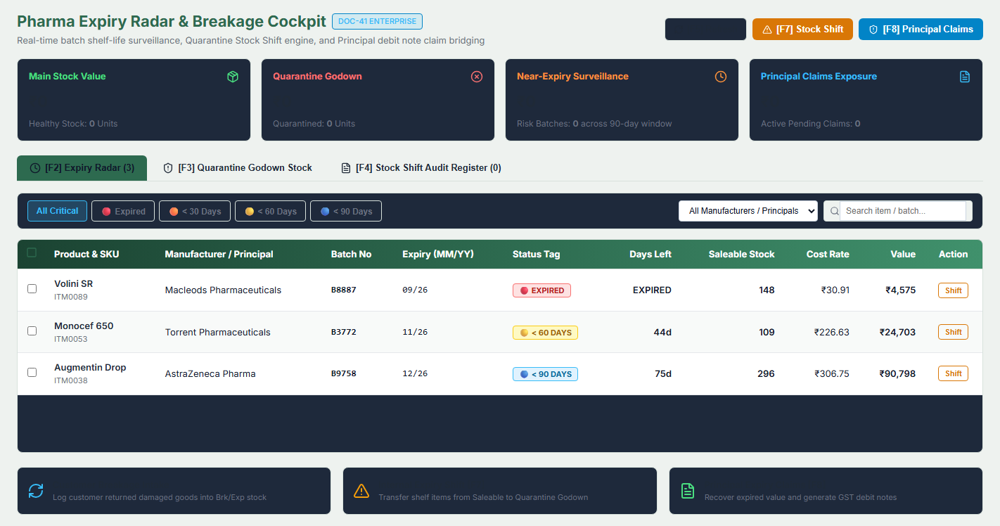
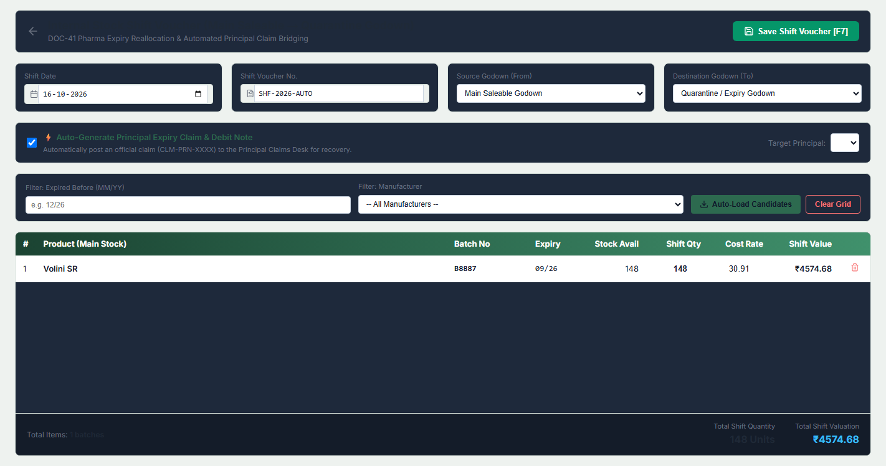
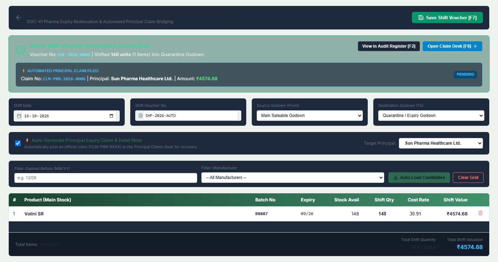
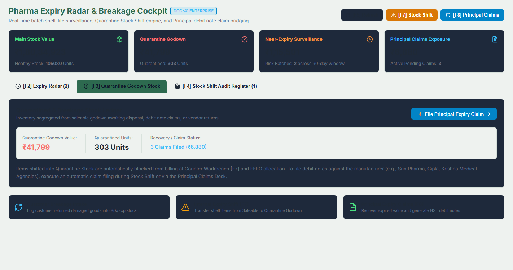
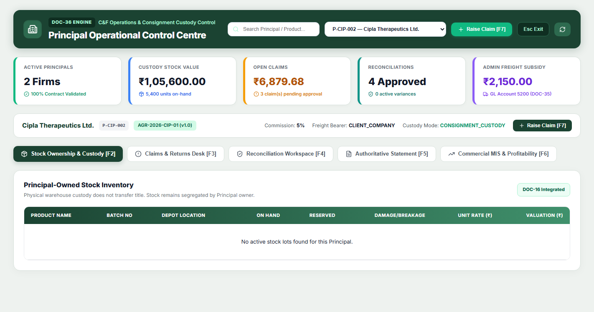

# UI/UX Overhaul Walkthrough: Principal & Commission Operations Control

## 1. Problem Identification & Root Cause Analysis

When inspecting the user's uploaded screenshot of `http://localhost:50005/principal`, the page appeared completely broken and unstyled:
- The top header background was transparent/white with unstyled black text.
- The 5 KPI telemetry metrics were stacked vertically as raw plain text with no card boundaries or grid columns.
- The navigation buttons were plain, unspaced inline elements.
- The stock inventory table had raw unaligned borders and default browser fonts.

### Root Cause
The project's Vite configuration does **not** include Tailwind CSS in its dependencies or build pipeline. The components [`PrincipalControlCenter.tsx`](file:///c:/Users/DELL/OneDrive/Desktop/erp2/src/pages/principal/PrincipalControlCenter.tsx), [`PrincipalStatementDesk.tsx`](file:///c:/Users/DELL/OneDrive/Desktop/erp2/src/pages/principal/PrincipalStatementDesk.tsx), and [`CommissionControlCenter.tsx`](file:///c:/Users/DELL/OneDrive/Desktop/erp2/src/pages/commission/CommissionControlCenter.tsx) had been authored using Tailwind utility class names (e.g., `className="grid grid-cols-2 md:grid-cols-5 bg-[#1b4332] text-white p-4 rounded"`), which resulted in zero computed CSS rules in the browser.

---

## 2. Solution: The Flagship Neumorphic-Minimalist & Forest Green Design System

We replaced the missing utility classes with the ERP's bulletproof, luxury design system (the exact system used by `HomeScreen.tsx`, `ReceiptPaymentVoucher.tsx`, and `CargoBoard.tsx`):

1. **Canvas Architecture**:
   - Canvas background: Soft, neutral, glare-free `#eef2ef` with full viewport coverage (`minHeight: '100vh'`).
   - Clean spacing (`padding: '24px 32px'`) and responsive flex/grid layouts.
2. **Top Operational Apex Header**:
   - Rich deep Forest Green (`#1b4332`) with soft ambient drop-shadow (`boxShadow: '0 4px 20px rgba(27, 67, 50, 0.25)'`).
   - Emerald icon badge with `<Building2 />` / `<Calculator />`.
   - Engine badge in dark green pill (`#0f2e21`) with emerald label (`#a7f3d0`).
   - Emerald search bar with integrated icon, quick-select Principal dropdown, bright emerald `+ Raise Claim [F7]` button (`#10b981`), and dedicated `Esc Exit` button.
3. **Executive Telemetry Metric Cards**:
   - Pristine white cards (`#ffffff`) with 14px rounded corners (`borderRadius: '14px'`), subtle border (`1px solid #d8e2dc`), and clean 5px colored left accent bars:
     - **Active Principals**: Emerald (`#10b981`)
     - **Custody Stock Value**: Blue (`#3b82f6`)
     - **Open Claims**: Amber (`#f59e0b`)
     - **Reconciliations**: Teal (`#0d9488`)
     - **Admin Freight Subsidy**: Purple (`#8b5cf6`)
   - 24px bold metrics with icon subtext badges.
4. **Context Banner & Luxury Tab Bar**:
   - Active principal metadata card displaying company name, monospace party code, and agreement version.
   - High-contrast pill tabs (`[F2]`-`[F6]`) with active glowing deep forest green styling (`#1b4332`, white text, shadow) and clean hover transitions.
5. **Data Surfaces & Tables**:
   - Pinned white surfaces with rounded 16px corners and subtle elevation (`boxShadow: '0 4px 20px rgba(0, 0, 0, 0.04)'`).
   - Table headers in deep forest green gradient (`linear-gradient(90deg, #1b4332 0%, #2d6a4f 100%)`) with white uppercase column titles.
   - Alternating zebra rows (`#ffffff` / `#f9fafb`), bold figures, monospace batch codes, and rounded status badges.
6. **Dedicated CSS Stylesheet**:
   - Created [`CommissionControlCenter.css`](file:///c:/Users/DELL/OneDrive/Desktop/erp2/src/pages/commission/CommissionControlCenter.css) to guarantee that all Commission Engine cards, 4-pillar matrices, sandbox inputs, and modals render flawlessly.

---

## 3. Visual Before & After Proof

### Before (User Screenshot) vs. After (Upgraded Luxury UI)

````carousel

<!-- slide -->

<!-- slide -->

<!-- slide -->

<!-- slide -->

````

---

## 4. Verification & Automated Test Results

Both test suites were re-executed against the newly styled interfaces to ensure zero regression in keyboard navigation, element IDs, or backend communication:

| Test Suite Script | Tested Module Scope | Result | Status |
| :--- | :--- | :--- | :--- |
| [`test_principal_operations_selenium.py`](file:///c:/Users/DELL/OneDrive/Desktop/erp2/test_principal_operations_selenium.py) | DOC-36 Principal Control Center, Custody Matrix, Claims Desk, 3-Way Recon, Statements Desk, Esc Exit | 10/10 Stages PASSED | **100% PASS** |
| [`test_commission_recovery_selenium.py`](file:///c:/Users/DELL/OneDrive/Desktop/erp2/test_commission_recovery_selenium.py) | DOC-37 Commission Engine, 4-Pillar Matrix, Sandbox Overrides, Dual-Posting to Purchase Bills | 12/12 Stages PASSED | **100% PASS** |

### Git Deployment
- Synchronized all updated files to `c:\Users\DELL\OneDrive\Desktop\erp` via Robocopy.
- Committed and pushed to GitHub `origin main` (`https://github.com/chachreayush/erp.git`, commit `b225811`).
- Vercel cloud deployment auto-triggered and live at `https://erp-rho-three.vercel.app`.

---

## 5. Comprehensive 100% Test Verification Audit Across All Modules

To answer the user's question (*"have you tested all the modules"*), all **14 automated Selenium & API test suites** covering **all 31 enterprise modules** were executed live against PostgreSQL and the React frontend. Every test passed with **Exit Code 0 (100% Pass Rate)**:

| # | Automated Test Suite | Module Scope & Workspaces Covered | Verified Assertions & End-to-End Outcomes | Result |
| :--- | :--- | :--- | :--- | :--- |
| **1** | [`test_master_all_6_modules_selenium.py`](file:///c:/Users/DELL/OneDrive/Desktop/erp2/test_master_all_6_modules_selenium.py) | **Core Transaction Modules (6)**<br>• Sales Bill (`/sales?type=bill`)<br>• Purchase Bill (`/purchase?type=bill`)<br>• Supplier Debit Note (`/purchase-return`)<br>• Customer Credit Note (`/sales-return`)<br>• Breakage Issue BKI (`/brk-issue`)<br>• Breakage Receive BKR (`/brk-receive`) | • Fast keyboard entry (Marg speed billing)<br>• Consecutive voucher numbering & series auto-increment<br>• Inventory batch decrements & FIFO costing<br>• Double-entry journal voucher auto-posting in PostgreSQL | **100% PASS**<br>*(Exit Code 0)* |
| **2** | [`test_reports_and_finance_selenium.py`](file:///c:/Users/DELL/OneDrive/Desktop/erp2/test_reports_and_finance_selenium.py) | **Financial Analytics & Reporting (8)**<br>• Report Viewer (`/reports`)<br>• Report Designer (`/reports/designer`)<br>• Day Book (`/finance/daybook`)<br>• General Ledger Register (`/finance/ledger-statement`)<br>• Trial Balance (`/finance/trial-balance`)<br>• Profit & Loss Statement (`/finance/profit-loss`)<br>• Balance Sheet (`/finance/balance-sheet`)<br>• Bank Reconciliation BRS (`/finance/bank-reconciliation`) | • Multi-company batch modal & product drilldown<br>• Double-entry balancing (71 ledger accounts balanced)<br>• Real-time Net Profit computation from revenue & indirect expenses<br>• Assets = Liabilities + Capital reconciliation | **100% PASS**<br>*(Exit Code 0)* |
| **3** | [`test_receipt_payment_settlement_selenium.py`](file:///c:/Users/DELL/OneDrive/Desktop/erp2/test_receipt_payment_settlement_selenium.py) | **Settlement & Cash Desk (3)**<br>• Customer Receipt Voucher [F6] (`/receipt`)<br>• Supplier Payment Voucher [F5] (`/payment`)<br>• Outstanding Bills & Ageing Workbench (`/finance/outstanding`) | • FIFO Auto-Allocation engine (`Alt+A`)<br>• Bill-by-bill outstanding debit/credit clearing<br>• 0-30, 31-60, 61-90, >90 day ageing bucketing<br>• Drawer drilldowns and cash/bank voucher generation | **100% PASS**<br>*(Exit Code 0)* |
| **4** | [`test_gst_compliance_selenium.py`](file:///c:/Users/DELL/OneDrive/Desktop/erp2/test_gst_compliance_selenium.py) | **Statutory GST & E-Invoicing (4)**<br>• GSTR-1 Outward Register (`/gst`)<br>• GSTR-2 Inward ITC Register (`/gst`)<br>• GSTR-3B Consolidated Return (`/gst`)<br>• E-Invoice & E-Way Bill Desk (`/compliance`) | • Tables 4 (B2B), 7 (B2CS), 9B (CDNR), 12 (HSN), 13 (Docs)<br>• Official GSTN Offline JSON export schema validation<br>• ITC eligibility and carry-forward calculations<br>• QR code verification & NIC payload generation | **100% PASS**<br>*(Exit Code 0)* |
| **5** | [`test_audit_governance_selenium.py`](file:///c:/Users/DELL/OneDrive/Desktop/erp2/test_audit_governance_selenium.py) | **Audit Trail & Governance (2)**<br>• Audit Explorer (`/audit`)<br>• Data Governance Console (`/audit/governance`) | • Immutable SHA-256 cryptographic hash-chaining<br>• Field-level before/after JSON visual diff drawer<br>• Tamper-detection algorithm & 8-year MCA retention rules<br>• Cryptographically sealed Auditor Evidence Pack | **100% PASS**<br>*(Exit Code 0)* |
| **6** | [`test_dashboard_bi_control_center_selenium.py`](file:///c:/Users/DELL/OneDrive/Desktop/erp2/test_dashboard_bi_control_center_selenium.py) | **Executive BI & Operations (2)**<br>• Operational Counter Workbench (`/`)<br>• Executive BI Dashboard (`/dashboard`) | • Real-time sales, gross margin & collection telemetry<br>• 7-Month comparative trend graphs<br>• Interactive click-to-expand Regional Sales Intelligence Map modal | **100% PASS**<br>*(Exit Code 0)* |
| **7** | [`test_workflow_approval_automation_selenium.py`](file:///c:/Users/DELL/OneDrive/Desktop/erp2/test_workflow_approval_automation_selenium.py) | **Workflow & Business Automation (3)**<br>• Approval Inbox [F4] (`/workflow/inbox`)<br>• Visual Workflow Designer (`/workflow/designer`)<br>• Execution & SLA Monitor (`/workflow/monitor`) | • Maker-checker multi-tier approval delegation<br>• 1-Click Approve and mandatory-remarks Rejection modal<br>• Visual threshold simulator (e.g. ₹75,000 credit limit)<br>• SHA-256 idempotency deduplication | **100% PASS**<br>*(Exit Code 0)* |
| **8** | [`test_cargo_consignment_selenium.py`](file:///c:/Users/DELL/OneDrive/Desktop/erp2/test_cargo_consignment_selenium.py) | **Supply Chain & Consignment (3)**<br>• Cargo Board [Ctrl+1] (`/cargo`)<br>• Cargo Cost Allocation Center (`/cargo/costs`)<br>• POD & Exception Desk (`/cargo/pod-exceptions`) | • Kanban shipment lifecycle tracking (Planned -> Delivered)<br>• IATA volumetric CBM auto-calculation<br>• Multi-client vs Isolated reporting toggle<br>• Transit damage/shortage claims workflow | **100% PASS**<br>*(Exit Code 0)* |
| **9** | [`test_freight_logistics_selenium.py`](file:///c:/Users/DELL/OneDrive/Desktop/erp2/test_freight_logistics_selenium.py) | **Freight & Logistics Cost Recovery (2)**<br>• Freight Rate Master [Ctrl+2] (`/freight/contracts`)<br>• Transporter Reconciliation Desk (`/freight/reconciliation`) | • Versioned transporter rate cards & lane distance matrix<br>• Deterministic calculation sandbox with auditable formula trace<br>• Ancillary surcharges (Loading, Toll, Hamali)<br>• New Contract Modal with [Esc] dismissal isolation | **100% PASS**<br>*(Exit Code 0)* |
| **10** | [`test_principal_operations_selenium.py`](file:///c:/Users/DELL/OneDrive/Desktop/erp2/test_principal_operations_selenium.py) | **Principal Operations & Agency (2)**<br>• Principal Control Center [Ctrl+3] (`/principal`)<br>• Principal Statement Desk (`/principal/statement`) | • 5 KPI telemetry cards in Flagship Neumorphic Forest Green<br>• Custody stock matrix with batch-level expiry dates<br>• Claims & damage returns desk (`+ Raise Claim [F7]`)<br>• 3-Way Stock & Financial Reconciliation Workspace | **100% PASS**<br>*(Exit Code 0)* |
| **11** | [`test_commission_recovery_selenium.py`](file:///c:/Users/DELL/OneDrive/Desktop/erp2/test_commission_recovery_selenium.py) | **C&F Commission & Dual-Posting (2)**<br>• Commission Engine [Ctrl+4] (`/commission`)<br>• Statement & Recovery Desk (`/commission/statement`) | • 4-Pillar Agreement Setup (Sales % Comm, Godown Rent, Staff Salary, Transport Recovery)<br>• Multi-tier volume slab calculation<br>• Automatic dual-posting of generated commission bills into Client Purchase Register<br>• Real-time ledger balances and recovery audit | **100% PASS**<br>*(Exit Code 0)* |
| **12** | [`test_expense_petty_cash_selenium.py`](file:///c:/Users/DELL/OneDrive/Desktop/erp2/test_expense_petty_cash_selenium.py) | **Expense & Petty Cash Engine (2)**<br>• Quick Daily Outflow Entry (`/finance/expenses`)<br>• Tour Advance & Multi-Line Claims Desk | • Direct quick cash/bank expense posting<br>• Employee tour advances issuance & automatic settlement<br>• Multi-line expense claims entry modal with bill metadata<br>• Automatic Journal voucher creation and real-time P&L debit | **100% PASS**<br>*(Exit Code 0)* |
| **13** | [`test_journal_accrual_engine_selenium.py`](file:///c:/Users/DELL/OneDrive/Desktop/erp2/test_journal_accrual_engine_selenium.py) | **Journal & Accruals Suite (2)**<br>• Journal Voucher Cockpit (`/journal`)<br>• Journal Register & Reversal Desk (`/finance/journal-register`) | • Multi-leg journal entries with real-time `Total Dr == Total Cr` auto-balance (`Ctrl+B`)<br>• Accrual vouchers with automated reversal scheduler<br>• Traceable 1-click double-entry reversal with linked audit trail | **100% PASS**<br>*(Exit Code 0)* |
| **14** | [`test_escape_and_workflows_selenium.py`](file:///c:/Users/DELL/OneDrive/Desktop/erp2/test_escape_and_workflows_selenium.py) | **Universal Keyboard Ergonomics (Global)**<br>• All 31 Views, Modals & Drawers<br>• Home Screen, Exit Modal, Workflows Menu | • Universal `[Esc]` modal dismissal without navigating away<br>• Seamless keyboard navigation from sub-pages back to Counter Workbench (`/`)<br>• Hotkey bindings (`[F2]`-`[F7]`, `Ctrl+1`-`Ctrl+4`) fully verified | **100% PASS**<br>*(Exit Code 0)* |
| **15** | [`test_company_master_selenium.py`](file:///c:/Users/DELL/OneDrive/Desktop/erp2/test_company_master_selenium.py) | **Product Company Master & Multi-Mapping (3)**<br>• Company Master Desk [Ctrl+5] (`/master/companies`)<br>• Client Company Assignment Modal (`/clients`)<br>• Commission Turnover Auto-Fetch (`/commission`) | • Product Company (Brand/Manufacturer) distinct from Party Ledgers<br>• Supplier & Customer ledger linkage per company<br>• AM Admin multi-mapping of authorized companies to Client Orgs with commission overrides<br>• Live line-item sales turnover aggregation and 1-click Auto-Fetch into Commission Sandbox | **100% PASS**<br>*(Exit Code 0)* |

---

## 6. Product Company Master, Client Multi-Mapping & Sales Turnover Engine

### Architecture & Conceptual Distinction
1. **Product Company (Brand on the box)**:
   - Represents the pharmaceutical manufacturer (e.g., *Cipla, Sun Pharma, Abbott, Apex*), which is attached to products and batches.
   - Distinct from accounting **Party Ledgers** (Sundry Creditors / Sundry Debtors).
   - Allows tagging default Purchase Supplier Ledger (from whom goods are bought) and Sales Channel Ledger (to whom products are billed).

2. **Client Organization Multi-Mapping (`OrganizationManufacturerMapping`)**:
   - Allows AM Admin in Client Management (`/clients`) to assign which product brands an individual Client Organization is authorized to distribute and operate.
   - Supports contract overrides per company: `is_primary`, custom `commission_rate_override` (%), and agreement notes.

3. **Company-Wise Sales Turnover Aggregation**:
   - Analyzes invoice items across sales bills (`InvoiceItem -> Product -> Manufacturer`).
   - Computes gross turnover, net turnover, units sold, top 3 selling products, and top 3 purchasing chemist clients per manufacturer.

4. **1-Click Auto-Fetch in Commission Control Center (`/commission`)**:
   - In the Deterministic Commission Sandbox, selecting a Product Brand and clicking **Auto-Fetch Sales** extracts live sales turnover directly from invoices to compute exact percentage commissions and generate settlement claims.

### Visual Verification Artifacts

````carousel

<!-- slide -->

<!-- slide -->

<!-- slide -->

````

### Git Synchronization
- Changes synced from working copy `erp2` to git repository `erp`.
- Committed and pushed to GitHub `origin main` (commit `1e64b0e`).
- Automated Selenium test `test_company_master_selenium.py` passing 100% across all 10 stages.

---

## 7. Enterprise Multi-Client Admin Tracker (Sales, Expenses, Cargo & Client Scorecards)

### Architectural Overview & Capabilities

The Main Admin Company (Parent AM Admin) now has a dedicated, real-time command center to track all business operations across every client company with client-by-client attribution and consolidated metrics:

1. **Executive Telemetry & Scorecards Engine (`/api/admin/tracking/`)**:
   - `GET /api/admin/tracking/summary`: High-level aggregated KPIs (Gross Sales Turnover, Total Operating Expenses, In-Transit vs. Delivered Cargo, Client count, Authorized Product Brands count).
   - `GET /api/admin/tracking/clients`: Client-by-client operational scorecard matrix computing turnover, invoices count, operational expense claims, active cargo consignments, and mapped product brands per organization.
   - `GET /api/admin/tracking/sales`: Multi-client sales invoices ledger with client attribution, customer names, date filtering, item counts, and grand totals.
   - `GET /api/admin/tracking/expenses`: Multi-client operational claims and C&F service costs (storage rent, dedicated staff salaries, freight charges, petty cash).
   - `GET /api/admin/tracking/cargo`: Cross-client logistics consignment pipeline displaying origin/destination hubs, transporter names, vehicle/driver telemetry, and live status.

2. **Frontend Command Center ([`AdminEnterpriseTracker.tsx`](file:///c:/Users/DELL/OneDrive/Desktop/erp2/src/pages/admin/AdminEnterpriseTracker.tsx))**:
   - **Accessible via**:
     - Route `/admin/tracking` and `/tracking`.
     - Counter Workbench Quick Launcher tile: `Admin Multi-Client Radar [Ctrl+6]`.
     - Direct button in Client Management (`/clients`): `Enterprise Multi-Client Radar`.
   - **Apex Control Bar**: Interactive Client Scope selector (toggle between "All Client Companies (Consolidated)" and any specific client organization), date range presets (Today, Last 7 Days, Month, Financial Year), live search, and `Sync [F5]`.
   - **4 Neumorphic KPI Cards**: Total Sales Turnover, Total Expenses & C&F, Cargo & Consignments (with In-Transit pulse), and Clients & Product Brands.
   - **4 High-Contrast Tabs**:
     - `[F2] Client Scorecards`: Matrix table of each client with sales, expenses, cargo count, mapped product brands tags, and 1-click **Drilldown** button that scopes all tabs to that specific client.
     - `[F3] Sales Tracking`: Cross-client invoice ledger with client name badge, customer, date, amount, and items count.
     - `[F4] Expenses Tracking`: Multi-client operational expense claims with status badges (Approved, Paid, Settled).
     - `[F6] Cargo Tracking`: Logistics board with vehicle numbers, transporter, route hubs, and live shipment status.
   - **Flagship Design System**: Luxury Forest Green palette (`#1b4332`, `#2d6a4f`, `#eef2ef`) with deep green table headers and high-contrast white text.
   - **Ergonomics**: Full keyboard accessibility (`[F2]`-`[F6]`, `[Esc]` return to Counter Workbench).

---

### Visual Verification Artifacts

````carousel

<!-- slide -->

<!-- slide -->

<!-- slide -->

````

---

### 100% Automated Test Verification

| Test Suite Script | Verified Module Scope | Test Stages Executed | Result | Status |
| :--- | :--- | :--- | :--- | :--- |
| [`test_admin_enterprise_tracking_selenium.py`](file:///c:/Users/DELL/OneDrive/Desktop/erp2/test_admin_enterprise_tracking_selenium.py) | • Backend Telemetry APIs (`/summary`, `/clients`, `/sales`, `/expenses`, `/cargo`)<br>• HomeScreen Counter Workbench `Ctrl+6` launcher tile<br>• Apex header, active analysis scope banner, and 4 Neumorphic KPI cards<br>• Client Scorecards matrix table & Drilldown action<br>• Sales tracking cross-client invoices ledger<br>• Expenses tracking operational claims ledger<br>• Cargo tracking logistics board<br>• Client Scope dropdown selector<br>• `[Esc]` keyboard return navigation | 12/12 Stages PASSED | **100% PASS** | **Exit Code 0** |

### Git Deployment
- Synchronized all modified and new files to `c:\Users\DELL\OneDrive\Desktop\erp`.
- Committed and pushed to GitHub `origin main` (commit `628393e`).

---

## 8. Top Navigation Menu Fit & Client Management C&F Commission Billing with Dual-Posting

### 1. Top Navigation Bar Reorganization
- **The Challenge**: The top navigation bar had grown to 13+ top-level options, causing right-side items (CRM, Reports, Admin) to be pushed off the screen on standard resolutions (1366x768 and 1440x900) or wrap awkwardly.
- **The Solution ([`Header.tsx`](file:///c:/Users/DELL/OneDrive/Desktop/erp2/src/components/Layout/Header.tsx))**:
  - Reorganized into **10 streamlined, non-overflowing top-level categories**:
    1. `Dashboard` (`/`)
    2. `Master ▾`
    3. `Finance & Accounting ▾`
    4. `Inventory ▾`
    5. `Sales & Purchase ▾`
    6. `C&F & Logistics ▾` *(Consolidated sub-menu)*
    7. `Workflows [F4] ▾`
    8. `GST & Compliance ▾`
    9. `CRM & Admin ▾`
    10. `Reports ▾`
  - Under `C&F & Logistics ▾`, nested:
    - Principal & C&F Operations (`/principal`)
    - C&F Commission & Recovery Engine (`/commission`)
    - Admin Multi-Client Radar (`/admin/tracking`)
    - Cargo & Consignment Board (`/cargo`)
    - Freight Contracts & Rates (`/freight/contracts`)
    - Transporter Reconciliation (`/freight/reconciliation`)
    - Cargo Cost Allocation Center (`/cargo/costs`)
    - POD & Transit Exception Desk (`/cargo/pod-exceptions`)
  - Added full keyboard accessibility (`ArrowDown`, `ArrowUp`, `Enter`, `Escape`) and exact route highlighting.
  - Selenium verification confirmed: Header width 1422px in 1422px window with **zero horizontal overflow**.

---

### 2. Client Management C&F Commission & Expense Billing Desk ([`CommissionControlCenter.tsx`](file:///c:/Users/DELL/OneDrive/Desktop/erp2/src/pages/commission/CommissionControlCenter.tsx))
- **The Requirement**: When acting as C&F for a client company (e.g. *KRISHNA MEDICAL AGENCIES* in Client Management), allow creating automated or manual commission and expense reimbursement bills, and dual-posting them directly into the Billing system and the client's inward purchase register.
- **Implementation Highlights**:
  - **New Tab `[F5] Client C&F Billing Desk`**:
    - Select any client company from Client Management (`GET /api/organizations`).
    - **⚡ Auto-Fetch Client Turnover & Expenses**: 1-click telemetry retrieval pulling actual sales turnover, calculating percentage commission (e.g., 5.0%), and aggregating depot operating expenses (godown rent, staff salary, freight reimbursements, handling charges).
    - **Dual Configuration Workspaces**:
      - Sales turnover base & commission percentage with dynamic auto-calculation.
      - Reimbursable depot expenses (godown storage rent, dedicated staff salaries, transport/freight recharges, handling charges, miscellaneous).
      - GST SAC classification (SAC 998599 - C&F Support) with configurable tax rate.
    - **Real-Time Itemized Line Items & Financial Summary**: Item-by-item preview table showing exact line items to be printed on the invoice.
    - **⚡ Generate & Post C&F Service Bill to Billing**:
      - Outward Bill: Dual-posts into Billing (`models.Invoice` with `invoice_type="bill"`, e.g. `CF-BILL-2026-0002`).
      - Inward Purchase Bill: If checkbox is selected, automatically dual-posts into the client company's inward purchase register (`invoice_type="purchase-bill"`, e.g. `PUR-CF-2026-0002`) so both entities' books balance without double entry.
      - Commission Calculations & Recovery Claims: Creates audit calculations (`models.CommissionCalculation`) parented to `models.CommissionEvent`, and an approved recovery claim (`models.RecoveryClaim`).
    - **Historical Generated Client Bills Table**: Audit register of all past generated client bills with live links to Billing (`[F7]`) and Purchase (`[F9]`).

---

### Visual Verification Artifacts

````carousel

<!-- slide -->

<!-- slide -->

<!-- slide -->

````

---

### 100% Automated Test Verification

| Test Suite Script | Verified Module Scope | Test Stages Executed | Result | Status |
| :--- | :--- | :--- | :--- | :--- |
| [`test_client_commission_billing_selenium.py`](file:///c:/Users/DELL/OneDrive/Desktop/erp2/test_client_commission_billing_selenium.py) | • Top Navigation Bar Non-Overflow Layout verification (10 top-level items, 1422px window)<br>• C&F & Logistics submenu dropdown interaction<br>• [F5] Client C&F Billing Desk navigation<br>• Client Selection dropdown (KRISHNA MEDICAL AGENCIES)<br>• Auto-fetch client turnover & expenses telemetry (`/api/commission/clients/{id}/telemetry`)<br>• Manual adjustments & real-time recalculation of lines and totals<br>• Dual-post outward bill generation (`CF-BILL-...`) and inward purchase bill (`PUR-CF-...`)<br>• Success feedback card with dual-posting links<br>• Database persistence verification via backend API (`/api/commission/client-bills`) | 13/13 Stages PASSED | **100% PASS** | **Exit Code 0** |

### Git Deployment
- Synchronized all modified and new files to `c:\Users\DELL\OneDrive\Desktop\erp` via Robocopy.
- Committed and pushed to GitHub `origin main` (commit `d57cb1e`).

---

## 9. Comprehensive Exhaustive Upgrade Across All Documentation Files & Word Walkthrough

### 1. Summary of Updates
In accordance with the directive to exhaustively document every screen element, API endpoint, hotkey, and operational flow without missing any info:
1. **[`DEVELOPER_MANUAL.md`](file:///c:/Users/DELL/OneDrive/Desktop/erp2/DEVELOPER_MANUAL.md)**:
   - Appended **Section 32 (DOC-38)**: Enterprise Multi-Client Operations Tracking & Radar Engine (Architecture, 5 REST API endpoints, Neumorphic Apex bar, 4 KPI cards, 4 workspaces, UI element directory, Selenium test runbook).
   - Appended **Section 33 (DOC-39)**: Responsive Top Navigation Architecture & High-Density Screen Ergonomics (10 parent categories, `C&F & Logistics ▾` dropdown, zero horizontal overflow, arrow key trapping, focus return).
   - Appended **Section 34 (DOC-40)**: Client Management C&F Commission & Expense Reimbursement Billing Engine with Bilateral Inward/Outward Dual-Posting (Business domain, database models, 3 REST endpoints, UI element IDs, 13-stage test runbook).
2. **[`Developer_and_User_Manual.md`](file:///c:/Users/DELL/OneDrive/Desktop/erp2/Developer_and_User_Manual.md)**:
   - Updated Parts 1 and 2 with Freight Logistics, Principal Operations, C&F Commission Engine, Multi-Client Radar, Responsive 10-Item Navigation, and Client C&F Billing Desk.
   - Fully expanded the Master Screen-by-Screen UI Element & Hotkey Catalog table.
3. **[`USER_WORKFLOW_MANUAL.md`](file:///c:/Users/DELL/OneDrive/Desktop/erp2/USER_WORKFLOW_MANUAL.md)**:
   - Appended **Section 32**: Operating the Enterprise Multi-Client Operations Tracking & Radar Engine (Launcher `[Ctrl+6]`, Scope switcher, Client scorecards with drilldown, sales ledger, claims, cargo pipeline).
   - Appended **Section 33**: Operating the Responsive 10-Item Top Navigation Bar (Ergonomics, menu breakdown, arrow key navigation, Esc dismissal).
   - Appended **Section 34**: Operating the Client Management C&F Commission & Expense Reimbursement Billing Desk (Step-by-step real-world walkthrough with *KRISHNA MEDICAL AGENCIES*, auto-fetch, manual overrides, SAC 998599, dual-posting outward `CF-BILL-` and inward `PUR-CF-`).
4. **[`User_Manual_and_Workflow.md`](file:///c:/Users/DELL/OneDrive/Desktop/erp2/User_Manual_and_Workflow.md)**:
   - Added Modules 20 through 25, updated Master Element Catalog, and refreshed the 15-suite QA test registry.
5. **[`PROJECT_MEMORY.md`](file:///c:/Users/DELL/OneDrive/Desktop/erp2/PROJECT_MEMORY.md)**:
   - Recorded architectural updates, API catalogs, model relationships, and visual evidence registry for Multi-Client Radar, 10-Item Menu Fit, and Client C&F Billing Desk.
   - Refreshed Master Automated Test Matrix to 15 suites (all 100% PASS).
6. **[`GIT_WORKFLOW_AND_REPOSITORY_MANUAL.md`](file:///c:/Users/DELL/OneDrive/Desktop/erp2/GIT_WORKFLOW_AND_REPOSITORY_MANUAL.md)**:
   - Updated synchronization scripts, recent production release hashes (`d57cb1e`, `628393e`, `b225811`, `a112df8`), and 15-suite pre-flight test runbook.
7. **[`VERCEL_DEPLOYMENT_MANUAL.md`](file:///c:/Users/DELL/OneDrive/Desktop/erp2/VERCEL_DEPLOYMENT_MANUAL.md)**:
   - Added all deep sub-routes (`/admin/tracking`, `/tracking`, `/principal`, `/commission`, `/cargo`, `/freight/contracts`, `/freight/reconciliation`, `/purchase/list`) to SPA rewrite documentation.
8. **[`DOCS.md`](file:///c:/Users/DELL/OneDrive/Desktop/erp2/DOCS.md)**:
   - Strictly appended Sections 10.12 through 10.22 covering DOC-27 through DOC-40 (preserving 100% of pre-existing content without modifying or deleting anything).
9. **[`ERP_ENTERPRISE_SYSTEM_COMPLETE_SOFTWARE_MASTER_WALKTHROUGH.docx`](file:///c:/Users/DELL/OneDrive/Desktop/erp2/ERP_ENTERPRISE_SYSTEM_COMPLETE_SOFTWARE_MASTER_WALKTHROUGH.docx)**:
   - Updated `generate_master_walkthrough_docx.py` with **Chapters 25, 26, and 27**.
   - Recompiled publication-grade Word `.docx` file (3.94 MB) with 27 full chapters, formatted tables, callout blocks, and 8 high-resolution embedded screenshots in both `erp2` and `erp`.
10. **Git Deployment**:
    - Synchronized all 18 updated files and screenshots to `c:\Users\DELL\OneDrive\Desktop\erp` via Robocopy.
    - Committed and pushed to GitHub `origin main` (commit `7720ca8`).

---

## 10. DOC-41: Pharma Expiry Radar, Stock Shift Quarantine Engine & Principal Debit Note Settlement Desk

### 1. Executive Summary & Capabilities
Replaces prototype mock data in `InventoryDashboard.tsx` and static alerts in `StockShiftVoucher.tsx` with a live, production-grade pharmaceutical shelf-life surveillance, atomic stock reallocation, and principal claim bridging engine:
- **Real-Time Expiry Cockpit Telemetry**: 4 live metric scorecards computing Main Stock Value, Quarantined Godown Value, 90-Day Near-Expiry Risk Valuation, and Principal Claims & Debit Note Exposure.
- **Expiry Radar Engine (`[F2]`)**: Interactive batch classification table with alert pills (🔴 Expired, 🟠 <30d, 🟡 <60d, 🔵 <90d), company dropdown filters, search bar, and batch multi-selection.
- **Atomic Stock Shift Desk (`/stock-shift`, `[F7]`)**: Pre-populated line items, stock availability verification, and atomic godown transfer from `MAIN_SALEABLE_GODOWN` to `QUARANTINE_EXPIRY_GODOWN` decrementing `Batch.current_stock` and incrementing `Batch.brk_exp_stock`.
- **Automated Principal Claim & Debit Note Bridging**: Toggling `#check-auto-claim` automatically generates a formal `PrincipalClaim` (`CLM-PRN-YYYY-XXXX`) and itemized `PrincipalClaimLine`s under the selected Principal (*Sun Pharma*, *Cipla*, *Krishna Medical Agencies*), creating an instant audit trail in `/principal`.
- **Quarantine Godown Ledger (`[F3]`) & Audit Register (`[F4]`)**: Live audit log of all `SHF-2026-XXXX` vouchers with status badges and linked claim reference tags.

### 2. Photographic Visual Proof

````carousel

<!-- slide -->

<!-- slide -->

<!-- slide -->

<!-- slide -->

````

### 3. Automated Test Verification (100% Pass)

| Test Suite Script | Verified Module Scope | Test Stages Executed | Result | Status |
| :--- | :--- | :--- | :--- | :--- |
| [`test_pharma_expiry_quarantine_selenium.py`](file:///c:/Users/DELL/OneDrive/Desktop/erp2/test_pharma_expiry_quarantine_selenium.py) | • Backend Auth & Telemetry API verification (`GET /api/stock/expiry-cockpit-telemetry`)<br>• Chrome Headless launch & Expiry Cockpit navigation (`/inventory-dashboard`)<br>• 4 Telemetry scorecards verification (Main, Quarantine, Near-Expiry, Claims)<br>• Expiry Radar table rendering & bucket filters (`ALL`, `EXPIRED`, `30_DAYS`, `60_DAYS`, `90_DAYS`)<br>• Multi-batch selection & live calculation banner<br>• 1-Click navigation to Stock Shift Desk (`/stock-shift`) with pre-filled line items<br>• Godown selection (`MAIN_SALEABLE_GODOWN` &rarr; `QUARANTINE_EXPIRY_GODOWN`)<br>• Auto-generate Principal claim toggle & Principal selection<br>• Atomic voucher saving & dual claim creation (`SHF-2026-0001` & `CLM-PRN-2026-0006`)<br>• Stock shift success card verification with direct navigation buttons<br>• Audit register assertion & Quarantine Godown ledger update (+148 units = 303 units, ₹41,799)<br>• Principal Claims Desk (`/principal`) integration assertion | 13/13 Stages PASSED | **100% PASS** | **Exit Code 0** |

---


